# 📘 DSA / FAANG Pattern Notes

> Simple-English notes for problems solved in **neetcode-submissions** (priority) and **My-LeetCode-Submissions** (fallback), tracked via **Leetcode-daily-problem-tracker**.
> Grouped by the pattern order of `FAANG_PATTERN_SHEET.md`.
>
> Each problem has: **Problem** → **Idea** → **Diagram** → **Steps** → **Complexity** → **Careful**.
> The prose matches the **latest `submission-N.py`** in `neetcode-submissions`, falling back to **My-LeetCode-Submissions** when NeetCode has no file. Problems with no solution in either repo are marked `· no repo code`.
>
> Note: `Leetcode-daily-problem-tracker` contains only the reminder app (`app.py`), no solution files. Code sources are `neetcode-submissions` (priority) and `My-LeetCode-Submissions` (fallback).

## How to use this file
1. Pick a pattern you want to practice.
2. Read **Idea** first — that is the "trick". If you get the trick, half work done.
3. See the **mermaid diagram** to picture how data moves.
4. Follow **Steps** to write code without looking at the answer.
5. Check **Complexity** so you can tell interviewer time & space.

---

## 🗂️ Table of Contents
1. [Arrays & Hashing](#1-arrays--hashing)
2. [Two Pointers](#2-two-pointers)
3. [Sliding Window](#3-sliding-window)
4. [Prefix Sum + HashMap](#4-prefix-sum--hashmap)
5. [Stack & Monotonic Stack](#5-stack--monotonic-stack)
6. [Binary Search](#6-binary-search)
7. [Linked List (incl. Fast & Slow Pointers)](#7-linked-list-incl-fast--slow-pointers)
8. [Trees — DFS & BFS](#8-trees--dfs--bfs)
9. [Binary Search Tree](#9-binary-search-tree)
10. [Heap / Top-K / Two Heaps](#10-heap--top-k--two-heaps)
11. [Backtracking](#11-backtracking)
12. [Trie (Prefix Tree)](#12-trie-prefix-tree)
13. [Graphs — BFS / DFS / Flood Fill](#13-graphs--bfs--dfs--flood-fill)
14. [Topological Sort](#14-topological-sort)
15. [Union-Find (Disjoint Set)](#15-union-find-disjoint-set)
16. [Intervals](#16-intervals)
17. [Greedy](#17-greedy)
18. [Dynamic Programming — 1-D](#18-dynamic-programming--1-d)
19. [Dynamic Programming — 2-D](#19-dynamic-programming--2-d)
20. [Bit Manipulation](#20-bit-manipulation)
21. [Design](#21-design)
22. [Extras](#extras)

---

## 1. Arrays & Hashing

Main idea of this pattern: use a **hash map / hash set** to remember what you have already seen, so you avoid checking everything again. This turns many O(n²) brute force into O(n).

### Contains Duplicate (Duplicate Integer)
`LeetCode #217` · Easy

**Problem:** Return True if any value appears at least twice.

**Idea:** Walk the array once, remembering each value in a hash set `st`. The moment a value is already in `st`, a duplicate exists. If the loop ends without a repeat, every value is distinct.

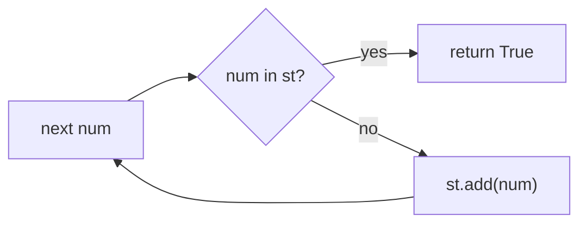

**Steps:**
1. Create an empty set `st`.
2. Loop over `nums`.
3. If `num in st` → return True.
4. Otherwise `st.add(num)` and continue.
5. After the loop → return False.

**Complexity:** Time O(n), Space O(n).
**Careful:** Insert and test as you go, not `len(set(nums)) != len(nums)` — the loop lets you return True the moment a repeat is seen.

---

### Valid Anagram
`LeetCode #242` · Easy

**Problem:** Check if string `t` is an anagram of `s` (same letters, same counts).

**Idea:** Anagrams must be the same length. Use one 26-slot frequency array `fq`: add 1 for every character of `s`, subtract 1 for every character of `t`. If a letter is balanced, its slot ends at 0.

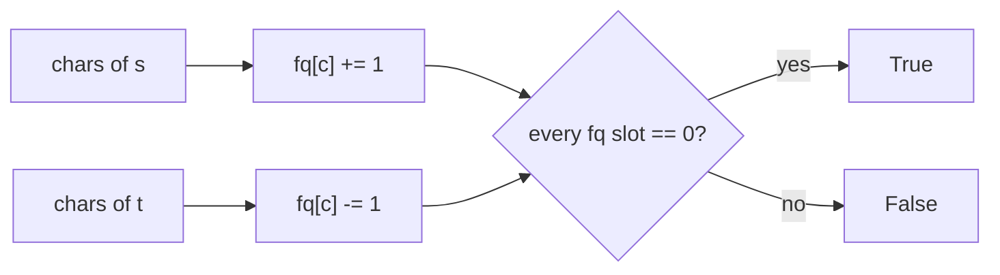

**Steps:**
1. If `len(s) != len(t)` → return False.
2. `fq = [0] * 26`.
3. For each `ch` in `s`: `fq[ord(ch)-ord('a')] += 1`.
4. For each `ch` in `t`: `fq[ord(ch)-ord('a')] -= 1`.
5. Loop over `fq`; if any entry is non-zero → return False. Otherwise return True.

**Complexity:** Time O(n), Space O(1) (fixed 26 slots).
**Careful:** One array with +1 then −1 is enough — no need to build two counters and compare. Index with `ord(ch)-ord('a')`, and check the length first so leftover counts cannot hide a mismatch.

---

### Two Sum
`LeetCode #1` · Easy

**Problem:** Given array `nums` and a `target`, return indices of two numbers that add to target.

**Idea:** One pass with a map of value → index, initialized as `defaultdict(int)`. For each number, the needed partner is `diff = target - num`. If `diff` is already in the map, we have the pair; otherwise store the current number with its index.

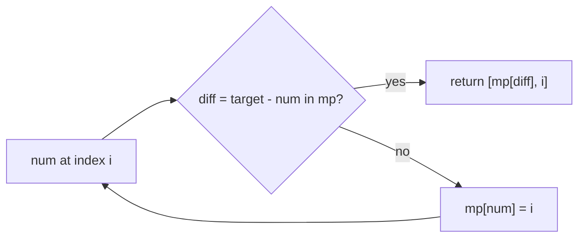

**Steps:**
1. Create `mp = defaultdict(int)`.
2. Enumerate `nums` as index `i`, value `num`.
3. Compute `diff = target - num`.
4. If `diff in mp` → return `[mp[diff], i]`.
5. Otherwise set `mp[num] = i` and continue.

**Complexity:** Time O(n), Space O(n).
**Careful:** Test membership with `diff in mp`, not truthiness — `defaultdict` returns `0` for missing keys and index `0` is valid. Insert only after the check so an element cannot pair with itself.

---

### Group Anagrams
`LeetCode #49` · Medium

**Problem:** Group words that are anagrams of each other.

**Idea:** Two anagrams produce the same 26-slot letter count. For each word build `fq = [0]*26`, convert it to a `tuple` (lists are unhashable), and use that tuple as the key of a `defaultdict(list)`.

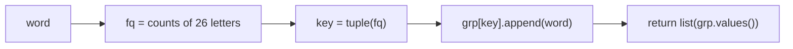

**Steps:**
1. Create `grp = defaultdict(list)`.
2. For each word, make a fresh `fq = [0]*26`.
3. For each `ch` in the word: `fq[ord(ch)-ord('a')] += 1`.
4. Append the word under `grp[tuple(fq)]`.
5. Return `list(grp.values())`.

**Complexity:** Time O(n·k) where k is word length, Space O(n·k).
**Careful:** Never use the list itself as a key — wrap it in `tuple(...)`. Recreate the count array per word, otherwise counts leak between words.

---

### Product of Array Except Self
`LeetCode #238` · Medium

**Problem:** Return array where `out[i]` = product of all numbers except `nums[i]`. No division allowed.

**Idea:** `out[i]` = (product of everything left of `i`) × (product of everything right of `i`). Write the prefix products into the result first, then sweep backwards multiplying in the suffix product. Two running scalars, no extra arrays.

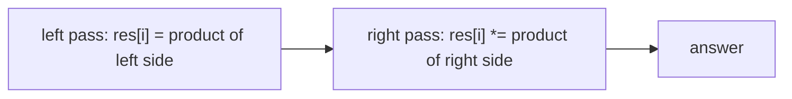

**Steps:**
1. `res = [1]*len(nums)`.
2. Set `l = 1`; for `i` from 0 to n−1: `res[i] = l`, then `l *= nums[i]`.
3. Set `r = 1`; for `i` from n−1 down to 0: `res[i] *= r`, then `r *= nums[i]`.
4. Return `res`.

**Complexity:** Time O(n), Space O(1) extra (output not counted).
**Careful:** Use the running product *before* multiplying in the current element, in both passes. That ordering is what excludes `nums[i]` itself.

---

### Longest Consecutive Sequence
`LeetCode #128` · Medium

**Problem:** Find length of longest run of consecutive integers (order does not matter). Must be O(n).

**Idea:** Put all numbers in a set `st`. A value is the start of a run only when `num-1` is not in `st`. From each start, extend `cur` while `cur+1` is present, and take `cur-num+1` as the run length.

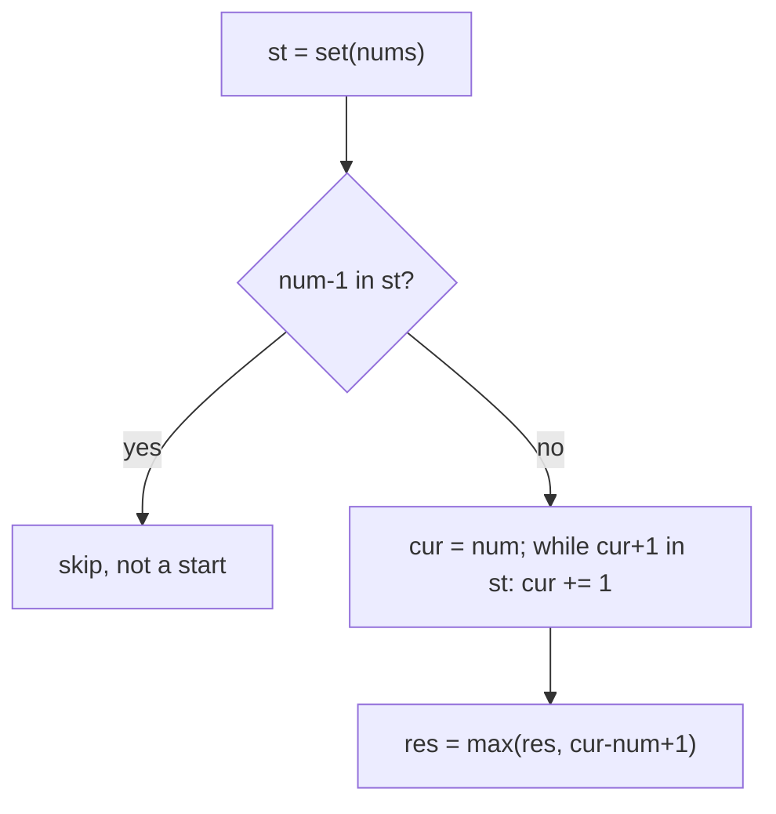

**Steps:**
1. `st = set(nums)`, `res = 0`.
2. For each `num` in `st`: skip if `num-1 in st`.
3. Set `cur = num`; while `cur+1 in st`, increment `cur`.
4. Update `res = max(res, cur-num+1)`.
5. Return `res`.

**Complexity:** Time O(n), Space O(n).
**Careful:** Iterate over the set, not the list, so duplicates are not re-processed. The `num-1` guard is what keeps the total work O(n); without it, runs get walked repeatedly.

---

### Valid Sudoku
`LeetCode #36` · Medium

**Problem:** Check if a 9×9 board is valid (no repeat in any row, column, or 3×3 box). Empty cells = `.`.

**Idea:** Keep three lists of nine sets: `rows`, `cols`, and `boxes`. A cell's box is the flat id `(r//3)*3 + c//3`. For every filled cell, check the digit in all three sets first, then add it to all three.

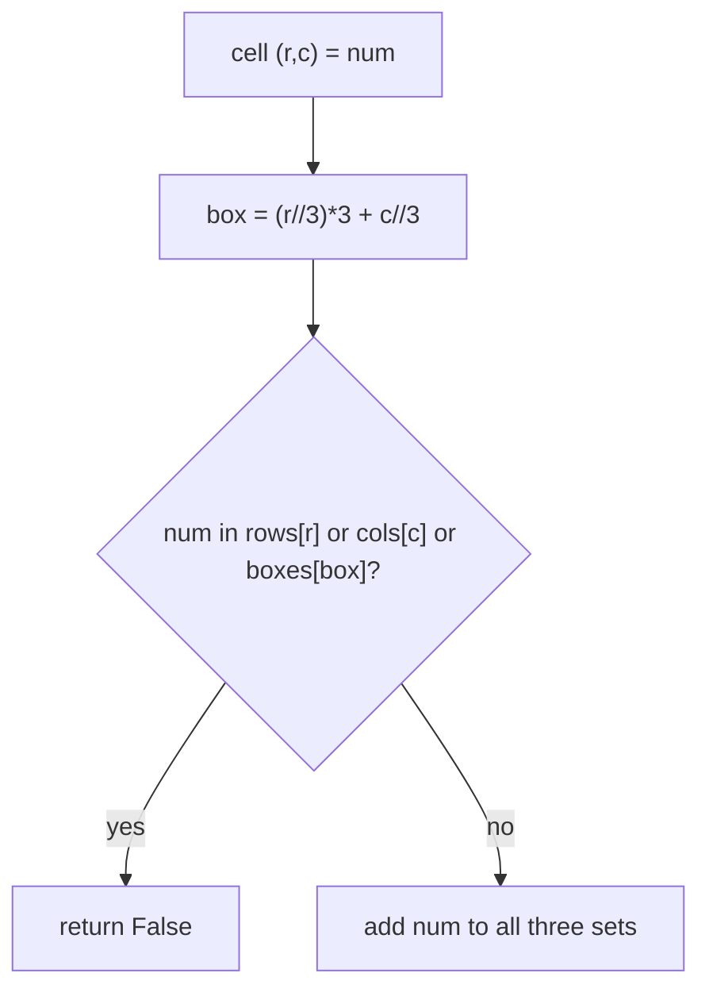

**Steps:**
1. Create `rows`, `cols`, `boxes`, each `[set() for _ in range(9)]`.
2. Loop `r` and `c` over 0..8; skip the cell if it is `"."`.
3. Read `num = board[r][c]` and compute `box = (r//3)*3 + c//3`.
4. If `num` is in `rows[r]`, `cols[c]`, or `boxes[box]` → return False.
5. Add `num` to all three sets.
6. After the full board → return True.

**Complexity:** Time O(81) = O(1), Space O(1).
**Careful:** The box id is a single integer `(r//3)*3 + c//3`, not a tuple. Digits are characters from the board, so store the string `num` as-is. Check all three sets before adding anything.

---

### First Missing Positive
`LeetCode #41` · Hard

**Problem:** Smallest missing positive integer, in O(n) time and O(1) space.

**Idea:** Use the array itself as a hash table: value `v` belongs at index `v-1`. A `while` loop cyclically swaps each value toward its home. Afterwards, the first index `i` with `nums[i] != i+1` is the answer; if every index matches, the answer is `n+1`.

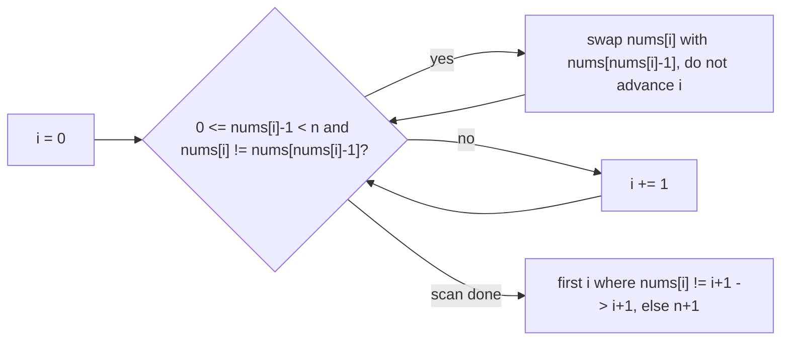

**Steps:**
1. Set `i = 0`; while `i < len(nums)`:
2. Let `j = nums[i] - 1`.
3. If `0 <= j < len(nums)` and `nums[i] != nums[j]` → swap `nums[i]` and `nums[j]`, keep `i` unchanged.
4. Else → `i += 1`.
5. Scan indices 0..n−1; the first where `nums[i] != i+1` returns `i+1`.
6. If none, return `len(nums)+1`.

**Complexity:** Time O(n) (each swap puts one value in its place), Space O(1).
**Careful:** Do not advance `i` right after a swap — the value just brought in may also need placing, so the `while` re-checks it. Values outside `1..n` (negatives, zero, too big) and duplicates terminate through the else branch. The `nums[i] != nums[j]` check also prevents an infinite swap of equal values.

---

## 2. Two Pointers

Main idea: use two indices (often one at each end, or slow/fast) moving toward each other. Turns O(n²) scans into O(n) on **sorted** or symmetric data.

### Valid Palindrome
`LeetCode #125` · Easy

**Problem:** Check if string is palindrome, considering only letters/digits, ignoring case.

**Idea:** First build `cleaned`, a list of lowercased characters for which `ch.isalnum()` is true. Then run two pointers from both ends of `cleaned`, comparing inward.

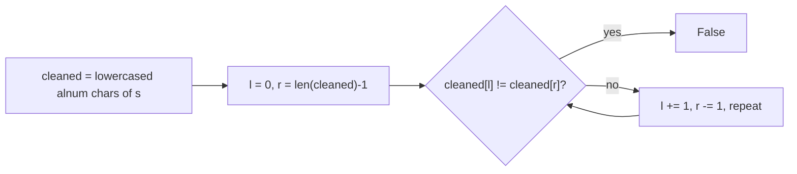

**Steps:**
1. Build `cleaned = [ch.lower() for ch in s if ch.isalnum()]`.
2. Set `l = 0`, `r = len(cleaned)-1`.
3. While `l < r`: if `cleaned[l] != cleaned[r]` → return False; else `l += 1`, `r -= 1`.
4. Return True.

**Complexity:** Time O(n), Space O(n) for `cleaned`.
**Careful:** This submission filters into a new list rather than skipping characters with pointer loops, so it uses O(n) extra space. `isalnum()` covers both letters and digits, and `lower()` is applied during the filter.

---

### Move Zeroes
`LeetCode #283` · Easy · no repo code

**Problem:** Move all zeroes to the end in place, keeping the order of non-zero elements.

**Idea:** Slow/fast pointers with a write index. `l` points at the next slot where a non-zero belongs. Scan `r`; every non-zero value is swapped into `nums[l]`, then `l` advances. Zeroes are never copied — they get swapped to the right.

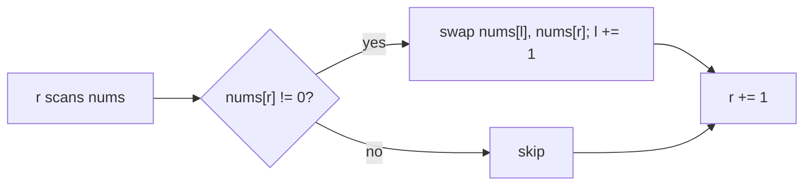

**Steps:**
1. `l = 0`.
2. For `r` in range: if `nums[r] != 0` → swap `nums[l]` and `nums[r]`; `l += 1`.
3. Return (the array is modified in place).

**Complexity:** Time O(n), Space O(1).
**Careful:** Swap, don't overwrite — swapping preserves values while pushing zeroes right. Because `r` only moves forward and non-zeroes are written in encounter order, the relative order is stable.

---

### Two Sum II — Input Array Is Sorted
`LeetCode #167` · Easy

**Problem:** Sorted array, find two numbers adding to target. Return 1-based indices.

**Idea:** Because the array is sorted, start with one pointer at each end. If the sum is too small, the left pointer moves right to grow it; if too large, the right pointer moves left to shrink it.

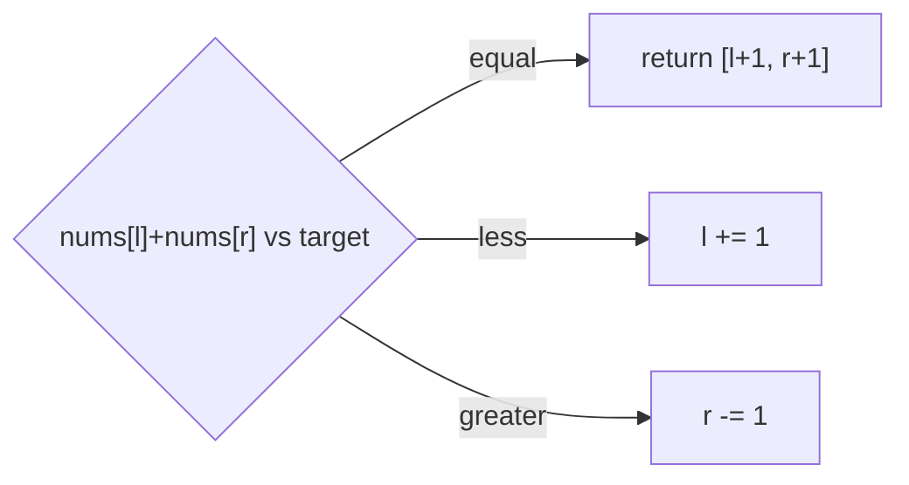

**Steps:**
1. `l = 0`, `r = len(nums)-1`.
2. While `l < r`:
3. If `nums[l]+nums[r] == target` → return `[l+1, r+1]`.
4. Else if the sum is `< target` → `l += 1`; otherwise → `r -= 1`.
5. If the loop ends, return `[-1, -1]`.

**Complexity:** Time O(n), Space O(1).
**Careful:** Indexes are 1-based, so add 1 to both pointers. This only works because the input is sorted. An equal sum returns immediately, so no pointer adjustment is needed on that branch.

---

### 3Sum
`LeetCode #15` · Medium

**Problem:** Find all unique triplets that sum to 0.

**Idea:** Sort the array, fix one index `i`, and run the two-pointer search for `-nums[i]` on the suffix `i+1..n-1`. Duplicates are removed by skipping a repeated `i` at the top and repeated `l` values after a hit.

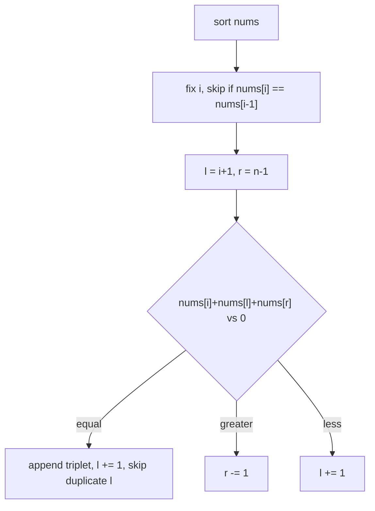

**Steps:**
1. Sort `nums` in place; create `res = []`.
2. For `i` in range(n): if `i > 0` and `nums[i] == nums[i-1]` → continue.
3. Set `l = i+1`, `r = n-1`.
4. While `l < r`: compute `s = nums[i]+nums[l]+nums[r]`.
5. If `s == 0`: append `[nums[i], nums[l], nums[r]]`; `l += 1`; then while `l < r` and `nums[l] == nums[l-1]`, increment `l`.
6. Else if `s > 0` → `r -= 1`; otherwise → `l += 1`.
7. Return `res`.

**Complexity:** Time O(n²), Space O(1) extra (sorting in place, output not counted).
**Careful:** Skip duplicate `i` only with the `i > 0` guard. After recording a triplet, the left pointer is advanced and then run past duplicates; there is no separate dedupe loop for `r` in this version. Also note it does not break early when `nums[i] > 0` — the `l < r` search simply finds nothing.

---

### Container With Most Water
`LeetCode #11` · Medium

**Problem:** Heights array; pick two lines forming most water. Area = width × min(height).

**Idea:** Start with the widest container, one pointer at each end. Area is limited by the shorter wall, so moving the taller wall can never help — move the shorter one inward and keep the best area.

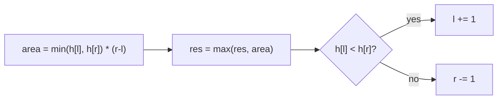

**Steps:**
1. `res = 0`, `l = 0`, `r = len(heights)-1`.
2. While `l < r`: compute `area = min(heights[l], heights[r]) * (r-l)`.
3. Update `res = max(res, area)`.
4. If `heights[l] < heights[r]` → `l += 1`; else → `r -= 1`.
5. Return `res`.

**Complexity:** Time O(n), Space O(1).
**Careful:** Compute the area *before* moving a pointer. On equal heights the `else` branch moves `r`, which is fine — either wall is equally short, and one pointer always moves so the loop terminates.

---

### Trapping Rain Water
`LeetCode #42` · Hard

**Problem:** Heights array; compute water trapped after rain.

**Idea:** Water above a bar is `min(maxLeft, maxRight) - height`. Two pointers carry running maxima `lmx` and `rmx`, seeded from the two endpoint heights. The side with the smaller max is the side whose water is already determined, so process it.

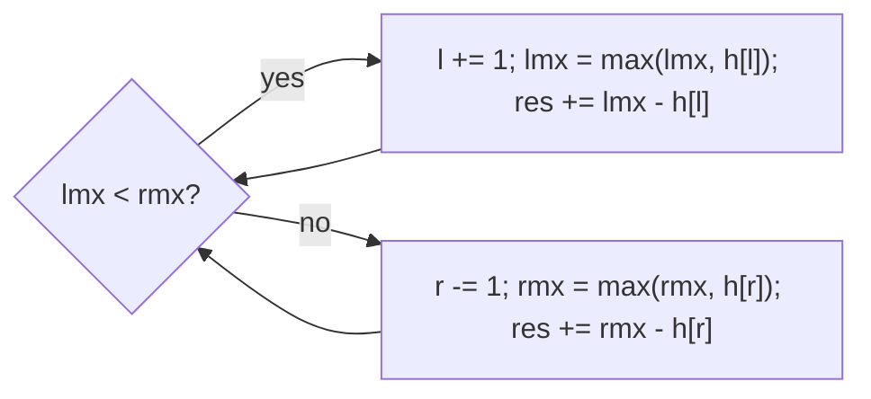

**Steps:**
1. `l = 0`, `r = len(height)-1`.
2. `lmx = height[l]`, `rmx = height[r]`, `res = 0`.
3. While `l < r`:
4. If `lmx < rmx`: `l += 1`, then `lmx = max(lmx, height[l])`, then `res += lmx - height[l]`.
5. Else: `r -= 1`, then `rmx = max(rmx, height[r])`, then `res += rmx - height[r]`.
6. Return `res`.

**Complexity:** Time O(n), Space O(1).
**Careful:** Move the pointer first, then update that side's max, then add the difference. Because the max is updated before the addition, the contribution is never negative. Seed `lmx`/`rmx` from the actual endpoints rather than 0.

---

## 3. Sliding Window

Main idea: a window `[l, r]` that grows on the right and shrinks from the left. Every index enters and leaves at most once, so a full pass is O(n); fixed-size variants slide a running sum or counter instead of a boundary.

### Maximum Average Subarray I
`LeetCode #643` · Easy

**Problem:** Find the contiguous subarray of fixed length `k` with the max average.

**Idea:** Sum the first window into `wsum` and seed `mxsum` with it. Then slide index `i` from `k`: add the entering value, subtract the one that left, and keep the larger window sum. Divide once at the end.

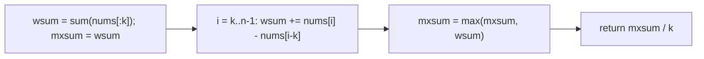

**Steps:**
1. `wsum = sum(nums[:k])`; `mxsum = wsum`.
2. For `i` from `k` to `len(nums)-1`: `wsum += nums[i] - nums[i-k]`; `mxsum = max(mxsum, wsum)`.
3. Return `mxsum / k`.

**Complexity:** Time O(n), Space O(1).
**Careful:** Keep the window sum as an integer and divide only on the return line. `mxsum` is seeded from the first window, so the loop can start at `k` and a single-window input returns immediately.

---

### Best Time to Buy and Sell Stock
`LeetCode #121` · Easy

**Problem:** One buy and one sell (buy before sell). Max profit.

**Idea:** One pass tracking `minprice`, the cheapest price seen so far, and `pro`, the best profit. Each day, fold the price into `minprice` first, then check `price - minprice` against `pro`.


**Steps:**
1. `pro = 0`, `minprice = prices[0]`.
2. For each `price` in `prices`: `minprice = min(minprice, price)`, then `pro = max(pro, price - minprice)`.
3. Return `pro`.

**Complexity:** Time O(n), Space O(1).
**Careful:** The loop includes `prices[0]`, so day one yields profit 0; updating `minprice` before the profit check allows buy-and-sell on the same day (0, never negative).

---

### Longest Substring Without Repeating Characters
`LeetCode #3` · Medium

**Problem:** Length of longest substring with all unique characters.

**Idea:** Window `[l, r]` with character counts in a `defaultdict(int)` named `mp`. After adding `s[r]`, only that character can become duplicated, so shrink while `mp[s[r]] > 1` by decrementing `mp[s[l]]` and moving `l`.

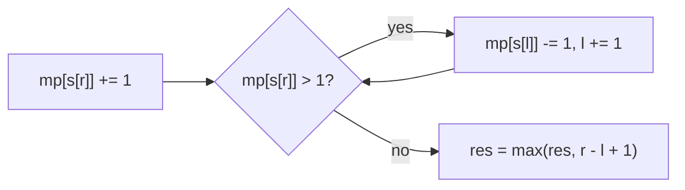

**Steps:**
1. `mp = defaultdict(int)`, `l = 0`, `res = 0`.
2. For `r`: `mp[s[r]] += 1`.
3. While `mp[s[r]] > 1`: `mp[s[l]] -= 1`, `l += 1`.
4. `res = max(res, r - l + 1)`; return `res`.

**Complexity:** Time O(n), Space O(min(n, charset)).
**Careful:** Decrement counts rather than deleting keys, and test `mp[s[r]]` for the repeat; each index is removed at most once, so the shrinks are amortized O(n).

---

### Longest Repeating Character Replacement
`LeetCode #424` · Medium

**Problem:** You may change up to `k` characters. Find longest substring of one repeated letter possible.

**Idea:** Window `[l, r]` with counts in `mp = defaultdict(int)`. Replacements needed are `window_length - count_of_most_frequent_char`, so the window is valid while `r - l + 1 - maxch <= k`. `maxch` records the highest single-char count seen anywhere, not just in the current window.

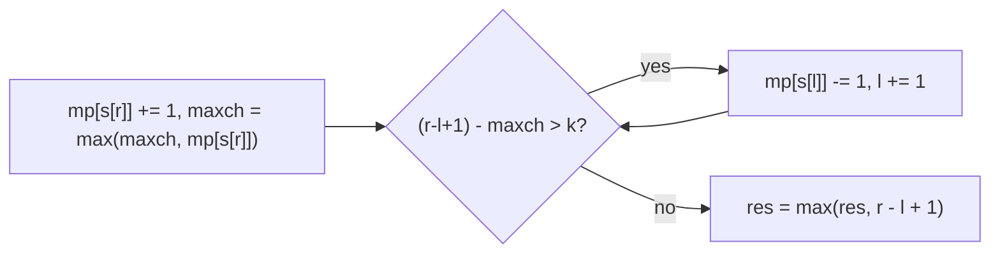

**Steps:**
1. `mp = defaultdict(int)`, `l = 0`, `res = 0`, `maxch = 0`.
2. For `r`: `mp[s[r]] += 1`; `maxch = max(maxch, mp[s[r]])`.
3. While `r - l + 1 - maxch > k`: `mp[s[l]] -= 1`, `l += 1`.
4. `res = max(res, r - l + 1)`; return `res`.

**Complexity:** Time O(n), Space O(26).
**Careful:** `maxch` is never lowered when the window shrinks. That is safe for a longest-window answer: a stale-high `maxch` only delays shrinking, and the window never needs to fall below the best length already found.

---

### Permutation in String
`LeetCode #567` · Medium

**Problem:** Does `s2` contain any permutation of `s1` as a substring?

**Idea:** Fixed window of size `len(s1)` over `s2`, with counts in two `defaultdict(int)` maps `mps1` and `mps2`. Compare the maps directly (`mps1 == mps2`) after building the first window and after each slide.

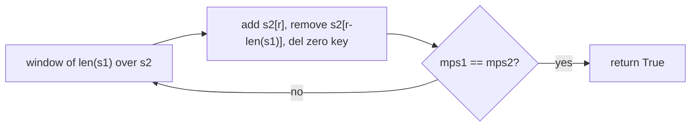

**Steps:**
1. If `len(s1) > len(s2)` → return False.
2. Build `mps1` and `mps2` from `s1` and the first `len(s1)` chars of `s2`.
3. If `mps1 == mps2` → True.
4. For `r` from `len(s1)` to `len(s2)-1`: `mps2[s2[r]] += 1`; `l = s2[r-len(s1)]`; `mps2[l] -= 1`; if `mps2[l] == 0` then `del mps2[l]`; if `mps1 == mps2` → True.
5. Return False.

**Complexity:** Time O(n), Space O(26).
**Careful:** Deleting zero-count keys is load-bearing: a leftover key holding 0 would make the dict comparison fail even when the letters match. Comparing two at-most-26-key dicts is O(26) = O(1).

---

### Minimum Window Substring
`LeetCode #76` · Hard

**Problem:** Smallest substring of `s` that contains all characters of `t` (with counts).

**Idea:** Expand `r` with a window map `mps`; `mpt` holds the target counts and `needed = len(mpt)` is the number of distinct target chars. `having` counts how many distinct chars have reached their required count. Once `having == needed`, shrink `l` while recording the shortest window in `res`/`resL`.

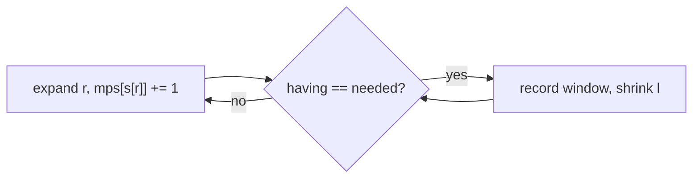

**Steps:**
1. If `len(t) > len(s)` → return `""`.
2. Build `mpt` from `t`; `needed = len(mpt)`.
3. `mps = defaultdict(int)`, `having = 0`, `l = 0`, `res = [-1, -1]`, `resL = inf`.
4. For `r`: `mps[s[r]] += 1`; if `s[r] in mpt` and `mps[s[r]] == mpt[s[r]]` → `having += 1`.
5. While `having == needed`: if `r - l + 1 < resL` → `resL = r - l + 1`, `res = [l, r]`; then `mps[s[l]] -= 1`; if `s[l] in mpt` and `mps[s[l]] < mpt[s[l]]` → `having -= 1`; `l += 1`.
6. If `resL != inf` return `s[res[0]:res[1]+1]`, else `""`.

**Complexity:** Time O(n + m), Space O(charset).
**Careful:** `having` increments only when a count reaches the requirement exactly, and the `in mpt` guard keeps non-target chars from touching it; compare against `mpt`, not against a running total of t's length.

---

### Sliding Window Maximum
`LeetCode #239` · Hard

**Problem:** For each window of size `k`, return the max.

**Idea:** Monotonic deque `q` of **indices** with strictly decreasing `nums` values; the front is always the current window's max. Pop smaller values off the back before appending the new index, drop the front once the left edge passes it, and append `nums[q[0]]` once a full window exists.

```mermaid
flowchart LR
    A["new r"] --> B["pop back while nums[q[-1]] < nums[r]"]
    B --> C["q.append(r)"]
    C --> D{"l > q[0]?"}
    D -- "yes" --> E["q.popleft()"]
    D -- "no" --> F{"r + 1 >= k?"}
    E --> F
    F -- "yes" --> G["res.append(nums[q[0]]), l += 1"]
```

**Steps:**
1. `res = []`, `q = deque()`, `l = 0`, `r = 0`.
2. While `r < len(nums)`: while `q` and `nums[q[-1]] < nums[r]` → `q.pop()`; then `q.append(r)`.
3. If `l > q[0]` → `q.popleft()`.
4. If `r + 1 >= k` → `res.append(nums[q[0]])`, `l += 1`.
5. `r += 1`; return `res`.

**Complexity:** Time O(n) amortized (each index pushed/popped once), Space O(k).
**Careful:** The back-pop uses strict `<`, so equal values stay in the deque. Only the front is checked against `l`, and the front is output and `l` advanced together once `r + 1 >= k`.

---

## 4. Prefix Sum + HashMap

Main idea: a running prefix sum turns any subarray sum into a difference of two prefixes. A HashMap keyed by prefix sum (or remainder, or first-seen index) then answers each query in O(1) and lets one pass count or measure subarrays.

### Range Sum Query — Immutable
`LeetCode #303` · Easy

**Problem:** Answer many `sumRange(left, right)` queries on a fixed array quickly.

**Idea:** Precompute prefix sums once in `__init__` into `self.prefix`, a list of size `n+1` where `prefix[k]` is the sum of the first `k` elements. Each query is a single subtraction.

```mermaid
flowchart LR
    A["prefix[i+1] = prefix[i] + nums[i]"] --> B["sumRange(left, right) = prefix[right+1] - prefix[left]"]
```

**Steps:**
1. `self.prefix = [0] * (len(nums) + 1)`.
2. For `i` in range: `self.prefix[i+1] = self.prefix[i] + nums[i]`.
3. `sumRange(left, right)` → `self.prefix[right+1] - self.prefix[left]`.

**Complexity:** Build O(n), each query O(1), Space O(n).
**Careful:** The leading 0 and the extra slot make both bounds inclusive with no special cases: `right + 1` is always a valid index.

---

### Find Pivot Index
`LeetCode #724` · Easy

**Problem:** Index where sum of left side equals sum of right side.

**Idea:** Compute `totalsum` once, then walk with `leftsum`. The right side for index `i` is `totalsum - leftsum - nums[i]`; compare before adding `nums[i]` to `leftsum`.

```mermaid
flowchart LR
    A["i from 0 to n-1"] --> B{"leftsum == totalsum - leftsum - nums[i]?"}
    B -- "yes" --> C["return i"]
    B -- "no" --> D["leftsum += nums[i]"]
    D --> A
```

**Steps:**
1. `totalsum = sum(nums)`, `leftsum = 0`.
2. For `i` in range: `rightsum = totalsum - leftsum - nums[i]`; if `leftsum == rightsum` → return `i`; otherwise `leftsum += nums[i]`.
3. Return -1.

**Complexity:** Time O(n), Space O(1).
**Careful:** The pivot element is excluded from both sides. At `i = 0` the left sum is 0, and at the last index the right sum is 0, so both edges are handled by the same formula.

---

### Subarray Sum Equals K
`LeetCode #560` · Medium

**Problem:** Count how many contiguous subarrays sum exactly to `k`.

**Idea:** Running prefix `prefix`; a subarray ending at `i` sums to `k` when an earlier prefix equals `prefix - k`. A `defaultdict(int)` named `mp` counts how many times each prefix sum has been seen, seeded with `mp[0] = 1` for the empty prefix.

```mermaid
flowchart LR
    A["prefix += nums[i]"] --> B["count += mp[prefix - k]"]
    B --> C["mp[prefix] += 1"]
```

**Steps:**
1. `mp = defaultdict(int)`, `mp[0] = 1`, `count = 0`, `prefix = 0`.
2. For each `num`: `prefix += num`; `count += mp[prefix - k]`.
3. `mp[prefix] += 1`.
4. Return `count`.

**Complexity:** Time O(n), Space O(n).
**Careful:** Seed `{0: 1}` so subarrays starting at index 0 are counted, and add to `count` before inserting the current prefix so the empty subarray is never counted.

---

### Contiguous Array
`LeetCode #525` · Medium

**Problem:** Longest subarray with equal number of 0s and 1s.

**Idea:** Track `oc` and `zc` counts. A subarray has equal counts when the difference `oc - zc` is the same at both ends. `mp` stores the first index where each difference appears; when the difference has been seen before, the span between the indices is balanced. A prefix with `oc == zc` is balanced from the start, so `res` becomes its full length.

```mermaid
flowchart LR
    A["count num as oc or zc"] --> B{"oc - zc in mp?"}
    B -- "no" --> C["mp[oc - zc] = i"]
    B -- "yes" --> D["res = max(res, i - mp[oc - zc])"]
    C --> E{"oc == zc?"}
    D --> E
    E -- "yes" --> F["res = oc + zc"]
    E -- "no" --> G["continue"]
```

**Steps:**
1. `mp = defaultdict(int)`; `res = 0`; `oc = zc = 0`.
2. For `i, num`: increment `zc` if `num == 0`, else `oc`.
3. If `oc - zc not in mp` → `mp[oc - zc] = i` (keep the first index).
4. If `oc == zc` → `res = oc + zc`; else → `res = max(res, i - mp[oc - zc])`.
5. Return `res`.

**Complexity:** Time O(n), Space O(n).
**Careful:** The map is checked with `not in`, not read directly — `defaultdict` would return `0`, which is a valid stored index. A fully balanced prefix is handled by the `oc == zc` branch instead of a seeded `{0: -1}` entry.

---

### Subarray Sums Divisible by K
`LeetCode #974` · Medium

**Problem:** Count contiguous subarrays whose sum is divisible by `k`.

**Idea:** Two prefix sums with the same remainder mod `k` differ by a multiple of `k`. Keep a running remainder `prefix = (prefix + num) % k` and a map counting how often each remainder has occurred. Each new occurrence can pair with every earlier one.

```mermaid
flowchart LR
    A["prefix = (prefix + num) % k"] --> B["count += mp[prefix]"]
    B --> C["mp[prefix] += 1"]
    C --> A
```

**Steps:**
1. `mp = defaultdict(int)`; `mp[0] = 1` (the empty prefix); `prefix = count = 0`.
2. For each `num`: `prefix = (prefix + num) % k`.
3. `count += mp[prefix]`; then `mp[prefix] += 1`.
4. Return `count`.

**Complexity:** Time O(n), Space O(k).
**Careful:** Python's `%` with positive `k` already returns a non-negative remainder, so there is no extra normalization step. Seeding remainder 0 counts subarrays that start at index 0.

---

## 5. Stack & Monotonic Stack

Main idea: LIFO handles matching pairs and expression evaluation; a monotonic stack keeps candidates in sorted order so each element is pushed and popped once, giving O(n) for next-greater and histogram problems.

### Valid Parentheses
`LeetCode #20` · Easy

**Problem:** Check if brackets `()[]{}` are balanced and correctly nested.

**Idea:** A map from each closing bracket to its opener, plus a stack. Closing brackets must match the current top; openers are pushed. At the end the stack must be empty.

```mermaid
flowchart LR
    A{"ch in mp?"} -- "no, opener" --> B["stk.append(ch)"]
    A -- "yes, closer" --> C{"stk empty or pop != mp[ch]?"}
    C -- "yes" --> D["False"]
    C -- "no" --> E["continue"]
    B --> F["return not stk"]
    E --> F
```

**Steps:**
1. `mp = {')': '(', '}': '{', ']': '['}`; `stk = []`.
2. For each `ch`: if `ch in mp` → if `not stk` or `stk.pop() != mp[ch]` → return False.
3. Otherwise → `stk.append(ch)`.
4. Return `not stk`.

**Complexity:** Time O(n), Space O(n).
**Careful:** The empty-stack check must be short-circuited before `stk.pop()`. Returning `not stk` rejects leftover openers such as `"(("`.

---

### Next Greater Element I
`LeetCode #496` · Easy

**Problem:** For each value in `nums1` (a subset of `nums2`), find its next greater element in `nums2`, else -1.

**Idea:** One pass over `nums2` with a monotonic stack of values. While the new value is greater than the top, the top has found its next greater element, so pop it into a map. Values left in the stack have no greater element to their right. Look up every `nums1` value with default -1.

```mermaid
flowchart LR
    A["num in nums2"] --> B{"stk and stk[-1] < num?"}
    B -- "yes" --> C["mp[stk.pop()] = num"]
    C --> B
    B -- "no" --> D["stk.append(num)"]
    D --> E["answer = mp.get(x, -1)"]
```

**Steps:**
1. `mp = defaultdict(int)`; `stk = []`.
2. For each `num` in `nums2`: while `stk` and `stk[-1] < num` → `mp[stk.pop()] = num`; then `stk.append(num)`.
3. Return `[mp.get(num, -1) for num in nums1]`.

**Complexity:** Time O(n + m), Space O(n).
**Careful:** The stack holds values, not indices, which is safe because `nums2` has distinct values. `mp.get(..., -1)` supplies the fallback for values with no greater element.

---

### Min Stack
`LeetCode #155` · Medium

**Problem:** Stack with push/pop/top and `getMin` all in O(1).

**Idea:** A single stack `self.stk` whose entries are `(value, running_min)` tuples. Each push stores the minimum of the new value and the previous entry's running min, so the minimum of the whole stack always sits in the top tuple.

```mermaid
flowchart LR
    A["push val"] --> B["minval = min(val, previous running min)"]
    B --> C["stk.append((val, minval))"]
    D["getMin"] --> E["return stk[-1][1]"]
```

**Steps:**
1. `__init__`: `self.stk = []`.
2. `push(val)`: `minval = min(val, self.stk[-1][1] if self.stk else val)`; `self.stk.append((val, minval))`.
3. `pop()`: `self.stk.pop()`; `top()`: `self.stk[-1][0]`.
4. `getMin()`: `self.stk[-1][1]`.

**Complexity:** All operations O(1), Space O(n).
**Careful:** The fallback `val` when the stack is empty makes the first tuple its own minimum. Every tuple carries its answer, so a pop needs no recomputation.

---

### Evaluate Reverse Polish Notation
`LeetCode #150` · Medium

**Problem:** Evaluate a postfix expression (operator comes after its two operands).

**Idea:** A stack of integers. Numbers are pushed; on an operator, pop the right operand then the left, apply the matching lambda from a dict `mp`, and push the result.

```mermaid
flowchart LR
    A{"token"} -- "number" --> B["stk.append(int(token))"]
    A -- "operator" --> C["b = pop, a = pop"]
    C --> D["stk.append(mp[ch](a, b))"]
    D --> E["return stk[-1]"]
```

**Steps:**
1. `stk = []`, `mp` maps `'+'`, `'-'`, `'*'`, `'/'` to lambdas; division lambda is `int(a/b)`.
2. For each token: if `token in mp` → `b, a = stk.pop(), stk.pop()`; `stk.append(mp[token](a, b))`.
3. Else `stk.append(int(token))`.
4. Return `stk[-1]`.

**Complexity:** Time O(n), Space O(n).
**Careful:** Pop order matters — the first pop is the right operand. `int(a/b)` truncates toward zero (as the problem requires), whereas `//` would floor negative results.

---

### Daily Temperatures
`LeetCode #739` · Medium

**Problem:** For each day, how many days until a warmer temperature? 0 if none.

**Idea:** Monotonic stack of indices with non-increasing temperatures. When today is warmer than the stack top, that index's answer is resolved as the index gap, and popping continues until the stack top is at least as warm.

```mermaid
flowchart LR
    A["day i"] --> B{"nums[stk[-1]] smaller than nums[i]?"}
    B -- "yes" --> C["j = pop, res[j] = i - j"]
    C --> B
    B -- "no" --> D["stk.append(i)"]
```

**Steps:**
1. `res = [0] * len(nums)`, `stk = []`.
2. For `i` in range: while `stk` and `nums[stk[-1]] < nums[i]` → `ind = stk.pop()`, `res[ind] = i - ind`.
3. `stk.append(i)`.
4. Return `res`.

**Complexity:** Time O(n), Space O(n).
**Careful:** The comparison is strict `<`, so equal temperatures do not count as warmer. Unresolved indices stay in the stack and keep their initialized 0.

---

### Largest Rectangle in Histogram
`LeetCode #84` · Hard

**Problem:** Bars of given heights; find largest rectangle area.

**Idea:** Monotonic increasing stack of `(height, start_index)`. When a shorter bar arrives, every taller entry on top is popped and its area is computed with width `i - start`; the current bar then inherits the earliest start it can extend back to.

```mermaid
flowchart LR
    A["bar i, height"] --> B{"stk top height greater than height?"}
    B -- "yes" --> C["pop (hei, ind), area = hei * (i - ind), st = ind"]
    C --> B
    B -- "no" --> D["push (height, st)"]
    D --> E["flush: height * (n - ind)"]
```

**Steps:**
1. `res = 0`, `stk = []`.
2. For `i, height` in `enumerate(heights)`: `st = i`; while `stk` and `stk[-1][0] > height` → `hei, ind = stk.pop()`, `res = max(res, hei * (i - ind))`, `st = ind`; push `(height, st)`.
3. After the loop: for each `height, i` left in `stk`, `res = max(res, height * (len(heights) - i))`.
4. Return `res`.

**Complexity:** Time O(n), Space O(n).
**Careful:** `st` must move back to each popped bar's start, so the new bar claims the full width it can span; the final flush treats the end of the array as a zero-height bar with width `n - start`.

---

## 6. Binary Search

Binary search works on any monotonic space: a sorted array, a flattened matrix, a rotated array with one sorted half, or a range of candidate answers. Every block here keeps an inclusive `l..r` window (except the rotated-minimum loop, which uses `l<r`) and shrinks it by half each step.

### Binary Search
`LeetCode #704` · Easy

**Problem:** Find target index in sorted array, else -1.

**Idea:** Keep an inclusive window `l..r`. Compare `nums[m]` with `target`, where `m = l + (r-l)//2`, then drop the half that cannot contain it.

```mermaid
flowchart LR
    A{"nums[m] vs target"} -- "equal" --> B["return m"]
    A -- "nums[m] < target" --> C["l = m+1"]
    A -- "nums[m] > target" --> D["r = m-1"]
```

**Steps:**
1. `l, r = 0, len(nums)-1`.
2. While `l <= r`: `m = l + (r-l)//2`.
3. `nums[m] == target` → return `m`; `nums[m] < target` → `l = m+1`; otherwise → `r = m-1`.
4. Return -1.

**Complexity:** Time O(log n), Space O(1).
**Careful:** `l <= r` with `m±1` moves means the window always shrinks, so no infinite loop.

---

### Search Insert Position
`LeetCode #35` · Easy

**Problem:** Return the index of `target` in a sorted array, or where it should be inserted.

**Idea:** Standard inclusive binary search. `l` and `r` are both valid indices and the loop runs while `l <= r`. A miss leaves `l` at the first element greater than `target`, which is exactly the insert position.

```mermaid
flowchart LR
    A{"l <= r?"} -- "yes" --> B["m = l + (r-l)//2"]
    B --> C{"nums[m] vs target"}
    C -- "equal" --> D["return m"]
    C -- "less" --> E["l = m + 1"]
    C -- "greater" --> F["r = m - 1"]
    E --> A
    F --> A
    A -- "no" --> G["return l"]
```

**Steps:**
1. `l = 0`; `r = len(nums) - 1`.
2. While `l <= r`: `m = l + (r - l) // 2`.
   - `nums[m] == target` → return `m`.
   - `nums[m] < target` → `l = m + 1`.
   - Else → `r = m - 1`.
3. Return `l`.

**Complexity:** Time O(log n), Space O(1).
**Careful:** Return `l`, not `r` — after the final miss, `l` is the insertion index (including `len(nums)` when the target is largest). `m` is computed as `l + (r - l) // 2` to avoid overflow in fixed-width languages.

---

### Search a 2D Matrix
`LeetCode #74` · Medium

**Problem:** Matrix where each row is sorted and the first value of each row is greater than the last of the previous row. Find target.

**Idea:** Those two properties make the whole matrix one sorted array of `row*col` values. Binary search a flat index `m` and map it back with `matrix[m//col][m%col]`.

```mermaid
flowchart LR
    A["l=0, r=row*col-1"] --> B["num = matrix[m//col][m%col]"]
    B --> C{"num vs target"}
    C -- "<" --> D["l = m+1"]
    C -- ">" --> E["r = m-1"]
    C -- "=" --> F["return True"]
```

**Steps:**
1. `row, col = len(matrix), len(matrix[0])`.
2. `l, r = 0, row*col - 1`.
3. While `l <= r`: `m = l + (r-l)//2`; `num = matrix[m//col][m%col]`.
4. Equal → return True; `num < target` → `l = m+1`; else `r = m-1`.
5. Return False.

**Complexity:** Time O(log(m·n)), Space O(1).
**Careful:** Divide and mod by the **column** count, not the row count.

---

### Search in Rotated Sorted Array
`LeetCode #33` · Medium

**Problem:** Rotated sorted array; find target index, else -1. O(log n).

**Idea:** At any mid, one side of `m` is still sorted. Use `nums[l] <= nums[m]` to pick which. If the sorted side's value range contains the target, search there; otherwise search the other side. The code writes this as reject conditions: target outside the sorted range → jump to the unsorted side.

```mermaid
flowchart TD
    A["m, nums[m] != target"] --> B{"nums[l] <= nums[m]?"}
    B -- "yes (left sorted)" --> C{"target > nums[m] or target < nums[l]?"}
    C -- "yes" --> D["l = m+1"]
    C -- "no" --> E["r = m-1"]
    B -- "no (right sorted)" --> F{"target < nums[m] or target > nums[r]?"}
    F -- "yes" --> G["r = m-1"]
    F -- "no" --> H["l = m+1"]
```

**Steps:**
1. `l, r = 0, len(nums)-1`.
2. While `l <= r`: `m = l + (r-l)//2`; return `m` if `nums[m] == target`.
3. If `nums[l] <= nums[m]` (left sorted): if `target > nums[m] or target < nums[l]` → `l = m+1`, else `r = m-1`.
4. Else (right sorted): if `target < nums[m] or target > nums[r]` → `r = m-1`, else `l = m+1`.
5. Return -1.

**Complexity:** Time O(log n), Space O(1).
**Careful:** The `<=` is required: when `m == l` the left "half" is a single element, so it counts as sorted and the empty-range condition pushes the search right.

---

### Find Minimum in Rotated Sorted Array
`LeetCode #153` · Medium

**Problem:** Sorted array rotated at some pivot; find the minimum. O(log n).

**Idea:** Compare `nums[m]` with `nums[r]`. If `nums[m] > nums[r]`, the rotation point (minimum) is strictly to the right; otherwise it is at `m` or to the left. Narrow until `l == r`.

```mermaid
flowchart LR
    A{"nums[m] > nums[r]?"} -- "yes" --> B["l = m+1"]
    A -- "no" --> C["r = m (keep mid)"]
```

**Steps:**
1. `l, r = 0, len(nums)-1`.
2. While `l < r`: `m = l + (r-l)//2`.
3. `nums[m] > nums[r]` → `l = m+1`; else `r = m`.
4. Return `nums[l]`.

**Complexity:** Time O(log n), Space O(1).
**Careful:** Compare against the **right** end and keep `r = m`; `m` itself can be the minimum.

---

### Koko Eating Bananas
`LeetCode #875` · Medium

**Problem:** Piles of bananas, `h` hours. Find the smallest eating speed `k` to finish in time. (Binary search on the answer.)

**Idea:** Binary search the speed. The code's range is `1..sum(piles)` — the sum is always feasible (one pile per hour), so it is a safe upper bound; it does not compute `max(piles)`. For a speed `m`, hours needed are `sum(math.ceil(pile/m))`, and a smaller speed needs more hours.

```mermaid
flowchart LR
    A["l=1, r=sum(piles)"] --> B["hrs = sum(ceil(pile/m))"]
    B --> C{"hrs <= h?"}
    C -- "yes" --> D["res=min(res,m); r=m-1"]
    C -- "no" --> E["l=m+1"]
```

**Steps:**
1. `l, r = 1, sum(piles)`; `res = r`.
2. While `l <= r`: `m = l + (r-l)//2`; `hrs = sum(math.ceil(pile/m) for pile in piles)`.
3. `hrs <= h` → `res = min(res, m)`, `r = m-1`; else `l = m+1`.
4. Return `res`.

**Complexity:** Time O(n log(sum(piles))), Space O(1).
**Careful:** Hours use `math.ceil`, and the answer is tracked in `res` because the loop records the last feasible mid before shrinking.

---

### Capacity to Ship Packages Within D Days
`LeetCode #1011` · Medium

**Problem:** Ship weights in order within `days` days. Find smallest ship capacity. (Binary search on the answer.)

**Idea:** Search capacity in `max(weights)..sum(weights)`. A helper `canShip(cap)` greedily simulates days with a remaining-capacity counter `curcap` and a day counter `shp` starting at 1: if the next package does not fit (`curcap - weight < 0`), start a new day and reset `curcap = cap`, then subtract the weight.

```mermaid
flowchart LR
    A["l=max(w), r=sum(w)"] --> B["canShip(m): greedily count days"]
    B --> C{"shp <= days?"}
    C -- "yes" --> D["res=min(res,m); r=m-1"]
    C -- "no" --> E["l=m+1"]
```

**Steps:**
1. `l, r = max(weights), sum(weights)`; `res = r`.
2. `canShip(cap)`: `curcap = cap`, `shp = 1`; for each weight, if `curcap - weight < 0` then `curcap = cap; shp += 1`; then `curcap -= weight`. Return `shp <= days`.
3. While `l <= r`: `m = l + (r-l)//2`; if `canShip(m)` → `res = min(res, m)`, `r = m-1`; else `l = m+1`.
4. Return `res`.

**Complexity:** Time O(n log(sum(weights))), Space O(1).
**Careful:** `l` starts at `max(weights)` so a single package always fits; and `canShip` is monotonic — if capacity `m` works, every larger capacity works.

---

### Median of Two Sorted Arrays
`LeetCode #4` · Hard

**Problem:** Median of two sorted arrays combined, in O(log(min(m,n))).

**Idea:** Binary search a partition of the shorter array. `i` is the **last index of the left partition in `a`**, and `j = half - i - 2` is the last index of the left partition in `b`, where `half = total//2` (the `-2` accounts for both cuts being inclusive indices). The cut is valid when `aleft <= bright` and `bleft <= aright`. Then the median comes from the four boundary values, using ±infinity when a side is empty.

```mermaid
flowchart TD
    A["binary search cut i in a (shorter)"] --> B["j = half - i - 2"]
    B --> C{"aleft <= bright and bleft <= aright?"}
    C -- "yes" --> D["odd: min(aright,bright); even: avg(max(aleft,bleft), min(aright,bright))"]
    C -- "aleft < bright" --> E["l = i+1 (cut too far left)"]
    C -- "otherwise" --> F["r = i-1"]
```

**Steps:**
1. `a, b = nums1, nums2`; `total = len(a)+len(b)`; `half = total//2`.
2. If `len(b) < len(a)`, swap `a` and `b` so `a` is the shorter array.
3. `l, r = 0, len(a)-1`. Loop forever:
4. `i = l + (r-l)//2`; `j = half - i - 2`.
5. `aleft = a[i]` or `-inf` if `i < 0`; `aright = a[i+1]` or `+inf` if `i+1 == len(a)`; same for `bleft`, `bright` with `j`.
6. If `aleft <= bright and bleft <= aright`: odd total → `min(aright, bright)`; even total → `(max(aleft, bleft) + min(aright, bright)) / 2`.
7. Else if `aleft < bright` → `l = i+1`; otherwise → `r = i-1`.

**Complexity:** Time O(log(min(m,n))), Space O(1).
**Careful:** `half` uses floor division, so for an odd total the extra element is on the right side — the odd answer is `min(aright, bright)`, not a max of the lefts. The search is `while True` because a valid partition always exists.

---

## 7. Linked List (incl. Fast & Slow Pointers)

Nodes linked by `next`. Dummy heads remove head special-cases, slow/fast pointers find middles and cycles, and reversal is just relinking `next` while saving the next node first. Draw arrows on paper.

### Reverse Linked List
`LeetCode #206` · Easy

**Problem:** Reverse a singly linked list.

**Idea:** Walk the list, flipping each node's `next` backward while keeping `prev` as the new head-so-far.

```mermaid
flowchart LR
    P["prev"] -. "cur.next = prev" .- C["cur"] --> N["temp"]
```

**Steps:**
1. `prev, cur = None, head`.
2. While `cur`: `temp = cur.next`; `cur.next = prev`; `prev = cur`; `cur = temp`.
3. Return `prev`.

**Complexity:** Time O(n), Space O(1).
**Careful:** Save `cur.next` in `temp` before overwriting `next`, or the rest of the list is lost.

---

### Merge Two Sorted Lists
`LeetCode #21` · Easy

**Problem:** Merge two sorted lists into one sorted list.

**Idea:** Dummy head plus a `cur` tail pointer. Compare the two front nodes, attach the smaller, advance that list, advance `cur`. Attach whatever remains in one step at the end.

```mermaid
flowchart LR
    A["dummy → cur"] --> B["if list1.val < list2.val pick list1, else list2"]
    B --> C["cur.next = picked; advance that list; cur = cur.next"]
    C --> D["cur.next = list1 or list2"]
```

**Steps:**
1. `dummy = ListNode()`; `cur = dummy`.
2. While `list1 and list2`: if `list1.val < list2.val` → `cur.next = list1; list1 = list1.next`; else → `cur.next = list2; list2 = list2.next`. Then `cur = cur.next`.
3. `cur.next = list1 or list2`.
4. Return `dummy.next`.

**Complexity:** Time O(n+m), Space O(1).
**Careful:** `<` is strict, so ties take `list2`; either choice is fine. The leftover list is already sorted, so one link finishes it.

---

### Linked List Cycle
`LeetCode #141` · Easy

**Problem:** Detect if the list has a cycle.

**Idea:** Floyd's slow/fast. `slow` moves one node, `fast` moves two. If they meet there is a cycle; if `fast` runs off the end, there is none.

```mermaid
flowchart LR
    A["slow +1, fast +2"] --> B{"slow == fast after move?"}
    B -- "yes" --> C["return True"]
    B -- "fast hits None" --> D["return False"]
```

**Steps:**
1. `slow, fast = head, head`.
2. While `fast and fast.next`: `slow = slow.next`; `fast = fast.next.next`; if `slow == fast` return True.
3. Return False.

**Complexity:** Time O(n), Space O(1).
**Careful:** Check `fast and fast.next` before taking two steps; the equality check happens **after** both pointers move.

---

### Middle of the Linked List
`LeetCode #876` · Easy

**Problem:** Return the middle node (second middle if even length).

**Idea:** Slow/fast pointers. Fast moves 2, slow moves 1; when fast falls off the end, slow is at the middle.

```mermaid
flowchart LR
    S["slow +1"] --- F["fast +2"] --> E["fast at end → slow = middle"]
```

**Steps:**
1. `slow, fast = head, head`.
2. While `fast and fast.next`: `slow = slow.next`; `fast = fast.next.next`.
3. Return `slow`.

**Complexity:** Time O(n), Space O(1).
**Careful:** This loop condition gives the **second** middle for even lengths, as required.

---

### Remove Nth Node From End of List
`LeetCode #19` · Medium

**Problem:** Remove the n-th node counting from the end.

**Idea:** Dummy head + two pointers with a gap of `n`. First move the `head` pointer `n` steps ahead, then move both `head` and `cur` (starting at the dummy) until `head` is None. `cur` then sits just before the target.

```mermaid
flowchart LR
    A["dummy → head; cur = dummy"] --> B["advance head n steps"]
    B --> C["move head and cur until head is None"]
    C --> D["cur.next = cur.next.next"]
```

**Steps:**
1. `dummy = ListNode(0, head)`; `cur = dummy`.
2. Repeat `n` times: `head = head.next`.
3. While `head`: `head = head.next`; `cur = cur.next`.
4. `cur.next = cur.next.next`; return `dummy.next`.

**Complexity:** Time O(n), Space O(1).
**Careful:** The dummy makes removing the real head (`n == length`) work; note the local `head` variable is reused as the lead pointer.

---

### Reorder List
`LeetCode #143` · Medium

**Problem:** Reorder `L0→L1→…→Ln` into `L0→Ln→L1→Ln-1→…`.

**Idea:** Three phases: find the middle, reverse the second half, weave the two halves alternately. `fast` starts at `head.next`, so `slow` ends at the **last node of the first half**.

```mermaid
flowchart LR
    A["slow/fast, fast = head.next"] --> B["second = slow.next; cut slow.next = None"]
    B --> C["reverse second half into prev"]
    C --> D["weave first and second while second"]
```

**Steps:**
1. `slow, fast = head, head.next`; while `fast and fast.next`: `slow = slow.next`; `fast = fast.next.next`.
2. `second = slow.next`; `slow.next = None`; reverse `second` into `prev` using `temp`.
3. `first, second = head, prev`. While `second`: save `temp1 = first.next`, `temp2 = second.next`; `first.next = second`; `second.next = temp1`; then `first, second = temp1, temp2`.

**Complexity:** Time O(n), Space O(1).
**Careful:** Cutting `slow.next` before reversing keeps the first half clean; the weave loop stops on `second` because the second half is shorter or equal in length.

---

### Find the Duplicate Number
`LeetCode #287` · Medium

**Problem:** Array of `n+1` numbers in `1..n`; exactly one repeats. Find it in O(1) extra space without modifying the array.

**Idea:** Treat each index as a node and `nums[i]` as its `next`. The duplicate value is the entrance of the cycle. Use Floyd's two-phase algorithm starting from index `0` (values are `1..n`, so index 0 is never part of the cycle).

```mermaid
flowchart LR
    A["phase 1: slow=nums[slow], fast=nums[nums[fast]] until meet"] --> B["slow2 = 0"]
    B --> C["phase 2: slow and slow2 one step until equal = duplicate"]
```

**Steps:**
1. `slow, fast = 0, 0`.
2. Loop: `slow = nums[slow]`; `fast = nums[nums[fast]]`; break when `slow == fast`.
3. `slow2 = 0`.
4. Loop: `slow = nums[slow]`; `slow2 = nums[slow2]`; when equal, return `slow`.

**Complexity:** Time O(n), Space O(1).
**Careful:** The answer is the **cycle entrance** (phase 2 meeting point), not the phase 1 meeting point.

---

### Reverse Nodes in k-Group
`LeetCode #25` · Hard

**Problem:** Reverse every group of `k` nodes. Leftover tail (<k) stays as is.

**Idea:** Dummy head + `grpprev`, the node just before the current group. A `getkth` closure walks `k` steps to check the group exists. `grpnxt = kth.next` serves both as stop sentinel and as the `prev` seed, so the reversed group automatically links to the next group.

```mermaid
flowchart LR
    A["kth = getkth(grpprev, k)"] --> B{"kth exists?"}
    B -- "no" --> C["break (leftover < k)"]
    B -- "yes" --> D["reverse grpprev.next..kth with prev = grpnxt"]
    D --> E["grpprev.next = kth; grpprev = old group head"]
```

**Steps:**
1. `dummy = ListNode(0, head)`; `grpprev = dummy`.
2. `getkth(cur, k)`: while `cur and k > 0`: `cur = cur.next`; `k -= 1`; return `cur`.
3. Loop: `kth = getkth(grpprev, k)`; if not `kth`, break.
4. `grpnxt = kth.next`; `prev, cur = grpnxt, grpprev.next`; while `cur != grpnxt`: `temp = cur.next`; `cur.next = prev`; `prev = cur`; `cur = temp`.
5. `temp = grpprev.next` (old head, now the group tail); `grpprev.next = kth`; `grpprev = temp`.
6. Return `dummy.next`.

**Complexity:** Time O(n), Space O(1).
**Careful:** `grpnxt` as the initial `prev` is what connects the group's tail to the next part; reversing happens only when `getkth` finds a full group.

---

## 8. Trees — DFS & BFS

Most tree problems are one DFS function that returns something upward (height, a subtree, a node) plus a mutable/global answer; BFS with a queue handles level-by-level work. A dummy or `nonlocal` result variable is the common pattern for the global answer.

### Invert Binary Tree
`LeetCode #226` · Easy

**Problem:** Mirror the tree (swap left and right everywhere).

**Idea:** Recurse into both children, then assign the inverted right subtree to `left` and the inverted left subtree to `right`.

```mermaid
flowchart TD
    A["node"] --> B["left = invert(right)"]
    A --> C["right = invert(left)"]
    B --> D["return node"]
    C --> D
```

**Steps:**
1. If `root` is truthy: `root.left, root.right = self.invertTree(root.right), self.invertTree(root.left)`.
2. Return `root` (None returns None unchanged).

**Complexity:** Time O(n), Space O(h).
**Careful:** Tuple assignment evaluates the right-hand side first, so the swap is safe without a temp variable.

---

### Maximum Depth of Binary Tree
`LeetCode #104` · Easy

**Problem:** Longest path length from root to a leaf (node count).

**Idea:** Depth = `1 + max(depth(left), depth(right))`.

```mermaid
flowchart TD
    A["node"] --> B["1 + max(left depth, right depth)"]
```

**Steps:**
1. If `not root` → 0.
2. Return `1 + max(self.maxDepth(root.left), self.maxDepth(root.right))`.

**Complexity:** Time O(n), Space O(h).
**Careful:** Empty tree depth is 0; a leaf returns 1.

---

### Diameter of Binary Tree
`LeetCode #543` · Easy

**Problem:** Longest path (in edges) between any two nodes.

**Idea:** A DFS returns the height of a subtree. At each node, the path through it is `left + right`, so update a `nonlocal res` with that value before returning `1 + max(left, right)` upward.

```mermaid
flowchart TD
    A["dfs(node) returns height"] --> B["res = max(res, left+right)"]
    B --> C["return 1 + max(left, right)"]
```

**Steps:**
1. `res = 0` in the enclosing function.
2. `dfs(node)`: if `not node` return 0.
3. `left = dfs(node.left)`; `right = dfs(node.right)`; `res = max(res, left+right)`.
4. Return `1 + max(left, right)`. After `dfs(root)`, return `res`.

**Complexity:** Time O(n), Space O(h).
**Careful:** Diameter counts edges, so the candidate is `left+right` (no `+1`).

---

### Binary Tree Level Order Traversal
`LeetCode #102` · Medium

**Problem:** Return node values level by level (list of lists).

**Idea:** BFS with a `deque`. Before consuming a level, `range(len(q))` freezes the number of nodes at that level; each iteration builds a `level` list and pushes children.

```mermaid
flowchart LR
    A["q = deque([root])"] --> B["level = []; loop len(q) times"]
    B --> C["popleft, append value, push children"]
    C --> D["res.append(level)"]
```

**Steps:**
1. If `not root` return `[]`; `res = []`; `q = deque([root])`.
2. While `q`: `level = []`; for `_ in range(len(q))`: `node = q.popleft()`; append `node.val`; push `node.left` and `node.right` if present.
3. Append `level` to `res`; return `res`.

**Complexity:** Time O(n), Space O(w) (width of the tree).
**Careful:** `range(len(q))` must be captured before the loop; the queue grows while children are pushed.

---

### Binary Tree Right Side View
`LeetCode #199` · Medium

**Problem:** Values visible from the right side (last node of each level).

**Idea:** Level-order BFS with a `deque`. Save `qlen = len(q)` for the level and append a node's value only when its index is `qlen-1`, i.e. it is the last node popped at that level.

```mermaid
flowchart TD
    A["q = deque([root])"] --> B["qlen = len(q); loop i over len(q)"]
    B --> C{"i == qlen-1?"} -- "yes" --> D["append node.val"]
    C -- "no" --> E["skip value"]
    D --> F["push children"]
```

**Steps:**
1. If `not root` return `[]`; `res = []`; `q = deque([root])`.
2. While `q`: `qlen = len(q)`; for `i in range(len(q))`: `node = q.popleft()`; if `i == qlen-1` append `node.val`; push existing children.
3. Return `res`.

**Complexity:** Time O(n), Space O(w).
**Careful:** Capture `qlen` before the inner loop; appending only at `qlen-1` picks the rightmost node per level.

---

### Lowest Common Ancestor of a Binary Tree
`LeetCode #236` · Medium

**Problem:** Find the LCA of two nodes in a general binary tree (no BST ordering).

**Idea:** Recurse. If the current node is None, `p`, or `q`, return it. Otherwise recurse both sides: if both return non-null, the current node is the split point and therefore the LCA; if only one side is non-null, return that side.

```mermaid
flowchart TD
    A["root is None or p or q?"] -- "yes" --> R1["return root"]
    A -- "no" --> B["left = rec(left), right = rec(right)"]
    B --> C{"left and right?"}
    C -- "yes" --> D["return root (LCA)"]
    C -- "no" --> E["return left or right"]
```

**Steps:**
1. If `not root or p is root or q is root` → return `root`.
2. `left = lowestCommonAncestor(root.left, p, q)`; `right = lowestCommonAncestor(root.right, p, q)`.
3. If `left and right` → return `root`; else return `left or right`.

**Complexity:** Time O(n), Space O(h).
**Careful:** Uses identity (`is`), not value equality; a node is allowed to be its own ancestor.

---

### Construct Binary Tree from Preorder and Inorder Traversal
`LeetCode #105` · Medium

**Problem:** Rebuild the tree from preorder and inorder arrays.

**Idea:** Preorder gives roots in order; inorder tells where each root splits its subtree. Build a value→index map `indx` for inorder so the split is O(1), and walk preorder with a `nonlocal preIdx`. Recursion uses **half-open** inorder ranges `[l, r)`; the base case is `l >= r`.

```mermaid
flowchart TD
    A["root = TreeNode(preorder[preIdx]); preIdx += 1"] --> B["m = indx[root.val]"]
    B --> C["left = build(l, m)"]
    B --> D["right = build(m+1, r)"]
```

**Steps:**
1. `indx = {v: i for i, v in enumerate(inorder)}`; `preIdx = 0`.
2. `build(l, r)`: if `l >= r` return None.
3. Take `preorder[preIdx]` as the root, increment `preIdx`; `m = indx[root.val]`.
4. `root.left = build(l, m)`; `root.right = build(m+1, r)`; return `root`.
5. Call `build(0, len(inorder))`.

**Complexity:** Time O(n), Space O(n) (map + recursion).
**Careful:** Left subtree must be built before right; preorder consumes a root and then the entire left subtree. Half-open ranges make `m` (the root index) the left range's end and `m+1` the right range's start.

---

### Binary Tree Maximum Path Sum
`LeetCode #124` · Hard

**Problem:** Max sum of any path (any node to any node, path bends allowed once).

**Idea:** DFS returns the best **downward** gain from a node. At each node, clamp both child gains at 0, update a `nonlocal best` with `node.val + left + right`, and return `node.val + max(left, right)` so only one branch goes upward.

```mermaid
flowchart TD
    A["left = max(dfs(left), 0)"] --> C["best = max(best, val+left+right)"]
    B["right = max(dfs(right), 0)"] --> C
    C --> D["return val + max(left, right)"]
```

**Steps:**
1. `best = float("-inf")`.
2. `dfs(node)`: if `not node` return 0.
3. `left = max(dfs(node.left), 0)`; `right = max(dfs(node.right), 0)`.
4. `best = max(best, node.val + left + right)`; return `node.val + max(left, right)`.
5. After `dfs(root)`, return `best`.

**Complexity:** Time O(n), Space O(h).
**Careful:** Clamp negative gains to 0; the returned value can only use one branch, while `best` may use both. Initializing to `-inf` handles all-negative trees.

---

### Serialize and Deserialize Binary Tree
`LeetCode #297` · Hard

**Problem:** Encode a tree to a string and decode it back.

**Idea:** Preorder DFS. Serialize appends `str(val)` for a node and `#` for an empty child, then joins with commas. Deserialize splits the string, wraps it in an iterator, and a recursive `build` consumes one token at a time — `#` → None, otherwise make the node and build left then right.

```mermaid
flowchart LR
    A["serialize: preorder, None → null marker"] --> B["comma-joined tokens"]
    B --> C["deserialize: iter over split; null marker → None else node + build left/right"]
```

**Steps:**
1. `serialize`: `out = []`; `dfs(node)` appends `"#"` if not node, else `str(node.val)` then recurses left and right. Return `",".join(out)`.
2. `deserialize`: `res = iter(data.split(","))`.
3. `build()`: `val = next(res)`; if `val == "#"` return None; create `TreeNode(int(val))`; set `root.left = build()`, `root.right = build()`; return root.
4. Return `build()`.

**Complexity:** Time O(n), Space O(n).
**Careful:** The iterator makes the token order implicit; both sides must use the same preorder (node, left, right) or decoding breaks.

---

## 9. Binary Search Tree

A BST keeps smaller values in the left subtree and larger values in the right. Almost every BST problem is one of three moves: walk down using the ordering, do an in-order traversal (which comes out sorted), or carry an allowed `(low, high)` range down the recursion.

### Search in a Binary Search Tree
`LeetCode #700` · Easy

**Problem:** Find the node in a BST whose value equals `val`, and return that subtree.

**Idea:** Recursive BST descent. An empty node returns None; a match returns the node itself; otherwise go left when `val` is smaller and right when it is larger.

```mermaid
flowchart LR
    A{"root is None?"} -- "yes" --> B["return None"]
    A -- "no" --> C{"root.val == val?"}
    C -- "yes" --> D["return root"]
    C -- "no" --> E{"val < root.val?"}
    E -- "yes" --> F["search left"]
    E -- "no" --> G["search right"]
```

**Steps:**
1. If `not root` → return None.
2. If `root.val == val` → return `root`.
3. If `val < root.val` → return `self.searchBST(root.left, val)`; else → `self.searchBST(root.right, val)`.

**Complexity:** Time O(h), Space O(h) recursion.
**Careful:** Return the node, not its value — the caller expects the whole subtree. The BST ordering lets each step discard one side entirely.

---

### Convert Sorted Array to BST
`LeetCode #108` · Easy

**Problem:** Build a height-balanced BST from a sorted array.

**Idea:** The middle element becomes the root; everything left builds the left subtree and everything right builds the right subtree. Choosing the midpoint at every level keeps the heights balanced.

```mermaid
flowchart TD
    A["m = len(nums)//2"] --> B["root = TreeNode(nums[m])"]
    B --> C["left = build(nums[:m])"]
    B --> D["right = build(nums[m+1:])"]
    C --> E["return root"]
    D --> E
```

**Steps:**
1. If `not nums` → return None.
2. `m = len(nums) // 2`.
3. Return `TreeNode(nums[m], self.sortedArrayToBST(nums[:m]), self.sortedArrayToBST(nums[m+1:]))`.

**Complexity:** Time O(n log n) because each level copies slices; Space O(n) peak (stack O(log n), slice chain O(n)).
**Careful:** For even lengths, `len // 2` picks the right-middle element — any consistent midpoint gives a valid balanced tree. Slicing copies data; an index-range version avoids the extra time.

---

### Lowest Common Ancestor of a BST
`LeetCode #235` · Medium

**Problem:** Find the lowest common ancestor of two nodes `p` and `q` in the tree.

**Idea:** The submitted code ignores the BST ordering and uses the **generic binary-tree LCA**: a nested `dfs(root)` returns the node itself when it is None or when `p is root` or `q is root`. Otherwise it recurses into both children; if both sides return something non-null, the current root is the split point (the LCA). If only one side returns non-null, that side's answer bubbles up. Identity checks (`is`) are used, not value comparisons.

```mermaid
flowchart TD
    A["dfs(node)"] --> B{"node None or node is p or q?"}
    B -- "yes" --> C["return node"]
    B -- "no" --> D["L = dfs(left), R = dfs(right)"]
    D --> E{"L and R both non-null?"}
    E -- "yes" --> F["return node (LCA)"]
    E -- "no" --> G["return L or R"]
```

**Steps:**
1. Define nested `dfs(root)`.
2. Base case: `if not root or p is root or q is root: return root`.
3. `left = dfs(root.left)`, `right = dfs(root.right)`.
4. If both are non-null → return `root`.
5. Else return `left or right`.
6. Call `dfs(root)`.

**Complexity:** Time O(n) worst case, Space O(h) recursion.
**Careful:** This is the generic tree LCA, not the BST ordering shortcut — do not claim O(h) or the "both smaller / both bigger" walk.

---

### Validate Binary Search Tree
`LeetCode #98` · Medium

**Problem:** Check if tree is a valid BST (left < node < right, for whole subtrees).

**Idea:** Pass down an allowed `(left, right)` open range. Each node must satisfy `left < node.val < right`; the left child tightens the upper bound to `node.val`, the right child tightens the lower bound.

```mermaid
flowchart TD
    A["dfs(node, left, right)"] --> B{"node None?"}
    B -- "yes" --> C["True"]
    B -- "no" --> D{"left < val < right?"}
    D -- "no" --> E["False"]
    D -- "yes" --> F["dfs(left, left, val) and dfs(right, val, right)"]
```

**Steps:**
1. `dfs(root, left, right)`: if `not root` → True.
2. If `not (root.val > left and root.val < right)` → False.
3. Return `dfs(root.left, left, root.val) and dfs(root.right, root.val, right)`.
4. Call `dfs(root, float("-inf"), float("inf"))`.

**Complexity:** Time O(n), Space O(h).
**Careful:** Just comparing a node with its direct children is NOT enough — the range must be carried down.

---

### Kth Smallest Element in a BST
`LeetCode #230` · Medium

**Problem:** Find the k-th smallest value in a BST.

**Idea:** In-order traversal of a BST gives sorted order. Do it iteratively with an explicit stack: push the whole left spine of `cur`, pop the next node, decrement `k`, and when `k` hits 0 return that node's value.

```mermaid
flowchart LR
    A["push all lefts of cur"] --> B["pop = next in-order node"]
    B --> C["k -= 1"]
    C --> D{"k == 0?"}
    D -- "yes" --> E["return cur.val"]
    D -- "no" --> F["cur = cur.right, repeat"]
```

**Steps:**
1. `cur = root`, `stk = []`.
2. Loop forever: while `cur`, append it to `stk` and move `cur = cur.left`.
3. `cur = stk.pop()`; `k -= 1`.
4. If `k == 0` → return `cur.val`.
5. Else `cur = cur.right` and repeat.

**Complexity:** Time O(h + k), Space O(h).
**Careful:** In-order on a BST is ascending; `k` is 1-based, so you return on the node where `k` becomes 0.

---

## 10. Heap / Top-K / Two Heaps

Two shapes cover this whole pattern: a **size-k heap** that keeps only the k best elements (min-heap for k largest, max-heap of negatives for k closest), and **two heaps split at the median**. Python's `heapq` is a min-heap, so a max-heap is done by pushing negatives.

### Kth Largest Element in a Stream
`LeetCode #703` · Easy

**Problem:** Keep returning the k-th largest after each new value added.

**Idea:** Maintain a **min-heap of at most k values** in `self.nums`. The constructor heapifies all input values and pops until only k remain. Each `add` pushes the new value and, if the heap grew past k, pops the smallest — so the root is always the k-th largest.

```mermaid
flowchart LR
    A["init: heapify nums, pop while size > k"] --> B["add(val): heappush"]
    B --> C{"size > k?"}
    C -- "yes" --> D["heappop smallest"]
    C -- "no" --> E["return heap[0] = kth largest"]
```

**Steps:**
1. `__init__`: store `k` and `nums`; `heapq.heapify(nums)`; while `len(nums) > k` → `heapq.heappop`.
2. `add(val)`: `heapq.heappush(self.nums, val)`.
3. If `len(self.nums) > self.k` → `heapq.heappop`.
4. Return `self.nums[0]`.

**Complexity:** Constructor O(n log n) worst (heapify plus pops), `add` O(log k), Space O(k).
**Careful:** Do the size check *after* the push — the newly pushed value may itself be the one to pop.

---

### Last Stone Weight
`LeetCode #1046` · Easy

**Problem:** Repeatedly smash the two heaviest stones; return the last remaining weight (or 0).

**Idea:** Store **negatives** so `heapq` acts as a max-heap. Pop the two heaviest; if they differ, push the negative of their difference. At the end append a `0` sentinel and return `abs(stones[0])` so an empty heap is handled.

```mermaid
flowchart LR
    A["negate all, heapify (max-heap)"] --> B["pop two heaviest"]
    B --> C{"second > first?"}
    C -- "yes" --> D["push first - second"]
    C -- "no" --> E["both destroyed"]
    D --> B
```

**Steps:**
1. `stones = [-s for s in stones]`; `heapq.heapify(stones)`.
2. While `len(stones) > 1`: `first = heappop`, `second = heappop`.
3. If `second > first` (i.e. the stones were unequal) → `heappush(stones, first - second)`.
4. After the loop append `0`, then return `abs(stones[0])`.

**Complexity:** Time O(n log n), Space O(n).
**Careful:** Everything lives in negative space: `first` and `second` are negative, so `first - second` is the negative leftover. The appended sentinel makes `stones[0]` safe when nothing is left.

---

### Kth Largest Element in an Array
`LeetCode #215` · Medium

**Problem:** Find the k-th largest value in an unsorted array.

**Idea:** No heap here — this is **3-way quickselect** on the same array. The k-th largest is the element at ascending index `target = len(nums) - k`. Picking `pivot = nums[l + (r-l)//2]`, partition the range into `< pivot`, `== pivot`, `> pivot` using pointers `low`, `mid`, `high`, then recurse into only the side containing `target`.

```mermaid
flowchart TD
    A["target = n - k (ascending index)"] --> B["l=0, r=n-1"]
    B --> C["pivot = nums[l + (r-l)//2]"]
    C --> D["3-way partition: low | == pivot | high"]
    D --> E{"target vs [low, high]"}
    E -- "< low" --> F["r = low - 1"]
    E -- "> high" --> G["l = high + 1"]
    E -- "inside" --> H["return nums[target]"]
```

**Steps:**
1. `target = len(nums) - k`; `l, r = 0, len(nums) - 1`.
2. While `l <= r`: `pivot = nums[l + (r-l)//2]`; set `low = mid = l`, `high = r`.
3. Partition: while `mid <= high` — if `nums[mid] < pivot`, swap into `low`, then `low += 1` and `mid += 1`; if `== pivot`, just `mid += 1`; else swap into `high` and `high -= 1`.
4. If `target < low` → `r = low - 1`; elif `target > high` → `l = high + 1`; else return `nums[target]`.

**Complexity:** Average O(n), worst O(n²) if pivots are bad; Space O(1) extra (in place).
**Careful:** 3-way partitioning is what makes duplicates safe. The index is in **ascending** order (`n-k`), and the function loops until the target index falls inside the equal block.

---

### Top K Frequent Elements
`LeetCode #347` · Medium

**Problem:** Return the `k` most frequent numbers.

**Idea:** Count frequencies with a `defaultdict(int)`, then keep a **min-heap of `(freq, num)` with at most k entries**. Push every `(freq, num)` and pop while the heap is larger than k; what remains is the k highest-frequency elements.

```mermaid
flowchart LR
    A["count freqs with defaultdict"] --> B["push (freq, num) into min-heap"]
    B --> C{"size > k?"} -- "yes" --> D["heappop smallest freq"]
    C -- "no" --> E["heap holds k most frequent"]
```

**Steps:**
1. `mp = defaultdict(int)`; for each num → `mp[num] += 1`.
2. `heap = []`; for `num, frq` in `mp.items()`: `heappush(heap, (frq, num))`.
3. While `len(heap) > k` → `heappop(heap)`.
4. Return `[num for _, num in heap]`.

**Complexity:** Time O(n + d log k) where d = distinct values, Space O(n).
**Careful:** This is the heap solution, not bucket sort. The heap root is the *least* frequent of the kept k, which is exactly what gets popped when the heap overflows.

---

### K Closest Points to Origin
`LeetCode #973` · Medium

**Problem:** Return the k points closest to origin.

**Idea:** Use squared distance (no sqrt needed). Keep a **max-heap of `(-distance, point)` of size k**; pushing the negative distance makes the farthest point sit on top, and popping while the heap exceeds k discards it. What remains are the k closest points.

```mermaid
flowchart LR
    A["dist = x*x + y*y"] --> B["push (-dist, point) into max-heap"]
    B --> C{"size > k?"} -- "yes" --> D["heappop farthest"]
    C -- "no" --> E["return the k points left"]
```

**Steps:**
1. `heap = []`.
2. For each point: `distance = point[0]**2 + point[1]**2`.
3. `heappush(heap, (-distance, point))`; while `len(heap) > k` → `heappop(heap)`.
4. Return `[point for _, point in heap]`.

**Complexity:** Time O(n log k), Space O(k).
**Careful:** The heap is a max-heap of negatives, so the popped entry is the *farthest*. Compare squared distances — sqrt is unnecessary.

---

### Task Scheduler
`LeetCode #621` · Medium

**Problem:** Same task needs `n` cooldown between runs. Find the minimum total time (with idles).

**Idea:** No heap simulation. The most frequent task dictates the skeleton. Count frequencies in a `defaultdict(int)`, let `maxFreq` be the highest count and `tied` the number of tasks achieving it. The skeleton needs `(maxFreq - 1) * (n + 1) + tied` slots; the answer is the max of that and `len(tasks)` (many distinct tasks mean no idle needed).

```mermaid
flowchart LR
    A["count tasks"] --> B["maxFreq and tied = count of tasks with maxFreq"]
    B --> C["time = (maxFreq-1)*(n+1) + tied"]
    C --> D["answer = max(len(tasks), time)"]
```

**Steps:**
1. `mp = defaultdict(int)`; for each task → `mp[task] += 1`.
2. `count = mp.values()`; `maxFreq = max(count)`.
3. `tied = sum(c == maxFreq for c in count)`.
4. `time = (maxFreq - 1) * (n + 1) + tied`; return `max(len(tasks), time)`.

**Complexity:** Time O(n), Space O(1) (26 task types).
**Careful:** The `max` with `len(tasks)` is what handles the no-idle case; `tied` counts every task with the maximum frequency, not just one.

---

### Merge k Sorted Lists
`LeetCode #23` · Hard

**Problem:** Merge `k` sorted lists into one.

**Idea:** A **min-heap of the current heads**. Push `(node.val, i, node)` for every non-empty list — the list index `i` is a tie-breaker so Python never has to compare `ListNode` objects. Repeatedly pop the smallest head, attach it to a dummy tail, and push that node's successor.

```mermaid
flowchart TD
    A["push (val, i, head) for each non-empty list"] --> B["pop smallest"]
    B --> C["attach node to dummy tail"]
    C --> D{"node.next?"}
    D -- "yes" --> E["push (next.val, i, next)"]
    D -- "no" --> B
    E --> B
```

**Steps:**
1. `heap = []`; for `i, node` in `enumerate(lists)`: if node → `heappush(heap, (node.val, i, node))`.
2. `dummy = ListNode()`, `cur = dummy`.
3. While heap: `val, i, node = heappop(heap)`.
4. `cur.next = node`, `cur = cur.next`.
5. If `node.next` → `heappush(heap, (node.next.val, i, node.next))`.
6. Return `dummy.next`.

**Complexity:** Time O(N log k) where N = total nodes, Space O(k).
**Careful:** The tuple's middle `i` is essential — without it, equal values would fall through to comparing `ListNode`s and raise a TypeError.

---

### Find Median from Data Stream
`LeetCode #295` · Hard

**Problem:** Support adding numbers and getting the running median.

**Idea:** Two heaps. `small` is a **max-heap stored as negatives** (lower half), `large` is a **min-heap** (upper half). Every insert goes into `small`, the top of `small` is immediately moved into `large`, and if `large` becomes bigger than `small` its top is moved back. So `small` holds the extra element on odd counts.

```mermaid
flowchart LR
    A["push -num to small (max-heap)"] --> B["move small top to large"]
    B --> C{"len(large) > len(small)?"}
    C -- "yes" --> D["move large top back"]
    D --> E["median: small top if bigger, else avg of tops"]
```

**Steps:**
1. `__init__`: `self.small = []`, `self.large = []`.
2. `addNum(num)`: `heappush(small, -num)`.
3. `heappush(large, -heappop(small))`.
4. If `len(large) > len(small)` → `heappush(small, -heappop(large))`.
5. `findMedian()`: if `len(small) > len(large)` → `-small[0]`; else `(-small[0] + large[0]) / 2`.

**Complexity:** `addNum` O(log n), `findMedian` O(1), Space O(n).
**Careful:** Both `small`'s pushes and its reads are negated; the two sizes differ by at most one and `small` is never smaller than `large`.

---

## 11. Backtracking

Backtracking = choose, recurse, undo. These problems differ mainly in the loop bounds: a start index (subsets, combination sum), all unused numbers (permutations), every split point (palindrome partitioning), or the next open cell (grid search).

### Subsets
`LeetCode #78` · Medium

**Problem:** Return all subsets (the power set) of distinct numbers.

**Idea:** Start-index backtracking. At every call, record a **copy of the current path** — every partial path is itself a valid subset, so no `include/skip` branching is needed. Then loop over indices from `start` onward, append, recurse from `i+1`, and pop.

```mermaid
flowchart TD
    A["backtrack(start, path)"] --> B["save path copy"]
    B --> C["for i in start..n-1"]
    C --> D["path.append(nums[i])"]
    D --> E["backtrack(i+1, path)"]
    E --> F["path.pop()"]
```

**Steps:**
1. `res = []`; define `backtrack(start, path)`.
2. Immediately `res.append(path[:])`.
3. For `i` in `range(start, len(nums))`: append `nums[i]`, call `backtrack(i+1, path)`, then `path.pop()`.
4. Call `backtrack(0, [])`; return `res`.

**Complexity:** Time O(n·2ⁿ), Space O(n) recursion.
**Careful:** The copy is saved at the *start* of every call, not only at the leaves. Advancing `i+1` (not `start+1`) avoids duplicates.

---

### Permutations
`LeetCode #46` · Medium

**Problem:** All orderings of distinct numbers.

**Idea:** No `used` array in this submission — it checks membership directly with `if num not in path`. Append an unused number, recurse, pop. A permutation is complete when `len(path) == n`.

```mermaid
flowchart TD
    A["backtrack(path)"] --> B{"len(path) == n?"}
    B -- "yes" --> C["save path copy"]
    B -- "no" --> D["for num in nums: if num not in path"]
    D --> E["append, recurse, pop"]
```

**Steps:**
1. `n = len(nums)`, `res = []`, `path = []`.
2. `backtrack()`: if `len(path) == n` → `res.append(path[:])` and return.
3. For each `num` in `nums`: `if num not in path` → append, `backtrack()`, pop.
4. Call `backtrack()`; return `res`.

**Complexity:** Time O(n·n!), Space O(n) for the path.
**Careful:** `num not in path` is an O(n) scan per candidate — correctness relies on all values being distinct.

---

### Combination Sum
`LeetCode #39` · Medium

**Problem:** Find all combinations summing to target. Each number may be reused.

**Idea:** Backtrack with a **remaining target**. When `rem == 0`, save the path and return. Otherwise loop from `start`; skip any candidate larger than `rem` (with `continue`, not `break`), append it, and recurse **with the same index `i`** so the number can be reused.

```mermaid
flowchart TD
    A["backtrack(start, path, rem)"] --> B{"rem == 0?"}
    B -- "yes" --> C["save path copy, return"]
    B -- "no" --> D["for i in start..n-1"]
    D --> E{"nums[i] > rem?"} -- "yes" --> F["continue"]
    E -- "no" --> G["append, backtrack(i, rem-nums[i]), pop"]
```

**Steps:**
1. `res = []`; define `backtrack(start, path, rem)`.
2. `if rem == 0`: `res.append(path[:])`; return.
3. For `i` in `range(start, len(nums))`: if `nums[i] > rem` → `continue`.
4. Append `nums[i]`; `backtrack(i, path, rem - nums[i])`; pop.
5. Call `backtrack(0, [], target)`; return `res`.

**Complexity:** Exponential in `target` and candidate count; recursion depth O(target / min candidate).
**Careful:** Recursing with `i` (not `i+1`) is the reuse. Passing `rem` down means there is no running-sum bookkeeping.

---

### Generate Parentheses
`LeetCode #22` · Medium

**Problem:** Generate all valid combinations of `n` pairs of parentheses.

**Idea:** Backtrack over two counters, `opens` and `closes`, building the string in a `path` list. Add `(` while `opens < n`. Add `)` only while `closes < opens` — that is what keeps every prefix valid. Join with `''.join(path)` when the path reaches length `2n`.

```mermaid
flowchart TD
    A["backtrack(opens, closes, path)"] --> B{"len(path) == 2n?"}
    B -- "yes" --> C["save ''.join(path)"]
    B -- "no" --> D{"opens < n?"}
    D -- "yes" --> E["add '(', recurse, pop"]
    A --> F{"closes < opens?"}
    F -- "yes" --> G["add ')', recurse, pop"]
```

**Steps:**
1. `res = []`; define `backtrack(opens, closes, path)`.
2. If `len(path) == 2 * n` → `res.append(''.join(path))`; return.
3. If `opens < n`: append `'('`, `backtrack(opens+1, closes, path)`, pop.
4. If `closes < opens`: append `')'`, `backtrack(opens, closes+1, path)`, pop.
5. Call `backtrack(0, 0, [])`; return `res`.

**Complexity:** Time O(4ⁿ/√n) (Catalan number of results), Space O(n) recursion.
**Careful:** Only `'('` can start a valid string, and `closes < opens` forbids a prefix with more closers — no separate validity check is needed.

---

### Word Search
`LeetCode #79` · Medium

**Problem:** Does the word exist in the grid via adjacent cells (no reuse)?

**Idea:** DFS from every cell. `backtrack(i, r, c)` fails on out-of-bounds or a letter mismatch, succeeds when `i == len(word)`. The visited cell is marked by writing `'#'` over it, the four neighbours are tried for index `i+1`, and then the original character `word[i]` is written back.

```mermaid
flowchart TD
    A["backtrack(i, r, c)"] --> B{"i == len(word)?"}
    B -- "yes" --> C["True"]
    B -- "no" --> D{"in bounds and board[r][c] == word[i]?"}
    D -- "no" --> E["False"]
    D -- "yes" --> F["board[r][c] = '#'"]
    F --> G["try 4 neighbours for i+1"]
    G --> H["restore word[i]"]
```

**Steps:**
1. `row, col = len(board), len(board[0])`; define `backtrack(i, r, c)`.
2. If `i == len(word)` → True.
3. If out of bounds or `board[r][c] != word[i]` → False.
4. Set `board[r][c] = '#'`.
5. `found = backtrack(i+1, r+1, c) or backtrack(i+1, r-1, c) or backtrack(i+1, r, c+1) or backtrack(i+1, r, c-1)`.
6. Restore `board[r][c] = word[i]`; return `found`.
7. Outer double loop over all cells calls `backtrack(0, r, c)`; return True on the first success, else False.

**Complexity:** Time O(m·n·4^L) worst case, Space O(L) recursion.
**Careful:** The mark is `'#'` and the restore writes back `word[i]` (the same character that was there). Restoring on the way out is what lets another path reuse the cell.

---

### Palindrome Partitioning
`LeetCode #131` · Medium

**Problem:** Partition string so every piece is a palindrome; return all partitions.

**Idea:** Backtrack on a start index. At `start == len(s)` save a copy of the path. Otherwise try **every end from `start+1` to `len(s)`**, take the slice `s[start:end]`, and recurse from `end` only when the slice passes the `p == p[::-1]` palindrome check.

```mermaid
flowchart TD
    A["backtrack(start, path)"] --> B{"start == len(s)?"}
    B -- "yes" --> C["save path copy"]
    B -- "no" --> D["for end in start+1..len(s)"]
    D --> E{"s[start:end] palindrome?"}
    E -- "no" --> F["next end"]
    E -- "yes" --> G["append piece, backtrack(end), pop"]
```

**Steps:**
1. `res = []`; define `backtrack(start, path)`.
2. If `start == len(s)` → `res.append(path[:])`.
3. For `end` in `range(start+1, len(s)+1)`: `p = s[start:end]`.
4. If `p == p[::-1]`: append `p`, `backtrack(end, path)`, pop.
5. Call `backtrack(0, [])`; return `res`.

**Complexity:** Time O(n·2ⁿ), Space O(n) recursion.
**Careful:** There is no `return` after saving — the loop simply does not execute when `start == len(s)`. The palindrome test uses slicing, so each check is O(length).

---

### N-Queens
`LeetCode #51` · Hard

**Problem:** Place N queens on N×N board so none attack each other; return all boards.

**Idea:** One queen per row. Keep three sets — `cols`, `diag1` for `row + col`, `diag2` for `row - col` — plus a `placement` list holding the chosen column per row. In row `row`, skip any column that appears in one of the sets; otherwise add to all three, recurse to `row+1`, then remove. At `row == n`, build each row string as `'.'*c + 'Q' + '.'*(n-c-1)`.

```mermaid
flowchart TD
    A["dfs(row)"] --> B{"row == n?"}
    B -- "yes" --> C["build board from placement"]
    B -- "no" --> D["for col in 0..n-1"]
    D --> E{"col or row+col or row-col used?"}
    E -- "yes" --> F["skip"]
    E -- "no" --> G["add to cols, diag1, diag2, placement"]
    G --> H["dfs(row+1)"]
    H --> I["remove all, pop placement"]
```

**Steps:**
1. `res = []`; `cols, diag1, diag2 = set(), set(), set()`; `placement = []`.
2. `dfs(row)`: if `row == n` → `res.append(['.'*c + 'Q' + '.'*(n-c-1) for c in placement])`; return.
3. For `col` in `range(n)`: skip if `col in cols` or `row+col in diag1` or `row-col in diag2`.
4. Add `col`, `row+col`, `row-col` to their sets; append `col` to `placement`.
5. `dfs(row+1)`; then `placement.pop()` and remove the three set entries.
6. Call `dfs(0)`; return `res`.

**Complexity:** Time ~O(N!), Space O(N) recursion.
**Careful:** Diagonal keys are `row+col` (anti-diagonal, `diag1`) and `row-col` (main diagonal, `diag2`) — keeping `row-col` signed is fine for a set. Undo all four pieces of state together.

---

## 12. Trie (Prefix Tree)

A trie stores characters along tree edges; each node holds a dict of children plus an `end` flag. Insert and lookup are character-by-character walks, and wildcard/grid problems layer DFS on top of the trie.

### Implement Trie (Prefix Tree)
`LeetCode #208` · Medium

**Problem:** Support `insert`, `search` (full word), and `startsWith` (prefix check).

**Idea:** `TrieNode` stores `children={}` and `end=False`; `PrefixTree` keeps a `root`. Every operation walks the word one character at a time, and only `insert` creates missing child nodes.

```mermaid
flowchart TD
    R["root"] --> A["a"] --> P["p"] --> P2["p end"]
    A --> N["n"] --> T["t end"]
```

**Steps:**
1. `TrieNode.__init__`: `children = {}`, `end = False`.
2. `insert`: start at `root`; for each `ch`, create `TrieNode()` if `ch` is missing, descend; mark the final node `end = True`.
3. `search`: descend through every character; if a child is missing return `False`; after the loop return `cur.end`.
4. `startsWith`: same descent, but return `True` once the whole prefix is consumed (no `end` check).

**Complexity:** O(L) per operation, Space O(total characters inserted).
**Careful:** `search` requires `end == True`; `startsWith` does not. Insert is the only operation that creates nodes.

---

### Design Add and Search Words Data Structure
`LeetCode #211` · Medium

**Problem:** Like a Trie, but `search` may contain `.` matching any single letter.

**Idea:** Use the same `TrieNode` (`children` dict + `end`). `addWord` is a plain trie insert; `search` delegates to a recursive `dfs(cur, ind)` so a `.` can branch into every child.

```mermaid
flowchart TD
    A["dfs(cur, ind)"] --> B{"word[i] is a dot?"}
    B -- yes --> C["try every child at i+1"]
    B -- no --> D["follow cur.children[ch]"]
    C --> E["any branch true gives true"]
    D --> F["end of word gives cur.end"]
```

**Steps:**
1. `TrieNode`: `children = {}`, `end = False`.
2. `addWord`: standard insert; set the last node's `end = True`.
3. `search` calls `dfs(self.root, 0)`.
4. In `dfs`, loop `i` from `ind` to `len(word)-1`: for `.`, recurse `dfs(child, i+1)` over every `cur.children.values()` and return `True` if any branch succeeds, otherwise `False`; for a normal char, return `False` if it is absent, else descend into it.
5. After the loop, return `cur.end`.

**Complexity:** `addWord` O(L); `search` O(L) without dots and up to O(26^d · L) with `d` dots. Space O(total characters).
**Careful:** A dot with no matching child branch returns `False` immediately. At the end of the word the answer is `cur.end`, not merely "a node was reached".

---

### Word Search II
`LeetCode #212` · Hard

**Problem:** Find all words from a list that exist in a letter grid using adjacent cells, without reusing a cell.

**Idea:** Build one trie of all words with `TrieNode.addWord`, then DFS from every board cell while walking the trie together with the word built so far. Prune as soon as the board character is not among the current node's children, and collect completed words in a set.

```mermaid
flowchart TD
    A["build trie of words"] --> B["DFS from every cell"]
    B --> C{"in bounds, unvisited, char in children?"}
    C -- no --> D["prune"]
    C -- yes --> E["descend, extend word"]
    E --> F{"node.end?"}
    F -- yes --> G["add word to res set"]
    E --> H["recurse 4 neighbors, then unmark cell"]
```

**Steps:**
1. `TrieNode` has `children={}`, `end=False`, plus an `addWord` method that walks a word and marks its last node.
2. Insert every word into `root`.
3. Keep `res = set()` and `visit = set()`.
4. `dfs(cur, word, r, c)`: return if out of bounds, `(r,c)` is in `visit`, or `board[r][c]` is not in `cur.children`.
5. Add `(r,c)` to `visit`, move `cur` to `cur.children[board[r][c]]`, append the character to `word`; if `cur.end`, add `word` to `res`.
6. Recurse into the four neighbors, then remove `(r,c)` from `visit`.
7. Start `dfs(root, "", r, c)` from every cell; return `list(res)`.

**Complexity:** Time O(cells · 4^L) worst case, Space O(total word characters + L).
**Careful:** The `visit` removal is the backtracking step that lets later paths reuse a cell. `res` is a set, so the same word found along different paths is stored once.

---

## 13. Graphs — BFS / DFS / Flood Fill

Grid and graph traversal: BFS gives shortest paths, while DFS/flood fill marks connected regions. On grids, mutating the cell is often enough as the visited marker.

### Flood Fill
`LeetCode #733` · Easy

**Problem:** Repaint the region connected to `(sr, sc)` with a new color, like a paint bucket.

**Idea:** Remember `start = image[sr][sc]`, then DFS from the start and recolor every connected cell still equal to `start`. If the new color already equals the start color, return immediately.

```mermaid
flowchart TD
    A["start color = image[sr][sc]"] --> B{"start == color?"}
    B -- yes --> C["return image unchanged"]
    B -- no --> D["DFS recolor to color"]
    D --> E["recurse 4 neighbors still equal to start"]
```

**Steps:**
1. Set `start = image[sr][sc]`; if `start == color`, return `image`.
2. `dfs(r,c)`: return on out-of-bounds or when `image[r][c] != start`.
3. Set `image[r][c] = color`, then recurse on the four neighbors.
4. Call `dfs(sr, sc)` and return `image`.

**Complexity:** Time O(m·n), Space O(m·n) worst.
**Careful:** The `start == color` guard prevents infinite recursion when the new color equals the old one. The color write doubles as the visited mark.

---

### Number of Islands
`LeetCode #200` · Medium

**Problem:** Count islands (4-connected groups of `"1"` cells) in a grid.

**Idea:** Scan every cell; each unvisited `"1"` starts a DFS that sinks the whole island by writing `0`, and increments the counter once.

```mermaid
flowchart TD
    A["scan each cell"] --> B{"grid cell is 1?"}
    B -- yes --> C["res += 1, DFS sink island"]
    B -- no --> D["skip"]
```

**Steps:**
1. `res = 0`; read `rows, cols`.
2. `dfs(r,c)`: return on out-of-bounds or when `grid[r][c] != "1"`.
3. Set `grid[r][c] = 0`, then recurse on all four neighbors.
4. Double loop over the grid: whenever a cell equals `"1"`, call `dfs(r,c)` and increment `res`.
5. Return `res`.

**Complexity:** Time O(m·n), Space O(m·n) worst (recursion).
**Careful:** The written value is the integer `0`, while the guard compares against the string `"1"`; that still correctly marks the cell. No separate visited set is used.

---

### Max Area of Island
`LeetCode #695` · Medium

**Problem:** Return the largest island area (number of connected land cells).

**Idea:** Same flood fill, but `dfs` returns the area of the region it sinks; the outer scan keeps the maximum.

```mermaid
flowchart TD
    A["land cell"] --> B["dfs returns 1 + four neighbor areas"]
    B --> C["area = max(area, dfs result)"]
```

**Steps:**
1. `area = 0`; read `rows, cols`.
2. `dfs(r,c)`: return `0` on out-of-bounds or when `grid[r][c] != 1`.
3. Set `grid[r][c] = 0`; return `1 + dfs(r-1,c) + dfs(r+1,c) + dfs(r,c-1) + dfs(r,c+1)`.
4. Scan all cells; for land, `area = max(area, dfs(r,c))`.
5. Return `area`.

**Complexity:** Time O(m·n), Space O(m·n) worst.
**Careful:** Mark the cell before recursing, otherwise neighbors would count it again. `dfs` returns counts, not just a boolean.

---

### Rotting Oranges
`LeetCode #994` · Medium

**Problem:** Each minute, rotten oranges rot their fresh 4-neighbors. Return the minutes until no fresh orange remains, or `-1` if impossible.

**Idea:** Multi-source BFS: enqueue every initially rotten cell, count the fresh oranges, and process the queue one level (one minute) at a time.

```mermaid
flowchart TD
    A["queue all rotten cells, count fresh"] --> B{"q nonempty and fresh > 0?"}
    B -- yes --> C["process one whole level, rotting neighbors"]
    C --> D["time += 1"]
    D --> B
    B -- no --> E{"fresh == 0?"}
    E -- yes --> F["return time"]
    E -- no --> G["return -1"]
```

**Steps:**
1. `fresh, time = 0, 0`; `q = deque()`.
2. Scan the grid: `1` increments `fresh`; `2` appends `[r,c]` to the queue.
3. While `q and fresh > 0`: for `range(len(q))`, pop left; for each in-bounds neighbor equal to `1`, set it to `2`, append it, and decrement `fresh`. After the level, increment `time`.
4. Return `time` if `fresh == 0`, else `-1`.

**Complexity:** Time O(m·n), Space O(m·n).
**Careful:** `time` starts at 0 and increments after each full level, so it counts elapsed minutes. If there are no fresh oranges the loop never runs and the answer is 0. Starting from all rotten cells at once is what makes it multi-source.

---

### Clone Graph
`LeetCode #133` · Medium

**Problem:** Deep-copy a connected undirected graph whose nodes have `val` and `neighbors`.

**Idea:** DFS with a dict `oldtonew` mapping each original node to its clone. Create and store the clone before recursing into neighbors so cycles terminate.

```mermaid
flowchart TD
    A["dfs(node)"] --> B{"node in oldtonew?"}
    B -- yes --> C["return oldtonew[node]"]
    B -- no --> D["create Node(node.val), store in map"]
    D --> E["append dfs(neighbor) for every neighbor"]
    E --> F["return clone"]
```

**Steps:**
1. `oldtonew = {}`.
2. `dfs(node)`: if `node` is already in `oldtonew`, return its clone.
3. Otherwise create `copy = Node(node.val)`, set `oldtonew[node] = copy`, then for every neighbor append `dfs(neighbor)` to `copy.neighbors`; return `copy`.
4. Return `dfs(node) if node else None`.

**Complexity:** Time O(V+E), Space O(V).
**Careful:** Store the clone in the map before the neighbor loop; otherwise a cycle recurses forever. Handle the empty-graph `None` case.

---

### Pacific Atlantic Water Flow
`LeetCode #417` · Medium

**Problem:** Return the cells from which water can reach both the Pacific (top/left) and Atlantic (bottom/right) oceans, flowing to equal-or-lower neighbors.

**Idea:** Reverse the flow. DFS inward from each ocean's border, climbing to cells with height at least the previous height. Track reachable cells in the `pac` and `atl` sets; the answer is their intersection.

```mermaid
flowchart TD
    A["DFS from Pacific borders into pac"] --> C["cells in both sets"]
    B["DFS from Atlantic borders into atl"] --> C
```

**Steps:**
1. Read `rows, cols`; `pac, atl = set(), set()`.
2. `dfs(r,c,visit,prevheight)`: return out of bounds, if `(r,c)` is already in `visit`, or if `heights[r][c] < prevheight`. Otherwise add the cell and recurse four ways with `heights[r][c]` as the new `prevheight`.
3. Seed the top row into `pac` and the bottom row into `atl`; seed the left column into `pac` and the right column into `atl`.
4. Scan every cell; append `[r,c]` when it is in both sets. Return the result.

**Complexity:** Time O(m·n), Space O(m·n).
**Careful:** The traversal is reversed, so it climbs (allows heights `>=` the previous). Equal heights are valid flow.

---

### Word Ladder
`LeetCode #127` · Hard

**Problem:** Shortest transformation from `beginWord` to `endWord`, changing one letter per step, with every intermediate word in `wordList`.

**Idea:** BFS over words for shortest path, with wildcard pattern buckets (`h*t`, `*ot`, `ho*`) built in a `defaultdict(list)` so neighbors are found without comparing every pair.

```mermaid
flowchart TD
    A["build wildcard buckets"] --> B["BFS from beginWord, level by level"]
    B --> C["neighbors = words sharing a pattern"]
    C --> D{"word == endWord?"}
    D -- yes --> E["return current level"]
    D -- no --> F["enqueue unvisited neighbors"]
    F --> B
```

**Steps:**
1. If `endWord` is not in `wordList`, return 0; append `beginWord` to `wordList`.
2. For every word and every index `i`, build `pattern = word[:i] + "*" + word[i+1:]` and append the word to `mp[pattern]`.
3. `visit = set(beginWord)` (as written: a set of characters), `res = 1`, `q = deque([beginWord])`.
4. While `q`: process one level with `for _ in range(len(q))`; pop left; if the word equals `endWord`, return `res`; otherwise generate its patterns and enqueue every neighbor not in `visit`, adding it to `visit`. After the level, increment `res`.
5. Return 0 if the queue empties without reaching `endWord`.

**Complexity:** Time O(N·L²) (N words of length L; pattern construction is O(L) per index), Space O(N·L).
**Careful:** BFS gives the shortest ladder, and the level counter starts at 1. The code writes `visit = set(beginWord)`, which yields a set of characters rather than the word itself, so it does not actually mark `beginWord`; newly enqueued words are still marked normally.

---

## 14. Topological Sort

Topological sort orders a directed graph so every edge points forward. It exists only for a DAG; cycle detection is the core, typically with DFS colors or a 3-state visit dict, appending nodes in postorder.

### Course Schedule
`LeetCode #207` · Medium

**Problem:** Given course prerequisites, determine whether all courses can be finished (i.e., the directed graph has no cycle).

**Idea:** Build `mp` mapping each course to its prerequisites. DFS with a `visit` set representing the current recursion path: re-entering a course already in `visit` means a cycle. After finishing a course, clear `mp[crs] = []` as a memoization step.

```mermaid
flowchart TD
    A["build crs to prereqs"] --> B["dfs(crs)"]
    B --> C{"crs in visit?"}
    C -- yes --> D["cycle, return False"]
    C -- no --> E["visit.add(crs), DFS prereqs"]
    E --> F["visit.remove(crs), mp[crs] = [], return True"]
```

**Steps:**
1. `mp = {c: [] for c in range(numCourses)}`; for each `(crs, pre)` append `pre` to `mp[crs]`.
2. `visit = set()`.
3. `dfs(crs)`: return `False` if `crs in visit`; then `if crs == []` return `True`; add `crs` to `visit`; recurse on every prerequisite and return `False` if any recursion fails; remove `crs` from `visit`; set `mp[crs] = []`; return `True`.
4. Call `dfs` on every course; return `False` if any call fails, otherwise `True`.

**Complexity:** Time O(V+E), Space O(V+E).
**Careful:** The submission literally checks `if crs == []`, comparing an integer course id to a list; it never fires, so the `mp[crs] = []` line does not actually short-circuit repeats. Correctness comes from the `visit` recursion-path set. Reproduce the check as written.

---

### Course Schedule II
`LeetCode #210` · Medium

**Problem:** Return any valid order to take all courses, or `[]` if impossible.

**Idea:** DFS postorder with two sets: `cycle` for nodes on the current recursion path and `visit` for nodes fully finished. Append a course after all of its prerequisites, which directly yields prerequisite-first order; no reversal is needed.

```mermaid
flowchart TD
    A["dfs(crs)"] --> B{"in cycle?"}
    B -- yes --> C["return False"]
    B -- no --> D{"in visit?"}
    D -- yes --> E["return True"]
    D -- no --> F["cycle.add(crs), DFS prereqs"]
    F --> G["cycle.remove(crs), visit.add(crs), res.append(crs)"]
```

**Steps:**
1. Build `mp` mapping each course to its prerequisite list.
2. `visit, cycle = set(), set()`; `res = []`.
3. `dfs(crs)`: return `False` if `crs in cycle`; return `True` if `crs in visit`; add `crs` to `cycle`; for every prerequisite, if `dfs(pre) == False` return `False`; remove `crs` from `cycle`; add it to `visit`; append `crs` to `res`; return `True`.
4. Run `dfs` on every course; if any returns `False`, return `[]`; otherwise return `res`.

**Complexity:** Time O(V+E), Space O(V+E).
**Careful:** Appending after the prerequisite loop produces a valid order without reversing. `visit` means finished, `cycle` means currently on the path; a finished course is safe to reuse.

---

### Alien Dictionary
`LeetCode #269` · Hard

**Problem:** Given words sorted lexicographically in an alien language, return a valid ordering of its letters (or `""` if none exists).

**Idea:** Each adjacent word pair contributes one edge: at the first differing position, `word1[j]` comes before `word2[j]`. DFS over the letter graph with a 3-state `visit` dict (absent, `True` = in progress, `False` = done) detects cycles; postorder results are reversed at the end to get the order.

```mermaid
flowchart TD
    A["adjacent words give one directed edge"] --> B["DFS each letter"]
    B --> C{"visit[c] state?"}
    C -- true --> D["in-progress repeat means cycle"]
    C -- false --> E["already safe"]
    C -- absent --> F["visit[c]=True, DFS neighbors"]
    F --> G["visit[c]=False, append c"]
    G --> H["reverse res and join"]
```

**Steps:**
1. Initialize `mp = {ch: set() for every character in every word}`.
2. For each adjacent pair, let `minlen = min(len(word1), len(word2))`. If `len(word1) > len(word2)` and `word1[:minlen] == word2[:minlen]` (word2 is a prefix of word1), return `""`.
3. Scan `j` in `range(minlen)`; at the first mismatch add `word1[j]` to `mp[word1[j]]` as an edge to `word2[j]`, then break.
4. `res = []`; `visit = {}`. `dfs(c)`: if `c in visit`, return `visit[c]`. Otherwise set `visit[c] = True`; for each neighbor, if `dfs(nei)` is truthy return `True` (cycle); then set `visit[c] = False`, append `c` to `res`.
5. Run `dfs` for every letter in `mp`; if any call returns truthy, return `""`. Finally reverse `res` and join it.

**Complexity:** Time O(total characters), Space O(total characters) (at most 26 letters, but sets and dicts are used).
**Careful:** `visit` carries three states: absent = unseen, `True` = on the current path, `False` = safe/done. The prefix check catches an invalid pair like `["abc", "ab"]`. Because adjacency uses sets, ties between unrelated letters can vary, but any produced order is valid.

---

## 15. Union-Find (Disjoint Set)

Disjoint Set Union maintains connected components under merges. These submissions use path halving in `find` (`parent[x] = parent[parent[x]]`) and union by rank, giving near O(α(n)) per operation.

### Number of Provinces
`LeetCode #547` · Medium

**Problem:** Given an `n × n` adjacency matrix of cities, count the connected components (provinces).

**Idea:** DSU over the city indices. Start with `n` provinces; each successful union merges two components, so decrement the count. Only the upper triangle of the matrix needs to be scanned.

```mermaid
flowchart TD
    A["parent[i]=i, rank=1"] --> B["for i, j >= i with edge"]
    B --> C{"find(i) == find(j)?"}
    C -- yes --> D["same province, no change"]
    C -- no --> E["union, res -= 1"]
```

**Steps:**
1. `parent = [i for i in range(n)]`, `rank = [1] * n`.
2. `find(n1)` with path halving: while `n1 != parent[n1]`, set `parent[n1] = parent[parent[n1]]` then `n1 = parent[n1]`; return `n1`.
3. `union(n1,n2)`: find both roots; return 0 if equal. Otherwise attach the lower-rank root under the higher-rank one (ties attach `p2` under `p1`) and add ranks; return 1.
4. `res = n`; for `n1` in `range(n)`, for `n2` in `range(n1, n)`, if `isConnected[n1][n2] == 1`, do `res -= union(n1,n2)`.
5. Return `res`.

**Complexity:** Time O(n²·α(n)) (the matrix scan dominates), Space O(n).
**Careful:** The upper-triangle scan avoids double-counting. Self-pairs on the diagonal call `union(i,i)`, which returns 0 and changes nothing.

---

### Redundant Connection
`LeetCode #684` · Medium

**Problem:** A tree had one extra edge added, creating exactly one cycle. Return that redundant edge.

**Idea:** DSU over 1-indexed nodes (`parent` has size `n+1`). Add edges in input order; the first edge whose endpoints already share a root closes the cycle and is the answer.

```mermaid
flowchart LR
    A["edge (u,v)"] --> B{"find(u) == find(v)?"}
    B -- yes --> C["return [u,v]"]
    B -- no --> D["union by rank"]
```

**Steps:**
1. `parent = [i for i in range(n+1)]`, `rank = [1] * (n+1)`.
2. `find(x)` uses path halving; `union(x1,x2)` returns `False` when the roots match, otherwise links by rank and returns `True`.
3. Iterate through `edges`; if `union(u1,u2)` returns `False`, immediately return `[u1,u2]`.

**Complexity:** Time O(n·α(n)), Space O(n).
**Careful:** Return the first edge that cannot be merged; processing order is what makes it the redundant one. The `n+1` sizing handles node labels starting at 1.

---

### Accounts Merge
`LeetCode #721` · Medium

**Problem:** Merge accounts belonging to the same person. Accounts share a person if they share at least one email; each account is `[name, email1, email2, ...]`.

**Idea:** DSU over account indices, not emails. `emailtoacc` maps each email to the first account index where it appeared; seeing the email again unions the two accounts. Then group every email under its account's root and prefix that account's name.

```mermaid
flowchart TD
    A["for account i, each email"] --> B{"email seen before?"}
    B -- yes --> C["union(i, emailtoacc[email])"]
    B -- no --> D["emailtoacc[email] = i"]
    C --> E["group emails by find(account)"]
    D --> E
    E --> F["[name] + sorted(emails)"]
```

**Steps:**
1. `parent = [i for i in range(n)]`, `rank = [1] * n`.
2. `find(n1)` uses path halving; `union` links by rank and returns `False` if already connected.
3. For account index `i`, iterate its emails (skip the name): if the email is in `emailtoacc`, `union(i, emailtoacc[email])`; otherwise store `emailtoacc[email] = i`.
4. `emailgrp = defaultdict(list)`; for each `(email, account)` in `emailtoacc.items()`, append the email under `find(account)`.
5. For each root and email list, take `name = accounts[root][0]`, sort the emails, and emit `[name] + sorted(emails)`. Return the collected result.

**Complexity:** Time O(N log N) due to the per-group sorting (N total emails), Space O(N).
**Careful:** Two accounts merge only through a shared email; the same name alone is not enough. Grouping by the root account index supplies both the name and the email set.

---

## 16. Intervals

Sort by start (sometimes by end), then sweep once. Most answers come from comparing the current interval's start against the previous end — `start < prevEnd` is an overlap, and whether touching intervals count decides between `<` and `<=`.

### Meeting Rooms
`LeetCode #252` · Easy

**Problem:** Given meeting intervals, can one person attend all (no overlap)?

**Idea:** Sort by start. Walk the sorted list and compare each interval with its immediate predecessor: if `previous.end > current.start`, the two overlap and the answer is False.

```mermaid
flowchart LR
    A["sort by start"] --> B{"prev.end > cur.start?"}
    B -- "yes" --> C["overlap, return False"]
    B -- "no" --> D["compare next pair"]
```

**Steps:**
1. `intervals.sort(key=lambda x: x.start)`.
2. For `i` in `1..len(intervals)-1`: set `interval1 = intervals[i-1]`, `interval2 = intervals[i]`; if `interval1.end > interval2.start` → return False.
3. Loop ends → return True.

**Complexity:** Time O(n log n), Space O(1) extra.
**Careful:** The test is strict `>` on the previous end, so back-to-back meetings (`prev.end == cur.start`) are allowed. An empty or single-element list is trivially True.

---

### Merge Intervals
`LeetCode #56` · Medium

**Problem:** Merge all overlapping intervals.

**Idea:** Sort by start, seed the result with the first interval, then walk the rest. If the current start is `<=` the last merged interval's end, extend that end with `max`; otherwise append the current interval as a new block.

```mermaid
flowchart LR
    A["sort by start, res = [first]"] --> B{"cur.start <= res[-1].end?"}
    B -- "yes" --> C["res[-1].end = max(end, res[-1].end)"]
    B -- "no" --> D["append [cur.start, cur.end]"]
```

**Steps:**
1. `intervals.sort(key=lambda x: x[0])`; `res = [intervals[0]]`.
2. For `start, end` in `intervals[1:]`: if `start <= res[-1][1]` → `res[-1][1] = max(end, res[-1][1])`; else `res.append([start, end])`.
3. Return `res`.

**Complexity:** Time O(n log n), Space O(n).
**Careful:** `res` holds a reference to the first input interval, so `res[-1][1] = ...` mutates the input list in place. Extending with `max` matters because the current interval can end earlier than the merged one.

---

### Insert Interval
`LeetCode #57` · Medium

**Problem:** Insert a new interval into a sorted non-overlapping list and merge if needed.

**Idea:** One pass over the already-sorted intervals, with `newInterval` carried along and updated as a merge accumulator. Each interval falls into one of three cases: entirely right of `newInterval`, entirely left of it, or overlapping.

```mermaid
flowchart LR
    A["for each interval"] --> B{"new.end < cur.start?"}
    B -- "yes" --> C["append new, return res + rest"]
    B -- "no" --> D{"new.start > cur.end?"}
    D -- "yes" --> E["append cur, continue"]
    D -- "no" --> F["new = [min start, max end]"]
```

**Steps:**
1. `res = []`; `new = newInterval`.
2. For `i` in range:
   - If `new[1] < intervals[i][0]`: `res.append(new)` and `return res + intervals[i:]` — the rest is entirely to the right.
   - Elif `new[0] > intervals[i][1]`: `res.append(intervals[i])` and continue.
   - Else they overlap: `new = [min(new[0], intervals[i][0]), max(new[1], intervals[i][1])]` and keep scanning.
3. After the loop, `res.append(new)`; return `res`.

**Complexity:** Time O(n), Space O(n).
**Careful:** There is no separate "find insert position" phase — the accumulator plus the early return handles all three cases in one pass. The early return also stops copying the rest of the list.

---

### Non-overlapping Intervals
`LeetCode #435` · Medium

**Problem:** Minimum intervals to remove so the rest don't overlap.

**Idea:** Sort by **start** and keep `prevend` = the end of the last interval kept. If the current start is `>= prevend` the interval fits, so adopt its end. Otherwise one interval must go: count it as removed and keep the earlier finish via `prevend = min(prevend, end)`.

```mermaid
flowchart LR
    A["sort by start, prevend = intervals[0][1]"] --> B{"start >= prevend?"}
    B -- "yes" --> C["prevend = end"]
    B -- "no" --> D["removed++, prevend = min(prevend, end)"]
```

**Steps:**
1. `intervals.sort(key=lambda x: x[0])`; `prevend = intervals[0][1]`; `res = 0`.
2. For `start, end` in `intervals[1:]`:
   - `start >= prevend` → `prevend = end`.
   - Else → `res += 1` and `prevend = min(prevend, end)`.
3. Return `res`.

**Complexity:** Time O(n log n), Space O(1) extra.
**Careful:** This sorts by start and shrinks `prevend` with `min` on a conflict — it does not sort by end like the textbook greedy. `prevend` is seeded from the first interval, so the list must be non-empty.

---

### Meeting Rooms II
`LeetCode #253` · Medium

**Problem:** Minimum number of meeting rooms needed for all meetings.

**Idea:** Pull the starts and ends into two arrays and sort each independently. Sweep both with pointers `s` and `e`: if the next start is strictly before the current earliest end, a room is in use → `count++` and advance `s`; otherwise a meeting has ended → `count--` and advance `e`. Track the peak `count`. No heap is needed.

```mermaid
flowchart LR
    A["sorted starts, sorted ends, s = e = 0"] --> B{"start[s] < end[e]?"}
    B -- "yes" --> C["count++, s++"]
    B -- "no" --> D["count--, e++"]
    C --> E["res = max(res, count)"]
    D --> E
```

**Steps:**
1. `start = sorted(interval.start)` and `end = sorted(interval.end)`; `res = count = 0`; `s = e = 0`.
2. While `s < len(start)`:
   - If `start[s] < end[e]`: `count += 1`; `s += 1`.
   - Else: `count -= 1`; `e += 1`.
   - `res = max(res, count)`.
3. Return `res`.

**Complexity:** Time O(n log n), Space O(n).
**Careful:** In the else branch `s` does **not** advance — that same start is re-tested against the next end. Strict `<` means a meeting ending exactly when another starts frees the room.

---

### Car Pooling
`LeetCode #1094` · Medium

**Problem:** Trips `(passengers, from, to)` on a one-way road; the car has `capacity`. Can all trips fit without ever exceeding capacity? (Free alternative to Meeting Rooms II.)

**Idea:** Sort the trips by pickup location, then sweep with a **min-heap of active trips keyed by drop-off time**. Before boarding, pop every trip whose `end <= start`, releasing its passengers; then board the new trip, push `(end, numpass)`, and check the running total.

```mermaid
flowchart LR
    A["sort trips by start"] --> B["pop heap while end <= start"]
    B --> C["curpass += passengers, push (end, numpass)"]
    C --> D{"curpass > capacity?"}
    D -- "yes" --> E["return False"]
    D -- "no" --> F["next trip, else True"]
```

**Steps:**
1. `trips.sort(key=lambda x: x[1])`; `heap = []`; `curpass = 0`.
2. For each `(numpass, start, end)`:
   - While `heap` and `heap[0][0] <= start`: `curpass -= heap[0][1]`; `heapq.heappop(heap)`.
   - `curpass += numpass`; `heapq.heappush(heap, (end, numpass))`.
   - If `curpass > capacity` → return False.
3. Return True.

**Complexity:** Time O(n log n), Space O(n).
**Careful:** Passengers are tracked in `curpass`, not derived from the heap — the heap only orders expiries. The pop test is `<= start`, so riders alighting at a location free their seats before anyone boards there, and pop happens before boarding. This is a heap sweep, not a difference array.

---

## 17. Greedy

Take the locally best move and never revisit it, then argue it is globally optimal. Most of these collapse to a single pass with one or two running variables.

### Maximum Subarray
`LeetCode #53` · Medium

**Problem:** Contiguous subarray with the largest sum.

**Idea:** Kadane's algorithm with a reset-to-zero form. Keep a running `cursum`; if the carried sum has gone negative, throw it away (a negative prefix can never help), then add the current number and update the best.

```mermaid
flowchart LR
    A{"cursum < 0?"} -- "yes" --> B["cursum = 0"]
    A -- "no" --> C["cursum += num"]
    B --> C
    C --> D["maxsum = max(maxsum, cursum)"]
```

**Steps:**
1. `maxsum = nums[0]`; `cursum = 0`.
2. For each `num`: if `cursum < 0` → `cursum = 0`; then `cursum += num`; then `maxsum = max(maxsum, cursum)`.
3. Return `maxsum`.

**Complexity:** Time O(n), Space O(1).
**Careful:** The reset is itself the "start fresh" branch — this is `cur = max(0, cur) + num`, equivalent to `max(num, cur + num)`. `maxsum` starts at `nums[0]`, not 0, so an all-negative array still returns its largest element.

---

### Jump Game
`LeetCode #55` · Medium

**Problem:** Each value is max jump length. Can you reach the last index?

**Idea:** Work backwards. Set `goal = last index` and scan right to left; any index whose reach `i + nums[i]` touches or passes `goal` can become the new goal. If the goal walks all the way back to 0, the end is reachable.

```mermaid
flowchart LR
    A["goal = last index"] --> B["scan i from n-1 down to 0"]
    B --> C{"i + nums[i] >= goal?"}
    C -- "yes" --> D["goal = i"]
    C -- "no" --> E["goal unchanged"]
    D --> F["return goal == 0"]
```

**Steps:**
1. `goal = len(nums) - 1`.
2. For `i` from `len(nums)-1` down to `0`: if `i + nums[i] >= goal` → `goal = i`.
3. Return `goal == 0` (True) else False.

**Complexity:** Time O(n), Space O(1).
**Careful:** The comparison is `>=` — landing exactly on `goal` is enough. The loop deliberately runs through index 0 rather than stopping early.

---

### Jump Game II
`LeetCode #45` · Medium

**Problem:** Minimum number of jumps to reach the last index (guaranteed reachable).

**Idea:** BFS over jump counts without an explicit queue. The window `[l, r]` holds every index reachable with the current number of jumps; scan the whole window to find `far`, the farthest index one more jump can reach, then slide the window to `[r+1, far]` and count a jump.

```mermaid
flowchart LR
    A["l = r = 0, jumps = 0"] --> B["far = max over i in l..r of i + nums[i]"]
    B --> C["l = r + 1, r = far, jumps++"]
    C --> D{"r < n-1?"}
    D -- "yes" --> B
    D -- "no" --> E["return jumps"]
```

**Steps:**
1. `res = 0`, `l = r = 0`.
2. While `r < len(nums) - 1`:
   - `far = 0`; for `i` in `range(l, r+1)`: `far = max(far, i + nums[i])`.
   - `l = r + 1`; `r = far`; `res += 1`.
3. Return `res`.

**Complexity:** Time O(n) — each index is scanned in exactly one window — Space O(1).
**Careful:** `far` is reset every level. The loop stops as soon as `r` covers the last index, so no extra jump is counted when the start already reaches the end.

---

### Gas Station
`LeetCode #134` · Medium

**Problem:** Circular stations with `gas[i]` and `cost[i]`. Find a start index to complete the loop, or -1.

**Idea:** If total gas is below total cost, no start works — return -1 immediately. Otherwise one pass with a running `travel` tank: whenever it goes negative, no station from the current candidate through `i` can be the start, so restart at `i + 1` and zero the tank.

```mermaid
flowchart LR
    A["sum(gas) < sum(cost)?"] -- "yes" --> B["return -1"]
    A -- "no" --> C["travel += gas[i] - cost[i]"]
    C --> D{"travel < 0?"}
    D -- "yes" --> E["travel = 0, res = i + 1"]
    D -- "no" --> F["res unchanged"]
    E --> G["return res"]
```

**Steps:**
1. If `sum(gas) < sum(cost)` → return -1.
2. `res = 0`; `travel = 0`.
3. For `i` in range: `travel += gas[i] - cost[i]`; if `travel < 0` → `travel = 0`; `res = i + 1`.
4. Return `res`.

**Complexity:** Time O(n), Space O(1).
**Careful:** On failure the tank resets to `0`, not to `gas[i] - cost[i]`. No wrap-around re-check is needed: once the total is non-negative, the final `res` is guaranteed correct.

---

### Partition Labels
`LeetCode #763` · Medium

**Problem:** Cut a string into as many pieces as possible so each letter appears in only one piece. Return the piece sizes.

**Idea:** Record each letter's **last** index. Sweep left to right, keeping a running piece `size` and `end` = the farthest last-occurrence seen inside the current piece. When the index reaches `end`, everything in the piece is closed — record `size` and reset it.

```mermaid
flowchart LR
    A["mp[c] = last index of c"] --> B["size++, end = max(end, mp[c])"]
    B --> C{"end == i?"}
    C -- "yes" --> D["append size, size = 0"]
    C -- "no" --> E["continue"]
```

**Steps:**
1. `mp = defaultdict(int)`; for `i, ch` in `enumerate(s)`: `mp[ch] = i` (last occurrence wins).
2. `size = 0`; `end = 0`; `res = []`.
3. For `i, ch` in `enumerate(s)`: `size += 1`; `end = max(end, mp[ch])`; if `end == i` → `res.append(size)`; `size = 0`.
4. Return `res`.

**Complexity:** Time O(n), Space O(1) (at most 26 keys).
**Careful:** Piece length is tracked by incrementing `size` each step and zeroing it at a cut — there is no separate start pointer. `end` only ever grows within a piece.

---

## 18. Dynamic Programming — 1-D

One-dimensional state, one recurrence. Decide the fill direction from the recurrence: some of these fill left-to-right, several fill backwards from the end.

### Climbing Stairs
`LeetCode #70` · Easy

**Problem:** Climb `n` steps, 1 or 2 at a time. How many distinct ways?

**Idea:** Ways to reach step `i` = ways(i-1) + ways(i-2), so it is just Fibonacci, computed with two rolling variables (`one` = ways(i), `two` = ways(i-1)).

```mermaid
flowchart LR
    A["one = two = 1"] --> B["repeat n-1 times"]
    B --> C["temp = one; one = one + two; two = temp"]
    C --> D["return one"]
```

**Steps:**
1. `one, two = 1, 1`.
2. Repeat `n-1` times: `temp = one`; `one = one + two`; `two = temp`.
3. Return `one`.

**Complexity:** Time O(n), Space O(1).
**Careful:** The loop runs `n-1` times, not `n`, and both variables start at 1 so that `n = 1` returns 1 without entering the loop.

---

### Min Cost Climbing Stairs
`LeetCode #746` · Easy

**Problem:** Each step has a cost; from a step you go up 1 or 2. Reach the top with minimum cost (you may start at index 0 or 1).

**Idea:** Append a 0-cost top step, then fill backwards **in place**: `cost[i]` becomes the total cost of climbing from `i`, i.e. `cost[i] + min(cost[i+1], cost[i+2])`. The answer is `min(cost[0], cost[1])` because either of the first two steps is a valid start.

```mermaid
flowchart LR
    A["cost.append(0)"] --> B["i from len(cost)-3 down to 0"]
    B --> C["cost[i] += min(cost[i+1], cost[i+2])"]
    C --> D["return min(cost[0], cost[1])"]
```

**Steps:**
1. `cost.append(0)` — a free step above the top.
2. For `i` from `len(cost)-3` down to `0`: `cost[i] = min(cost[i] + cost[i+1], cost[i] + cost[i+2])`.
3. Return `min(cost[0], cost[1])`.

**Complexity:** Time O(n), Space O(1) extra (the input array is mutated).
**Careful:** The input is modified in place, and the loop starts at `len(cost)-3` — the two appended/top entries are already final. Returning `cost[-1]` would be wrong; the answer is the min of the two starting positions.

---

### House Robber
`LeetCode #198` · Medium

**Problem:** Rob houses in a line for max money, but cannot rob two adjacent houses.

**Idea:** Two rolling variables: `rob1` = best two houses back, `rob2` = best up to the previous house. At each house either skip it (`rob2`) or take it plus `rob1`.

```mermaid
flowchart LR
    A["rob1 = rob2 = 0"] --> B["temp = max(num + rob1, rob2)"]
    B --> C["rob1 = rob2; rob2 = temp"]
    C --> D["return temp"]
```

**Steps:**
1. `rob1, rob2 = 0, 0`.
2. For each `num`: `temp = max(num + rob1, rob2)`; `rob1 = rob2`; `rob2 = temp`.
3. Return `temp`.

**Complexity:** Time O(n), Space O(1).
**Careful:** The shift order matters — `rob1` takes the old `rob2` before `rob2` is overwritten with `temp`. The function returns `temp`, the last computed value (safe because `nums` is non-empty).

---

### House Robber II
`LeetCode #213` · Medium

**Problem:** Same as House Robber but the houses are in a **circle** (first and last are adjacent).

**Idea:** You cannot take both the first and last house, so solve the linear problem twice — once on `nums[1:]` (first excluded) and once on `nums[:-1]` (last excluded) — and take the max. `nums[0]` is included in the max as the single-house case.

```mermaid
flowchart TD
    A["circle"] --> B["rob(nums[1:]) — skip first"]
    A --> C["rob(nums[:-1]) — skip last"]
    A --> D["nums[0] — single house"]
    B --> E["max of the three"]
    C --> E
    D --> E
```

**Steps:**
1. `return max(nums[0], self.hsrb1(nums[1:]), self.hsrb1(nums[:-1]))`.
2. `hsrb1(nums)` is the linear House Robber above with `rob1, rob2 = 0, 0`, updating `rob = max(num + rob1, rob2)` then shifting, and returning `rob2`.

**Complexity:** Time O(n), Space O(1).
**Careful:** The `nums[0]` term is the edge-case guard — for a single house both slices are empty and the helper returns 0. Note the helper returns `rob2` after the shift (unlike House Robber's `temp`, which holds the same value).

---

### Coin Change
`LeetCode #322` · Medium

**Problem:** Fewest coins to make `amount`, or -1 if impossible.

**Idea:** Bottom-up `dp` over amounts: `dp[a]` = min coins for `a`. For every amount try every coin and keep the best `1 + dp[a-coin]`. The "infinity" is the sentinel `amount + 1`, since no valid answer can use more than `amount` coins.

```mermaid
flowchart LR
    A["dp = [amount+1] * (amount+1), dp[0] = 0"] --> B["for a in 1..amount"]
    B --> C["dp[a] = min(dp[a], 1 + dp[a-coin])"]
    C --> D["dp[amount], or -1 if still amount+1"]
```

**Steps:**
1. `dp = [amount + 1] * (amount + 1)`; `dp[0] = 0`.
2. For `a` in `1..amount`: for each `coin`, if `a - coin >= 0` → `dp[a] = min(dp[a], 1 + dp[a-coin])`.
3. Return `dp[amount]` if it is not `amount + 1`, else -1.

**Complexity:** Time O(amount × len(coins)), Space O(amount).
**Careful:** This is unbounded knapsack (coins reusable), so the amount is the **outer** loop and coins the inner. The unreachable check compares against the exact sentinel `amount + 1`.

---

### Word Break
`LeetCode #139` · Medium

**Problem:** Can `s` be split into a sequence of words from `wordDict` (words reusable)?

**Idea:** `dp[i]` = "the suffix `s[i:]` can be segmented". Fill the array **backwards** from the end (`dp[len(s)] = True`). For each `i`, try every dictionary word: if it matches the slice starting at `i`, inherit `dp[i + len(word)]`.

```mermaid
flowchart LR
    A["dp[n] = True"] --> B["i from n-1 down to 0"]
    B --> C{"s[i:i+len(w)] == w?"}
    C -- "yes" --> D["dp[i] = dp[i+len(w)], break"]
    C -- "no" --> E["try next word"]
    D --> F["return dp[0]"]
```

**Steps:**
1. `dp = [False] * (len(s) + 1)`; `dp[len(s)] = True`.
2. For `i` from `len(s)-1` down to `0`:
   - For each `word` in `wordDict`: if `i + len(word) <= len(s)` and `s[i:i+len(word)] == word` → `dp[i] = dp[i+len(word)]`.
   - If `dp[i]` is now True → `break` out of the word loop.
3. Return `dp[0]`.

**Complexity:** Time O(n · m · L) in the worst case (`n = len(s)`, `m = len(wordDict)`, `L` = word length, from the slice comparison), Space O(n).
**Careful:** The bounds check `i + len(word) <= len(s)` comes before slicing. The `break` is load-bearing: without it, a later matching word whose suffix is not breakable would overwrite `dp[i]` back to False.

---

### Longest Increasing Subsequence
`LeetCode #300` · Medium

**Problem:** Length of the longest strictly increasing subsequence.

**Idea:** O(n²) DP where `dp[i]` is the length of the longest increasing subsequence **starting at** `i`. Because each state depends on later indices, fill the array backwards: for every `j > i` with `nums[i] < nums[j]`, extend by `1 + dp[j]`.

```mermaid
flowchart LR
    A["dp = [1] * n"] --> B["i from n-1 down to 0"]
    B --> C{"nums[i] < nums[j]?"}
    C -- "yes" --> D["dp[i] = max(dp[i], 1 + dp[j])"]
    C -- "no" --> E["skip j"]
    D --> F["return max(dp)"]
```

**Steps:**
1. `dp = [1] * len(nums)`.
2. For `i` from `len(nums)-1` down to `0`: for `j` from `i+1` to `len(nums)-1`: if `nums[i] < nums[j]` → `dp[i] = max(dp[i], 1 + dp[j])`.
3. Return `max(dp)`.

**Complexity:** Time O(n²), Space O(n).
**Careful:** This is the "starting at `i`" formulation, which is why it fills right-to-left and why the answer is `max(dp)` rather than `dp[0]` or `dp[-1]`. The comparison is strict `<` — equal values do not extend the subsequence. (The O(n log n) patience-sorting / binary search variant was not used.)

---

### Maximum Product Subarray
`LeetCode #152` · Medium · no repo code

**Problem:** Find the contiguous subarray with the largest product.

**Idea:** A negative number flips the sign, so the smallest product so far can become the largest after multiplying by a negative. Track both `curmax` and `curmin`. When `num` is negative, swap them before extending, then take `max(num, curmax*num)` and `min(num, curmin*num)` — the `num` term starts a fresh subarray.

```mermaid
flowchart LR
    A["num"] --> B{"num < 0?"}
    B -- "yes" --> C["swap curmax, curmin"]
    B -- "no" --> D["keep order"]
    C --> E["curmax = max(num, curmax*num)"]
    D --> E
    E --> F["curmin = min(num, curmin*num)"]
    F --> G["res = max(res, curmax)"]
```

**Steps:**
1. `res = curmax = curmin = nums[0]`.
2. For each `num` in `nums[1:]`:
   - If `num < 0` → swap `curmax` and `curmin`.
   - `curmax = max(num, curmax * num)`; `curmin = min(num, curmin * num)`.
   - `res = max(res, curmax)`.
3. Return `res`.

**Complexity:** Time O(n), Space O(1).
**Careful:** Swap before updating, not after. Including `num` itself in both `max`/`min` is what resets the run after a zero. The answer is the best `curmax` ever seen, not the final one.

---

## 19. Dynamic Programming — 2-D

Same notebook idea, two dimensions: `dp[i][j]` = answer for "first `i` of A vs first `j` of B" (two strings), "cell `(i, j)`" (grids), or "first `i` items with capacity `j`" (knapsack). Two strings almost always means LCS / edit-distance family; a grid means paths; a budget means knapsack.

### Unique Paths
`LeetCode #62` · Medium · no repo code

**Problem:** Count paths from top-left to bottom-right moving only right or down in an `m × n` grid.

**Idea:** Every cell is reached from above or from the left, so `dp[r][c] = dp[r-1][c] + dp[r][c-1]`. Keep just one row: initialise it to all 1s (the top row has exactly one path), then for each later row add the cell to its left into it.

```mermaid
flowchart LR
    A["dp = [1] * n"] --> B["for each row r = 1..m-1"]
    B --> C["for c = 1..n-1: dp[c] += dp[c-1]"]
    C --> D["return dp[n-1]"]
```

**Steps:**
1. `dp = [1] * n`.
2. For each row from `1` to `m-1`: for `c` from `1` to `n-1`: `dp[c] += dp[c-1]`.
3. Return `dp[-1]`.

**Complexity:** Time O(m·n), Space O(n).
**Careful:** `dp[c-1]` has already been updated to the current row, so it holds the left neighbour; `dp[c]` still holds the value from above before the addition. The first row/column is all 1s because there is only one straight path.

---

### Minimum Path Sum
`LeetCode #64` · Medium · no repo code

**Problem:** Minimum sum path from top-left to bottom-right, moving right or down.

**Idea:** Fill the grid in place: each cell adds the cheaper of its top and left neighbours. The first row accumulates from the left and the first column from above.

```mermaid
flowchart LR
    A["first row: running sum"] --> B["first col: running sum"]
    B --> C["grid[i][j] += min(top, left)"]
    C --> D["return grid[-1][-1]"]
```

**Steps:**
1. For `i` from `1` to `m-1`: `grid[i][0] += grid[i-1][0]`.
2. For `j` from `1` to `n-1`: `grid[0][j] += grid[0][j-1]`.
3. For `i` from `1` to `m-1`: for `j` from `1` to `n-1`: `grid[i][j] += min(grid[i-1][j], grid[i][j-1])`.
4. Return `grid[-1][-1]`.

**Complexity:** Time O(m·n), Space O(1) extra (input mutated).
**Careful:** The borders must be handled before the interior loop; their only predecessor is one side. Mutating the input saves memory but destroys the original grid.

---

### Longest Common Subsequence
`LeetCode #1143` · Medium · no repo code

**Problem:** Length of the longest subsequence common to two strings.

**Idea:** `dp[i][j]` = LCS length of `text1[:i]` and `text2[:j]`. If the current characters match, extend the diagonal; otherwise drop one character from either string and take the better result.

```mermaid
flowchart LR
    A{"text1[i-1] == text2[j-1]?"} -- "yes" --> B["dp[i][j] = 1 + dp[i-1][j-1]"]
    A -- "no" --> C["dp[i][j] = max(dp[i-1][j], dp[i][j-1])"]
    B --> D["return dp[m][n]"]
    C --> D
```

**Steps:**
1. `dp = [[0] * (n+1) for _ in range(m+1)]`.
2. For `i` in `1..m`: for `j` in `1..n`:
   - Match → `dp[i][j] = 1 + dp[i-1][j-1]`.
   - Else → `dp[i][j] = max(dp[i-1][j], dp[i][j-1])`.
3. Return `dp[m][n]`.

**Complexity:** Time O(m·n), Space O(m·n).
**Careful:** The DP is 1-indexed over prefixes, so characters are `text1[i-1]` and `text2[j-1]`. Row/column 0 is the empty-prefix base case.

---

### Longest Palindromic Substring
`LeetCode #5` · Medium · no repo code

**Problem:** Return the longest palindromic substring of `s`.

**Idea:** Expand around every possible centre. There are `2n - 1` centres: each index (odd length) and each gap between indices (even length). Each expansion walks outward while the two characters match.

```mermaid
flowchart LR
    A["for each centre"] --> B["odd: expand l = r = i"]
    A --> C["even: expand l = i, r = i+1"]
    B --> D{"s[l] == s[r]?"}
    C --> D
    D -- "yes" --> E["widen l -= 1, r += 1"]
    D -- "no" --> F["update longest"]
```

**Steps:**
1. `res = ""`.
2. For each `i` in range:
   - Odd centre: `l = r = i`; while `l >= 0` and `r < n` and `s[l] == s[r]` → widen.
   - Even centre: `l = i`, `r = i + 1`; same expansion.
   - If `r - l - 1 > len(res)` → `res = s[l+1:r]`.
3. Return `res`.

**Complexity:** Time O(n²), Space O(1) extra.
**Careful:** After the loop, `l` and `r` point one step outside the palindrome, so the slice is `s[l+1:r]`. Both centre types are needed — odd-only misses even-length answers like `"abba"`.

---

### Partition Equal Subset Sum
`LeetCode #416` · Medium · no repo code

**Problem:** Can the array be split into two subsets with equal sums?

**Idea:** 0/1 knapsack. If the total is odd the answer is immediately False. Otherwise target `total // 2` and ask which sums are reachable; each number may be used at most once. A boolean `dp` is updated backwards so an item is not reused.

```mermaid
flowchart LR
    A["total odd?"] -- "yes" --> B["False"]
    A -- "no" --> C["dp[0] = True"]
    C --> D["for num: for t = target down to num"]
    D --> E["dp[t] = dp[t] or dp[t-num]"]
    E --> F["return dp[target]"]
```

**Steps:**
1. `total = sum(nums)`; if `total % 2` → return False.
2. `target = total // 2`; `dp = [False] * (target + 1)`; `dp[0] = True`.
3. For each `num`: for `t` from `target` down to `num`: `dp[t] = dp[t] or dp[t-num]`.
4. Return `dp[target]`.

**Complexity:** Time O(n·target), Space O(target).
**Careful:** Descending `t` is essential — ascending would let the same number be picked repeatedly. `dp[0] = True` represents the empty subset.

---

### Target Sum
`LeetCode #494` · Medium · no repo code

**Problem:** Assign `+` or `-` to each number so the expression equals `target`. Count the ways.

**Idea:** Let `P` be the numbers with `+` and `N` those with `-`. Then `sum(P) - sum(N) = target` and `sum(P) + sum(N) = total`, so `sum(P) = (total + target) / 2`. The problem becomes: count subsets summing to that value. If it is not a non-negative integer, the answer is 0.

```mermaid
flowchart LR
    A["check abs(target) <= total"] --> B["P = (total + target) / 2"]
    B --> C["dp[0] = 1"]
    C --> D["for num: for s = P down to num"]
    D --> E["dp[s] += dp[s-num]"]
    E --> F["return dp[P]"]
```

**Steps:**
1. `total = sum(nums)`; if `abs(target) > total` or `(total + target) % 2` → return 0.
2. `P = (total + target) // 2`; `dp = [0] * (P + 1)`; `dp[0] = 1`.
3. For each `num`: for `s` from `P` down to `num`: `dp[s] += dp[s-num]`.
4. Return `dp[P]`.

**Complexity:** Time O(n·P), Space O(P).
**Careful:** `dp` counts subsets, so it adds (`+=`) rather than assigns. Descending `s` enforces 0/1 use. Both parity and magnitude checks are needed: a target larger than the total, or a fractional `P`, has no valid assignment.

---

### Edit Distance
`LeetCode #72` · Hard · no repo code

**Problem:** Minimum insert/delete/replace operations to turn `word1` into `word2`.

**Idea:** `dp[i][j]` = edits for `word1[:i]` → `word2[:j]`. Matching characters carry the diagonal for free. Otherwise take `1 + min(delete, insert, replace)`, where the three options are the cell above, the cell to the left, and the diagonal.

```mermaid
flowchart LR
    A{"word1[i-1] == word2[j-1]?"} -- "yes" --> B["dp[i][j] = dp[i-1][j-1]"]
    A -- "no" --> C["1 + min(dp[i-1][j], dp[i][j-1], dp[i-1][j-1])"]
    B --> D["return dp[m][n]"]
    C --> D
```

**Steps:**
1. `dp` is `(m+1) × (n+1)`; `dp[i][0] = i` and `dp[0][j] = j` (delete/insert everything).
2. For `i` in `1..m`: for `j` in `1..n`:
   - Match → `dp[i][j] = dp[i-1][j-1]`.
   - Else → `dp[i][j] = 1 + min(dp[i-1][j], dp[i][j-1], dp[i-1][j-1])`.
3. Return `dp[m][n]`.

**Complexity:** Time O(m·n), Space O(m·n).
**Careful:** Above = delete from `word1`, left = insert into `word1`, diagonal = replace. The base row/column are not zero — converting a prefix to or from the empty string costs its length.

---

### Regular Expression Matching
`LeetCode #10` · Hard · no repo code

**Problem:** Implement `.` (any single char) and `*` (zero or more of the preceding element) matching for the whole string.

**Idea:** `dp[i][j]` = "`s[:i]` matches `p[:j]`". A normal character or `.` consumes one character and inherits the diagonal. A `*` either matches zero copies (drop `p[j-2:j]`, so `dp[i][j-2]`) or, if the preceding pattern char matches `s[i-1]`, consumes one more string character (`dp[i-1][j]`).

```mermaid
flowchart LR
    A{"p[j-1] == '*'?"} -- "yes" --> B["dp[i][j] = dp[i][j-2]"]
    B --> C{"s[i-1] matches p[j-2]?"}
    C -- "yes" --> D["or dp[i-1][j]"]
    A -- "no" --> E["dp[i-1][j-1] if chars match"]
    E --> F["return dp[m][n]"]
    D --> F
```

**Steps:**
1. `dp = [[False] * (n+1) for _ in range(m+1)]`; `dp[0][0] = True`.
2. For `i` in `0..m`: for `j` in `1..n`:
   - If `p[j-1] == '*'`:
     - `dp[i][j] = dp[i][j-2]` (zero copies).
     - If `i > 0` and (`s[i-1] == p[j-2]` or `p[j-2] == '.'`) → also `or dp[i-1][j]`.
   - Else if `i > 0` and (`s[i-1] == p[j-1]` or `p[j-1] == '.'`) → `dp[i][j] = dp[i-1][j-1]`.
3. Return `dp[m][n]`.

**Complexity:** Time O(m·n), Space O(m·n).
**Careful:** The `i = 0` row is valid — patterns like `a*b*` can match the empty string, which is why the loop starts at `i = 0`. `dp[i][j-2]` needs `j >= 2`; a `*` always follows a character, so that holds.

---

## 20. Bit Manipulation

Numbers are rows of on/off switches. XOR is the star: `x ^ x = 0`, so pairs vanish. Know `n & (n - 1)` (drops the lowest set bit) and `n >> 1` (shifts right), and most bit problems become a short loop.

### Single Number
`LeetCode #136` · Easy · no repo code

**Problem:** Every element appears twice except one. Find it in O(n) time and O(1) space.

**Idea:** XOR every number into one accumulator. `a ^ a = 0` and `a ^ 0 = a`, so all paired values cancel and only the unique value remains.

```mermaid
flowchart LR
    A["res = 0"] --> B["for num: res ^= num"]
    B --> C["return res"]
```

**Steps:**
1. `res = 0`.
2. For each `num`: `res ^= num`.
3. Return `res`.

**Complexity:** Time O(n), Space O(1).
**Careful:** XOR is commutative and associative, so order does not matter. This works only because every other value appears exactly twice.

---

### Number of 1 Bits
`LeetCode #191` · Easy · no repo code

**Problem:** Count the set bits ("Hamming weight") of an unsigned 32-bit integer.

**Idea:** `n & (n - 1)` clears the lowest set bit. Repeat until `n` is zero; the number of iterations is the number of 1 bits.

```mermaid
flowchart LR
    A{"n != 0?"} -- "yes" --> B["n &= n - 1; count += 1"]
    B --> A
    A -- "no" --> C["return count"]
```

**Steps:**
1. `count = 0`.
2. While `n`: `n &= n - 1`; `count += 1`.
3. Return `count`.

**Complexity:** Time O(number of 1 bits), Space O(1).
**Careful:** The loop runs once per set bit, not 32 times. `n - 1` flips the lowest 1 to 0 and all lower 0s to 1; the AND then removes that bit.

---

### Missing Number
`LeetCode #268` · Easy · no repo code

**Problem:** `nums` holds `n` distinct values from `0..n`. Find the missing one.

**Idea:** XOR all indices `0..n` with all values. Every present value cancels its matching index, leaving the missing number.

```mermaid
flowchart LR
    A["res = n"] --> B["for i, num: res ^= i ^ num"]
    B --> C["return res"]
```

**Steps:**
1. `res = len(nums)`.
2. For `i, num` in `enumerate(nums)`: `res ^= i ^ num`.
3. Return `res`.

**Complexity:** Time O(n), Space O(1).
**Careful:** Starting from `n` supplies the index that has no array element. The alternative `n*(n+1)//2 - sum(nums)` is equivalent but can overflow in fixed-width languages; XOR does not.

---

### Counting Bits
`LeetCode #338` · Easy · no repo code

**Problem:** Return an array where `ans[i]` is the number of set bits in `i`, for `i = 0..n`.

**Idea:** Drop the lowest bit with `i >> 1`, whose answer is already known, then add back whether that bit was 1: `dp[i] = dp[i >> 1] + (i & 1)`.

```mermaid
flowchart LR
    A["dp[0] = 0"] --> B["i = 1..n"]
    B --> C["dp[i] = dp[i >> 1] + (i & 1)"]
    C --> D["return dp"]
```

**Steps:**
1. `dp = [0] * (n + 1)`.
2. For `i` in `1..n`: `dp[i] = dp[i >> 1] + (i & 1)`.
3. Return `dp`.

**Complexity:** Time O(n), Space O(n) for the output.
**Careful:** `i >> 1 < i`, so the value is always computed before it is needed. `i & 1` is the bit that was shifted away.

---

### Reverse Bits
`LeetCode #190` · Easy · no repo code

**Problem:** Reverse the bits of a 32-bit unsigned integer.

**Idea:** Pull off the low bit of `n` and push it onto the low end of `res`, 32 times. Each step shifts the accumulated answer left and shifts `n` right.

```mermaid
flowchart LR
    A["repeat 32 times"] --> B["res = (res << 1) | (n & 1)"]
    B --> C["n >>= 1"]
    C --> A
    A --> D["return res"]
```

**Steps:**
1. `res = 0`.
2. Repeat 32 times: `res = (res << 1) | (n & 1)`; `n >>= 1`.
3. Return `res`.

**Complexity:** Time O(32) = O(1), Space O(1).
**Careful:** The count is fixed at 32 — stopping when `n` hits zero would leave the high bits unshifted, producing a different number. Pad with zeros by running all 32 iterations.

---

### Sum of Two Integers
`LeetCode #371` · Medium · no repo code

**Problem:** Add two integers without using `+` or `-`.

**Idea:** XOR gives the sum without carries; AND shifted left one gives the carries. Feed the carry back into the same two operations until it is zero. Python integers are unbounded, so mask to 32 bits inside the loop and convert back to a signed value at the end.

```mermaid
flowchart LR
    A{"b != 0?"} -- "yes" --> B["carry = ((a & b) << 1) & mask"]
    B --> C["a = (a ^ b) & mask; b = carry"]
    C --> A
    A -- "no" --> D["signed result"]
```

**Steps:**
1. `mask = 0xFFFFFFFF`.
2. While `b`: `carry = ((a & b) << 1) & mask`; `a = (a ^ b) & mask`; `b = carry`.
3. Return `a` if `a < 2**31`, else `~(a ^ mask)` (reinterpret as signed 32-bit).

**Complexity:** Time O(32) = O(1), Space O(1).
**Careful:** Without the mask, Python's arbitrary-precision arithmetic lets the carry shift forever. The final conversion is needed because the loop produces an unsigned 32-bit pattern; `~(a ^ mask)` maps values with the top bit set back to negatives.

---

## 21. Design

"Build a data structure with these operations at these speeds." The answer is composition: a hash map for O(1) lookup plus a second structure that supplies ordering — doubly linked list for LRU, array for random access, sorted list for time queries.

### LRU Cache
`LeetCode #146` · Medium · no repo code

**Problem:** Design a cache with `get` and `put` in O(1), evicting the least recently used key when full.

**Idea:** A hash map `key -> node` gives O(1) lookup and a doubly linked list orders recency. Nodes sit between dummy `head` and `tail`: most recently used next to `head`, least recently used next to `tail`. Both operations move a node to the front; `put` on a full cache drops `tail.prev`.

```mermaid
flowchart LR
    A["get(key)"] --> B{"key in map?"}
    B -- "no" --> C["return -1"]
    B -- "yes" --> D["move node to front, return value"]
    E["put(key, value)"] --> F{"key exists?"}
    F -- "yes" --> G["update value, move to front"]
    F -- "no" --> H["insert front; if over capacity evict tail.prev"]
```

**Steps:**
1. Build a node with `key`, `value`, `prev`, `next`; create dummy `head` and `tail` linked to each other. Keep `map = {}` and `capacity`.
2. Helper `remove(node)` splices it out; helper `add_front(node)` inserts after `head`.
3. `get(key)`: missing → -1; else remove, add front, return value.
4. `put(key, value)`: if present, update value and move front. Else create a node, add front, store in map; if `len(map) > capacity` → evict `tail.prev`, delete its key from the map.

**Complexity:** O(1) per `get`/`put`, Space O(capacity).
**Careful:** Dummy sentinels remove all null checks at the ends. Store the key in each node — eviction needs it to delete the map entry. On update, move the node to the front as well; a read or write both count as use.

---

### Insert Delete GetRandom O(1)
`LeetCode #380` · Medium · no repo code

**Problem:** Support `insert`, `remove`, and `getRandom` in average O(1), with no duplicates.

**Idea:** An array gives O(1) random access; a map `value -> index` gives O(1) membership. Removing from the middle would shift the array, so swap the target with the last element, pop the last slot, then fix the moved element's index.

```mermaid
flowchart LR
    A["insert"] --> B{"in map?"}
    B -- "yes" --> C["False"]
    B -- "no" --> D["append; map[val] = last index"]
    E["remove"] --> F["swap with last; pop; update moved index"]
    G["getRandom"] --> H["random.choice(nums)"]
```

**Steps:**
1. `nums = []`; `pos = {}`.
2. `insert(val)`: if `val in pos` → False; else `pos[val] = len(nums)`; `nums.append(val)`; True.
3. `remove(val)`: if missing → False; let `i = pos[val]`, `last = nums[-1]`; move `last` into `i`, update `pos[last] = i`; `nums.pop()`; delete `pos[val]`; True. (Skip the move when `i` is already the last index.)
4. `getRandom()`: `random.choice(nums)`.

**Complexity:** O(1) average per operation, Space O(n).
**Careful:** Update `pos[last]` before deleting `pos[val]`, and handle removing the last element itself. `random.choice` on the compact array is uniform because every live value occupies exactly one slot.

---

### Time Based Key-Value Store
`LeetCode #981` · Medium · no repo code

**Problem:** `set(key, value, timestamp)` and `get(key, timestamp)` returning the value with the largest timestamp `<=` the query, or `""`.

**Idea:** Timestamps arrive strictly increasing per key, so each key maps to a list of `(timestamp, value)` pairs. `set` appends; `get` binary-searches for the rightmost timestamp not greater than the query.

```mermaid
flowchart LR
    A["set: append (timestamp, value)"] --> B["get: binary search list"]
    B --> C{"mid timestamp <= query?"}
    C -- "yes" --> D["record value, move right"]
    C -- "no" --> E["move left"]
    D --> F["rightmost value, or empty string"]
```

**Steps:**
1. `store = defaultdict(list)`.
2. `set(key, value, timestamp)`: append `(timestamp, value)`.
3. `get(key, timestamp)`: `lo, hi = 0, len(store[key]) - 1`; `res = ""`.
   - While `lo <= hi`: `mid = (lo + hi) // 2`; if `store[key][mid][0] <= timestamp` → `res = store[key][mid][1]`, `lo = mid + 1`; else `hi = mid - 1`.
4. Return `res`.

**Complexity:** `set` O(1) amortised, `get` O(log n), Space O(total entries).
**Careful:** Keep searching right after a hit — the answer is the latest qualifying timestamp, not any match. Return `""` when nothing qualifies, including a missing key.

---

## Extras

Problems not in `FAANG_PATTERN_SHEET.md`, kept for completeness.

### Car Fleet
`LeetCode #853` · Medium

**Problem:** Cars on a road to `target`. A faster car behind a slower one forms a fleet (it cannot pass). Count the fleets.

**Idea:** Sort the `(position, speed)` pairs by position and walk them from closest-to-target backwards. Push each car's arrival time `(target - position) / speed` onto a stack; if the new time is `<=` the time of the fleet in front (`stk[-2]`), this car catches it and merges — so pop it. The stack then holds one entry per fleet.

```mermaid
flowchart LR
    A["sort (pos, speed) by pos, walk reversed"] --> B["push time = (target - pos) / speed"]
    B --> C{"len(stk) >= 2 and stk[-1] <= stk[-2]?"}
    C -- "yes" --> D["pop — joins the fleet ahead"]
    C -- "no" --> E["stays as a new fleet"]
    D --> F["return len(stk)"]
```

**Steps:**
1. Build `prs = [[p, s] for p, s in zip(position, speed)]`; iterate over `sorted(prs)[::-1]`.
2. For each: `stk.append((target - p) / s)`.
3. If `len(stk) >= 2` and `stk[-1] <= stk[-2]` → `stk.pop()`.
4. Return `len(stk)`.

**Complexity:** Time O(n log n), Space O(n).
**Careful:** It pushes first and then conditionally pops, rather than peeking before pushing — so the merge test is against `stk[-2]` once the new time is on top. `<=` (not `<`) is correct: arriving at the same moment still joins the fleet.

---

### Hand of Straights
`LeetCode #846` · Medium

**Problem:** Can the cards be split into groups of size `groupSize`, each group consecutive numbers?

**Idea:** Count the cards, then keep a **min-heap of the distinct values**. While the heap is non-empty, take the smallest value and demand the next `groupSize` consecutive values exist, decrementing each count as you go.

```mermaid
flowchart LR
    A["count cards, heap of distinct keys"] --> B["first = heap[0]"]
    B --> C["decrement first .. first+groupSize-1"]
    C --> D{"a value is missing?"}
    D -- "yes" --> E["return False"]
    D -- "no" --> F{"count hit 0 but value != heap[0]?"}
    F -- "yes" --> E
    F -- "no" --> G["heappop, continue"]
```

**Steps:**
1. If `len(hand) % groupSize != 0` → False.
2. `mp = defaultdict(int)`; count every card. `heap = list(mp.keys())`; `heapq.heapify(heap)`.
3. While `heap`: `first = heap[0]`; for `i` in `range(first, first + groupSize)`:
   - If `i not in mp` → return False.
   - `mp[i] -= 1`.
   - If `mp[i] == 0`: if `i != heap[0]` → return False; else `heapq.heappop(heap)`.
4. Return True.

**Complexity:** Time O(n log n), Space O(n).
**Careful:** The `i != heap[0]` check is the real invariant — a value can only be exhausted if it is the current minimum; otherwise a smaller card would be stranded. The heap holds distinct **keys**, not cards, and each group starts at the smallest remaining value.

---

### Count Nodes Equal to Average of Subtree
`LeetCode #2265` · Medium

**Problem:** Count nodes whose value equals the floor average of its subtree.

**Idea:** Post-order dfs returning `(sum, height)` where `height` is the subtree's node count. Combine both children with the current value, compute `sum // height`, and increment the nonlocal answer on a match.

```mermaid
flowchart TD
    A["dfs(left) = (sL, cL)"] --> C["sum = sL + sR + root.val"]
    B["dfs(right) = (sR, cR)"] --> C
    C --> D["height = cL + cR + 1"]
    D --> E{"root.val == sum // height?"}
    E -- "yes" --> F["res += 1"]
    E --> G["return (sum, height)"]
```

**Steps:**
1. `res = 0`; define `dfs(root)` using `nonlocal res`.
2. Empty node → `(0, 0)`.
3. Recurse left and right to get `(leftsum, leftheight)` and `(rightsum, rightheight)`.
4. `sum = leftsum + rightsum + root.val`; `height = leftheight + rightheight + 1`.
5. If `root.val == sum // height` → `res += 1`.
6. Return `(sum, height)`; call `dfs(root)` and return `res`.

**Complexity:** Time O(n), Space O(h) recursion.
**Careful:** `height` here counts nodes, not edges. Use integer division for the average. `sum` shadows the built-in inside the function — harmless here but easy to trip over.

---

### Reverse Degree of a String
`LeetCode #3498` · Easy

**Problem:** Sum over characters of (reversed-alphabet position) × (1-based position in the string). `'a'` = 26, `'b'` = 25, …, `'z'` = 1.

**Idea:** One loop. For character `ch` at index `i`, the reverse weight is `ord('z') - ord(ch) + 1`; multiply by the 1-based position `i + 1` and accumulate.

```mermaid
flowchart LR
    A["i, ch in enumerate(s)"] --> B["mul = (ord('z') - ord(ch) + 1) * (i+1)"]
    B --> C["res += mul"]
    C --> A
```

**Steps:**
1. `res = 0`.
2. For `i, ch` in `enumerate(s)`: `mul = (ord('z') - ord(ch) + 1) * (i + 1)`.
3. `res += mul`.
4. Return `res`.

**Complexity:** Time O(n), Space O(1).
**Careful:** The submission also contains a `print(mul)` debug line — harmless on LeetCode (stdout ignored) but noisy. The weight formula is equivalent to `26 - (ord(ch) - ord('a'))`.

---

### Check Divisibility by Digit Sum and Product
`LeetCode #3622` · Easy

**Problem:** Is `n` divisible by (digit-sum + digit-product)?

**Idea:** Copy `n` into `temp`, peel digits with `% 10` and `//= 10`, accumulating `sum` and `prod`, then test `temp % (sum + prod) == 0`.

```mermaid
flowchart LR
    A{"n != 0?"} -- "yes" --> B["dig = n % 10; sum += dig; prod *= dig; n //= 10"]
    B --> A
    A -- "no" --> C["return temp % (sum + prod) == 0"]
```

**Steps:**
1. If `n == 1` → return False (explicit guard in the submission).
2. `temp = n`; `sum = 0`; `prod = 1`.
3. While `n != 0`: `dig = n % 10`; `sum += dig`; `prod *= dig`; `n //= 10`.
4. Return `temp % (sum + prod) == 0`.

**Complexity:** Time O(number of digits), Space O(1).
**Careful:** Work on the copy `temp` because the digit loop destroys `n`. The `n == 1` guard is redundant (1 is not divisible by 2) but present. The product starts at 1, so a single digit still multiplies correctly.

---

### Count Commas in Range
`LeetCode #3870` · Easy

**Problem:** Total commas used writing all integers `1..n` in standard formatting (a comma every 3 digits from the right).

**Idea:** Under the problem's limits, every number from 1000 through `n` contains exactly one comma and smaller numbers contain none. So the answer is `n - 999`, clamped at 0. The submission is a single expression.

```mermaid
flowchart LR
    A["max(n - 999, 0)"] --> B["return"]
```

**Steps:**
1. Return `max(n - 999, 0)`.

**Complexity:** Time O(1), Space O(1).
**Careful:** The formula assumes `n < 1,000,000`, where each qualifying number has exactly one comma. From 1,000,000 upward a number carries two commas and this formula undercounts.

---

### Construct Uniform Parity Array I
`LeetCode #3875` · Easy

**Problem:** `nums1` holds distinct ints. Build `nums2` where each `nums2[i]` is either `nums1[i]` or `nums1[i] - nums1[j]` (j ≠ i), and all elements share the same parity. Is it possible?

**Idea:** The submission answers True unconditionally — under the stated constraints a valid construction always exists. With distinct values, any element can keep its own parity by choosing itself, and can flip parity via a difference with an element of the opposite parity; if all values share a parity, choosing each element itself already works.

```mermaid
flowchart LR
    A["problem constraints guarantee a construction"] --> B["return True"]
```

**Steps:**
1. Return True.

**Complexity:** Time O(1), Space O(1).
**Careful:** This is a constant return, not a computed parity check. It relies on the problem guaranteeing the construction always exists; do not reuse the pattern for a variant where it does not.
