# 📘 DSA / FAANG Pattern Notes

> Simple-English notes for all problems solved in **neetcode-submissions** + **My-LeetCode-Submissions**.
> Grouped by pattern. Read one problem → understand idea → code it yourself.
>
> Each problem has: **Problem** → **Idea** → **Diagram** → **Steps** → **Complexity** → **Careful**.

## How to use this file
1. Pick a pattern you want to practice.
2. Read **Idea** first — that is the "trick". If you get the trick, half work done.
3. See the **mermaid diagram** to picture how data moves.
4. Follow **Steps** to write code without looking at answer.
5. Check **Complexity** so you can tell interviewer time & space.

---

## 🗂️ Table of Contents
1. [Arrays & Hashing](#1-arrays--hashing)
2. [Two Pointers](#2-two-pointers)
3. [Sliding Window](#3-sliding-window)
4. [Stack](#4-stack)
5. [Binary Search](#5-binary-search)
6. [Linked List](#6-linked-list)
7. [Trees](#7-trees)
8. [Tries](#8-tries)
9. [Heap / Priority Queue](#9-heap--priority-queue)
10. [Backtracking](#10-backtracking)
11. [Graphs](#11-graphs)
12. [Dynamic Programming](#12-dynamic-programming)
13. [Greedy](#13-greedy)
14. [Intervals](#14-intervals)
15. [Prefix Sum / Design](#15-prefix-sum--design)
16. [Math / Misc](#16-math--misc)

---

## 1. Arrays & Hashing

Main idea of this pattern: use a **hash map / hash set** to remember what you have already seen, so you avoid checking everything again. This turns many O(n²) brute force into O(n).

### Two Sum
`LeetCode #1` · Easy

**Problem:** Given array `nums` and a `target`, return indices of two numbers that add to target.

**Idea:** For each number `x`, the partner we need is `target - x`. Keep seen numbers in a map `{value: index}`. If partner already in map, answer found.

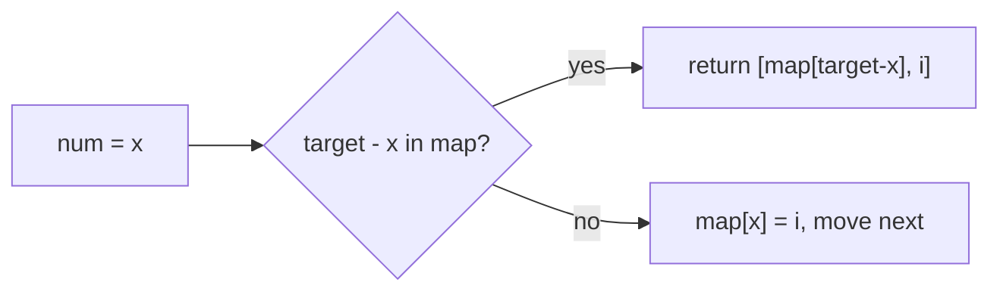

**Steps:**
1. Make empty dict `seen`.
2. Loop with index `i`, value `x`.
3. `need = target - x`. If `need` in `seen` → return `[seen[need], i]`.
4. Else `seen[x] = i`.

**Complexity:** Time O(n), Space O(n).
**Careful:** Do not use same element twice — that is why we check map *before* inserting current number.

---

### Valid Anagram
`LeetCode #242` · Easy

**Problem:** Check if string `t` is an anagram of `s` (same letters, same counts).

**Idea:** Count letters of both. If counts match → anagram.

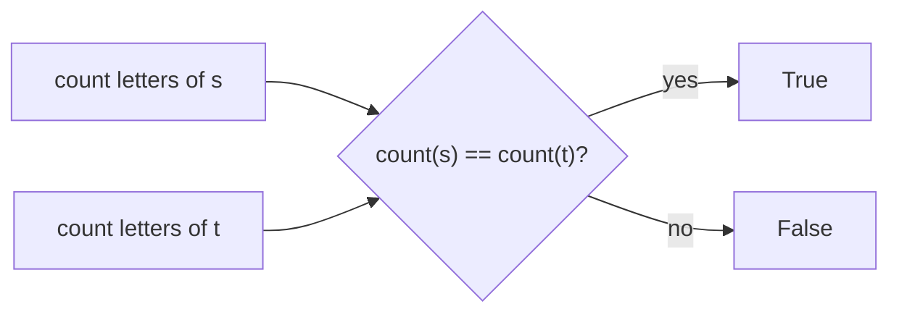

**Steps:**
1. If `len(s) != len(t)` → False.
2. Use `collections.Counter(s) == Counter(t)`.

**Complexity:** Time O(n), Space O(1) (max 26 letters).
**Careful:** Different length means never anagram — check first.

---

### Group Anagrams
`LeetCode #49` · Medium

**Problem:** Group words that are anagrams of each other.

**Idea:** All anagrams give the **same sorted string** (or same letter-count tuple). Use that as a map key.

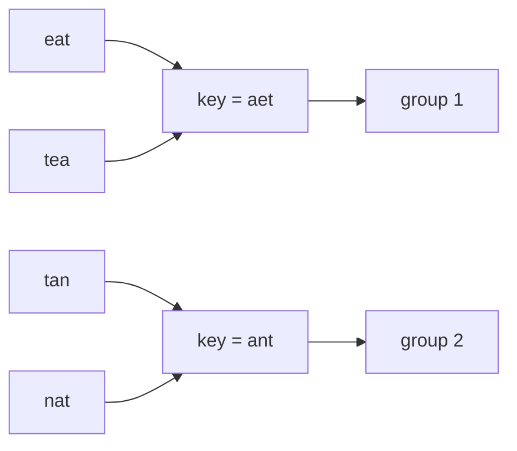

**Steps:**
1. Make `defaultdict(list)`.
2. For each word, key = `''.join(sorted(word))` (or tuple of 26 counts).
3. Append word to `map[key]`.
4. Return `map.values()`.

**Complexity:** Time O(n·k log k) with sorting (k = word length), Space O(n·k).
**Careful:** Using 26-size count tuple as key gives O(n·k) without sort.

---

### Top K Frequent Elements
`LeetCode #347` · Medium

**Problem:** Return the `k` most frequent numbers.

**Idea:** Count frequency, then **bucket sort** by frequency (bucket index = count). Walk buckets from high to low, pick first k.

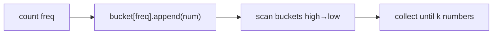

**Steps:**
1. `count = Counter(nums)`.
2. Make `buckets = [[] for _ in range(len(nums)+1)]`.
3. For `num, c` in count → `buckets[c].append(num)`.
4. Loop buckets from end, collect numbers until you have k.

**Complexity:** Time O(n), Space O(n).
**Careful:** Bucket size must be `len(nums)+1` because count can be n.

---

### Product of Array Except Self
`LeetCode #238` · Medium

**Problem:** Return array where `out[i]` = product of all numbers except `nums[i]`. No division allowed.

**Idea:** `out[i]` = (product of everything on left) × (product of everything on right). Do two passes — prefix then suffix.

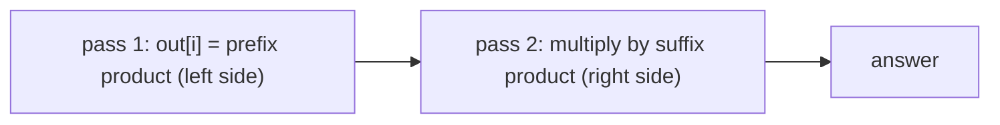

**Steps:**
1. `out = [1]*n`.
2. Left pass: keep `pre=1`; `out[i]=pre; pre*=nums[i]`.
3. Right pass from end: keep `post=1`; `out[i]*=post; post*=nums[i]`.

**Complexity:** Time O(n), Space O(1) extra (output not counted).
**Careful:** Build prefix in output first, then multiply suffix on the fly — no second array needed.

---

### Valid Sudoku
`LeetCode #36` · Medium

**Problem:** Check if a 9×9 board is valid (no repeat in any row, column, or 3×3 box). Empty cells = `.`.

**Idea:** Keep three sets of sets — rows, cols, boxes. Box id = `(r//3, c//3)`. If a digit already in its row/col/box → invalid.

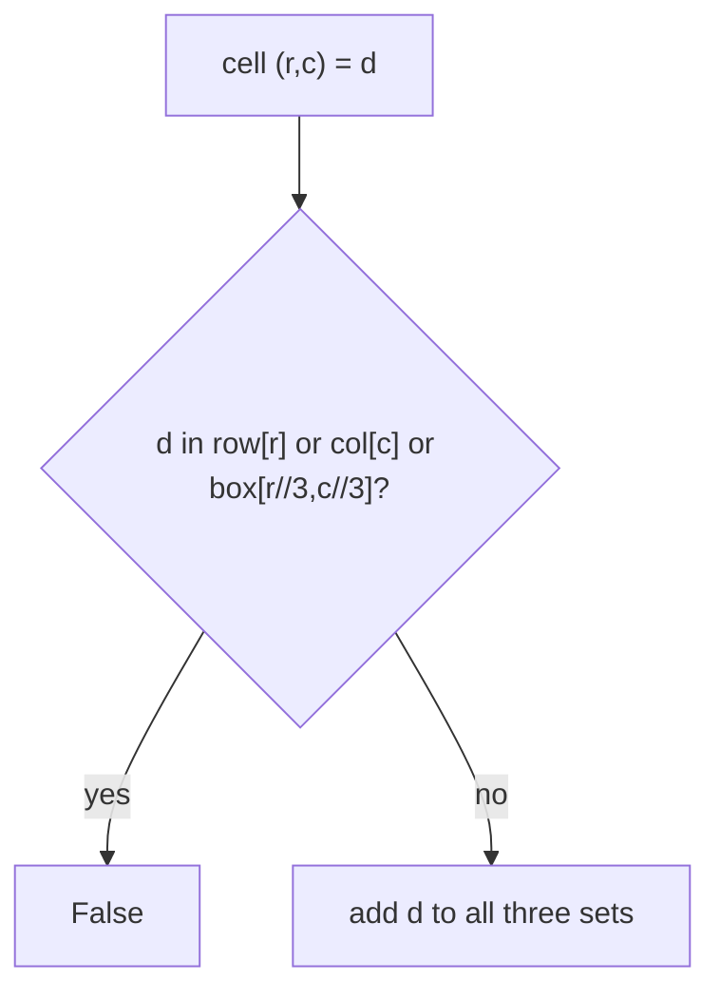

**Steps:**
1. Make `rows`, `cols`, `boxes` as `defaultdict(set)`.
2. Loop each cell; skip `.`.
3. If `d` present in any of three → return False, else add it.
4. End → True.

**Complexity:** Time O(81)=O(1), Space O(1).
**Careful:** Box key must be `(r//3, c//3)`, not `r//3*3+c//3` unless consistent.

---

### Longest Consecutive Sequence
`LeetCode #128` · Medium

**Problem:** Find length of longest run of consecutive integers (order does not matter). Must be O(n).

**Idea:** Put all in a set. A number is a **sequence start** only if `num-1` is NOT in set. From each start, count up `num+1, num+2...`.

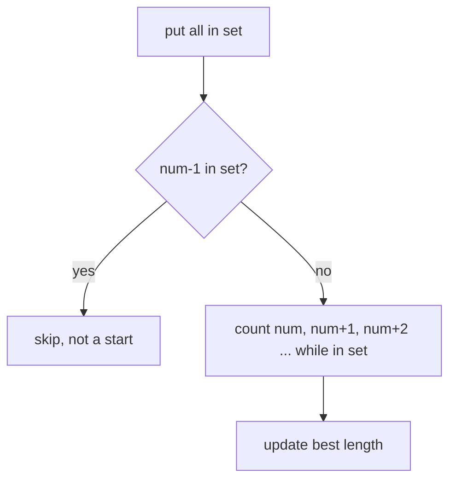

**Steps:**
1. `s = set(nums)`.
2. For each `num` in `s`: if `num-1` not in `s`, it is a start.
3. Walk `length` while `num+length` in `s`.
4. Track max length.

**Complexity:** Time O(n), Space O(n).
**Careful:** Only count from starts — else you re-walk same sequence and it becomes O(n²).

---

### Contains Duplicate (Duplicate Integer)
`LeetCode #217` · Easy

**Problem:** Return True if any value appears at least twice.

**Idea:** Set remembers seen values. If a value is already in set → duplicate.

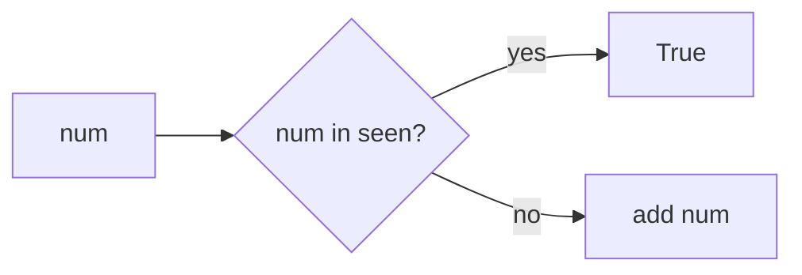

**Steps:**
1. `seen = set()`.
2. For each num: if in seen → True, else add.
3. End → False. (Shortcut: `len(set(nums)) != len(nums)`.)

**Complexity:** Time O(n), Space O(n).
**Careful:** Easy one-liner exists but the set loop shows the idea.

---

### Subarray Sum Equals K
`LeetCode #560` · Medium

**Problem:** Count how many contiguous subarrays sum exactly to `k`.

**Idea:** Running **prefix sum**. A subarray `(j, i]` sums to k when `prefix[i] - prefix[j] = k`, i.e. `prefix[j] = prefix[i] - k`. Keep a map of how many times each prefix sum seen.

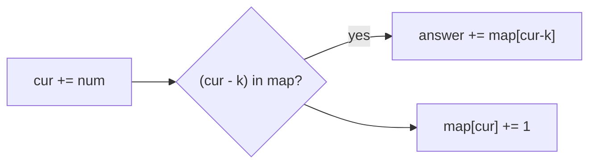

**Steps:**
1. `seen = {0: 1}` (empty prefix), `cur = 0`, `ans = 0`.
2. For each num: `cur += num`; add `seen.get(cur-k, 0)` to ans.
3. `seen[cur] += 1`.

**Complexity:** Time O(n), Space O(n).
**Careful:** Seed map with `{0:1}` so subarrays starting at index 0 are counted.

---

### Contiguous Array
`LeetCode #525` · Medium

**Problem:** Longest subarray with equal number of 0s and 1s.

**Idea:** Treat 0 as `-1`, 1 as `+1`. Then equal 0s and 1s means a subarray with **sum 0**. Same prefix sum seen twice → the piece between them sums to 0. Store first index of each prefix sum.

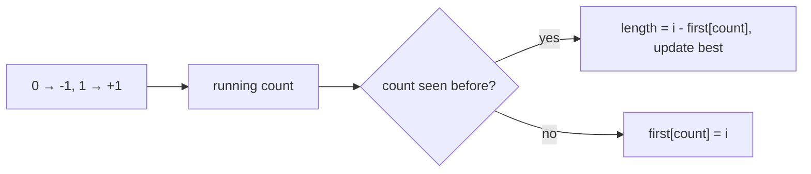

**Steps:**
1. `first = {0: -1}`, `count = 0`, `best = 0`.
2. For index i: `count += 1 if num else -1`.
3. If count in first → `best = max(best, i - first[count])`; else `first[count] = i`.

**Complexity:** Time O(n), Space O(n).
**Careful:** Store only the **first** index of a prefix value (gives longest span).

---

### Subarray Sums Divisible by K
`LeetCode #974` · Medium

**Problem:** Count contiguous subarrays whose sum is divisible by `k`.

**Idea:** Two prefix sums with the **same remainder mod k** → the piece between them is divisible by k. Count remainders. Handle negative numbers with `((cur % k) + k) % k`.

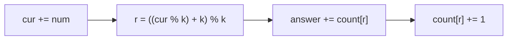

**Steps:**
1. `count = {0: 1}`, `cur = 0`, `ans = 0`.
2. For each num: `cur += num`; `r = ((cur % k)+k) % k`.
3. `ans += count.get(r, 0)`; `count[r] += 1`.

**Complexity:** Time O(n), Space O(k).
**Careful:** Python `%` already returns non-negative, but the `((x%k)+k)%k` form is safe in any language.

---

## 2. Two Pointers

Main idea: use two indices (often one at each end, or slow/fast) moving toward each other. Turns O(n²) scans into O(n) on **sorted** or symmetric data.

### Valid Palindrome
`LeetCode #125` · Easy

**Problem:** Check if string is palindrome, considering only letters/digits, ignoring case.

**Idea:** One pointer at start `l`, one at end `r`. Skip non-alphanumeric. Compare lower-cased chars. Move inward.

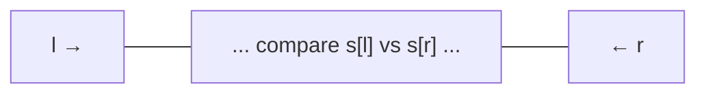

**Steps:**
1. `l=0, r=len-1`.
2. While `l<r`: skip if `s[l]` not alnum (l++), skip if `s[r]` not alnum (r--).
3. If `s[l].lower() != s[r].lower()` → False.
4. Else `l++, r--`. End → True.

**Complexity:** Time O(n), Space O(1).
**Careful:** Keep skipping non-alnum inside while loops, not just one skip.

---

### Two Sum II (Sorted Input)
`LeetCode #167` · Medium

**Problem:** Sorted array, find two numbers adding to target. Return 1-based indices.

**Idea:** Because sorted, use two ends. If sum too big → move right pointer left. If too small → move left pointer right.

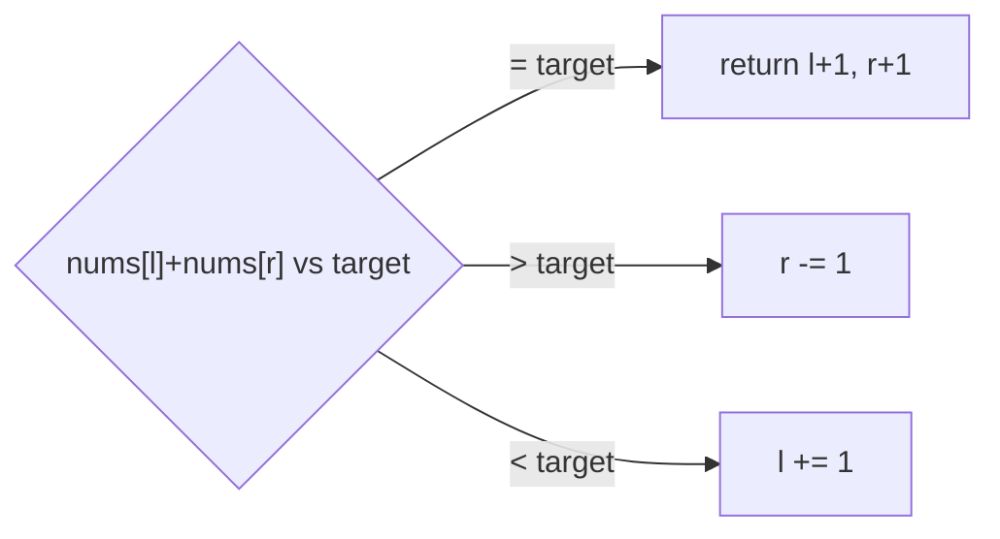

**Steps:**
1. `l=0, r=n-1`.
2. `s = nums[l]+nums[r]`.
3. If `s==target` return `[l+1, r+1]`; if `s>target` r--; else l++.

**Complexity:** Time O(n), Space O(1).
**Careful:** Works only because array is sorted.

---

### 3Sum
`LeetCode #15` · Medium

**Problem:** Find all unique triplets that sum to 0.

**Idea:** Sort first. Fix one number `nums[i]`, then two-pointer on the rest for `-nums[i]`. Skip duplicates to keep triplets unique.

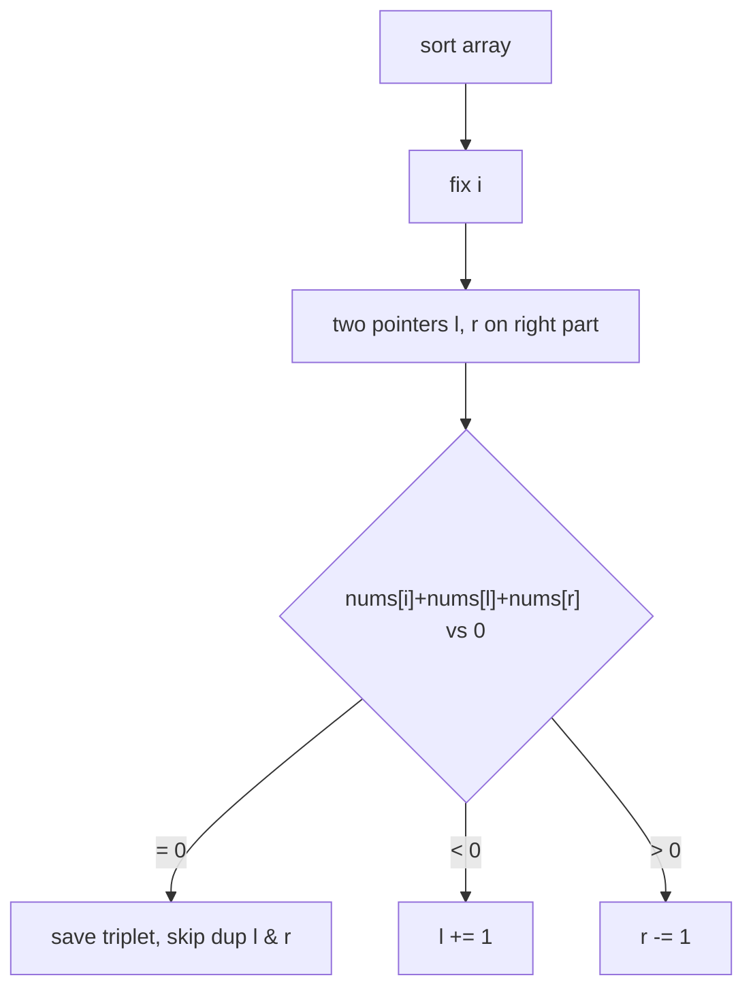

**Steps:**
1. Sort. Loop `i`; if `nums[i]>0` break; skip if `nums[i]==nums[i-1]`.
2. Two pointers `l=i+1, r=n-1`.
3. On sum 0: record, move l & r, skip duplicate values.
4. Adjust l/r by sum sign.

**Complexity:** Time O(n²), Space O(1) (ignoring output).
**Careful:** Duplicate skipping at both the fixed index and the two pointers.

---

### Container With Most Water
`LeetCode #11` · Medium

**Problem:** Heights array; pick two lines forming most water. Area = width × min(height).

**Idea:** Two ends. Area limited by the **shorter** wall. Move the shorter wall inward (moving taller never helps).

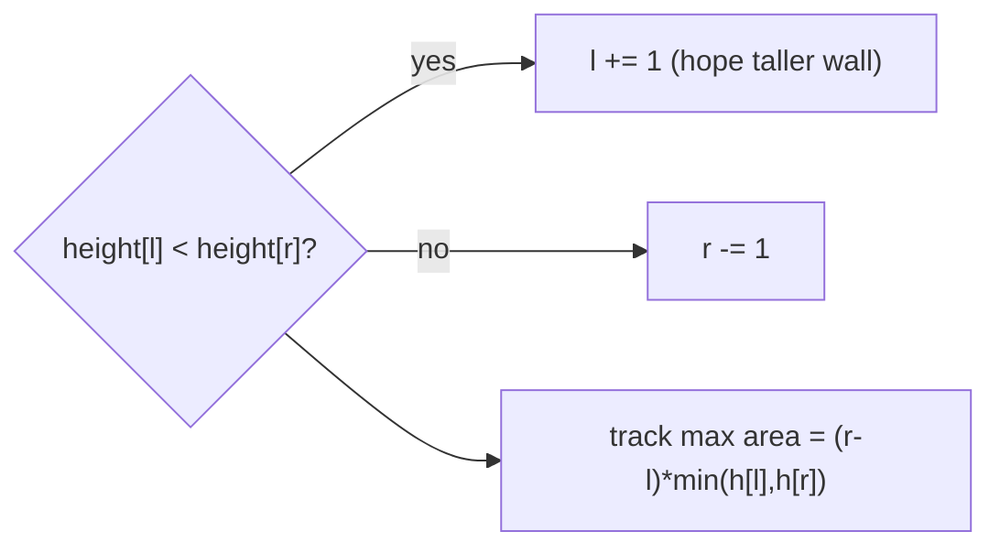

**Steps:**
1. `l=0, r=n-1, best=0`.
2. `area = (r-l) * min(h[l], h[r])`; update best.
3. Move pointer at smaller height inward.

**Complexity:** Time O(n), Space O(1).
**Careful:** Always move the shorter side — moving taller cannot increase min height.

---

### Trapping Rain Water
`LeetCode #42` · Hard

**Problem:** Heights array; compute water trapped after rain.

**Idea:** Water above a bar = `min(maxLeft, maxRight) - height`. Two pointers carry `leftMax` and `rightMax`. Process the side with smaller max — that side's answer is fixed by its own max.

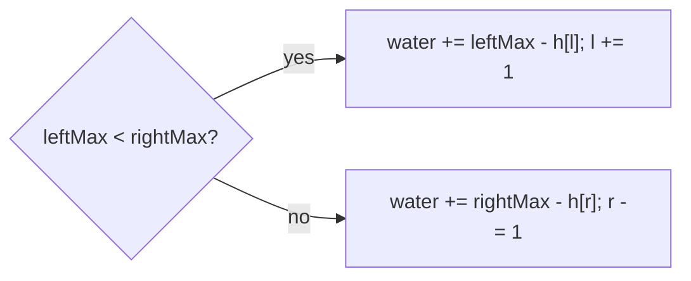

**Steps:**
1. `l=0, r=n-1, leftMax=rightMax=0, water=0`.
2. If `h[l] < h[r]`: update `leftMax`; add `leftMax - h[l]`; l++.
3. Else: update `rightMax`; add `rightMax - h[r]`; r--.

**Complexity:** Time O(n), Space O(1).
**Careful:** Update the max *before* adding water, so you never add negative.

---

## 3. Sliding Window

Main idea: a window `[left, right]` over the array/string. Grow `right` to include, shrink `left` when a rule breaks. Each element enters and leaves once → O(n).

### Best Time to Buy and Sell Stock
`LeetCode #121` · Easy

**Problem:** One buy and one sell (buy before sell). Max profit.

**Idea:** Keep lowest price seen so far (`buy`). At each day, profit = `price - buy`. Track max profit.

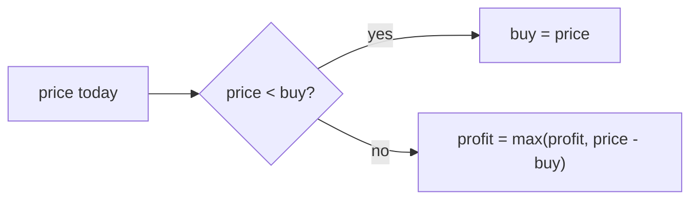

**Steps:**
1. `buy = prices[0]`, `profit = 0`.
2. For each price: if `price < buy` → `buy = price`; else `profit = max(profit, price - buy)`.

**Complexity:** Time O(n), Space O(1).
**Careful:** Window = (lowest-so-far, today). Never sell before buy.

---

### Longest Substring Without Repeating Characters
`LeetCode #3` · Medium

**Problem:** Length of longest substring with all unique characters.

**Idea:** Window of unique chars in a set. If new char repeats, shrink from left until it is unique again.

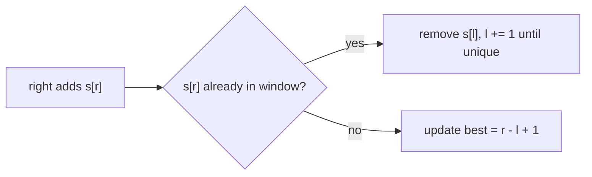

**Steps:**
1. `seen = set()`, `l = 0`, `best = 0`.
2. For `r`: while `s[r]` in seen → remove `s[l]`, l++.
3. Add `s[r]`; `best = max(best, r-l+1)`.

**Complexity:** Time O(n), Space O(min(n, charset)).
**Careful:** Shrink in a while loop, not a single step.

---

### Longest Repeating Character Replacement
`LeetCode #424` · Medium

**Problem:** You may change up to `k` characters. Find longest substring of one repeated letter possible.

**Idea:** Window is valid if `window_length - count_of_most_frequent_char <= k` (the rest can be replaced). Grow right; if invalid, shrink left.

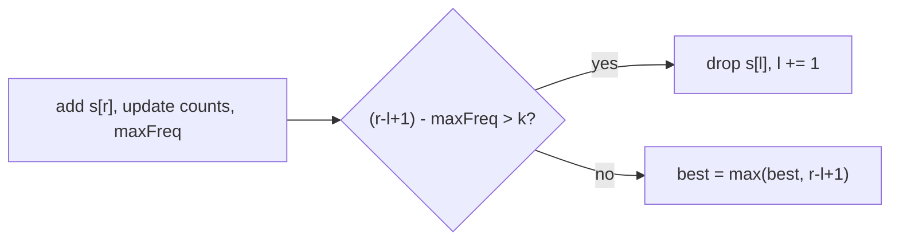

**Steps:**
1. `count = {}`, `l=0`, `maxFreq=0`, `best=0`.
2. For `r`: `count[s[r]]++`; `maxFreq = max(maxFreq, count[s[r]])`.
3. While `(r-l+1) - maxFreq > k`: `count[s[l]]--`, l++.
4. `best = max(best, r-l+1)`.

**Complexity:** Time O(n), Space O(26).
**Careful:** We never need to lower `maxFreq`; window only slides, keeping answer correct.

---

### Permutation in String
`LeetCode #567` · Medium

**Problem:** Does `s2` contain any permutation of `s1` as a substring?

**Idea:** Fixed window of size `len(s1)`. Keep letter counts. Slide window; if window count == s1 count → found.

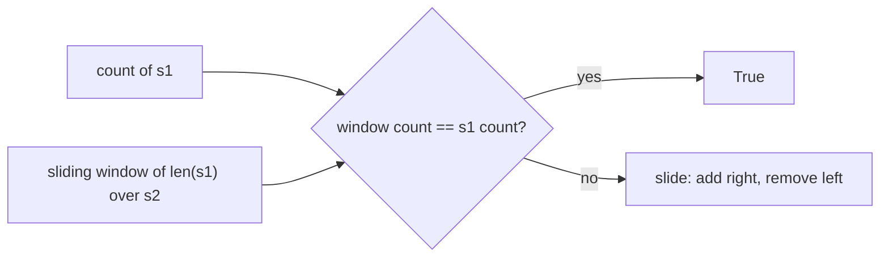

**Steps:**
1. If `len(s1) > len(s2)` → False.
2. Build `need = Counter(s1)` and first window counter.
3. Slide: add `s2[r]`, remove `s2[r-len(s1)]`; compare counters.

**Complexity:** Time O(n), Space O(26).
**Careful:** Comparing two 26-size arrays is O(26)=O(1), so overall O(n).

---

### Minimum Window Substring
`LeetCode #76` · Hard

**Problem:** Smallest substring of `s` that contains all characters of `t` (with counts).

**Idea:** Grow right until window has all needed chars (`have == need`). Then shrink left to make it smallest, recording best. Count distinct satisfied chars with `have`/`need`.

```mermaid
flowchart LR
    A["expand right, update have"] --> B{"have == need?"}
    B -- "yes" --> C["record if smaller, shrink left"]
    C --> B
    B -- "no" --> A
```

**Steps:**
1. `need = Counter(t)`, `needCount = len(need)`, `have = 0`, `window = {}`.
2. Expand `r`: add char; if its count == need's count → `have++`.
3. While `have == needCount`: update best `(r-l+1)`; remove `s[l]`; if drops below need → `have--`; l++.

**Complexity:** Time O(n), Space O(charset).
**Careful:** Only bump `have` when a char's window count *reaches exactly* the needed count.

---

### Sliding Window Maximum
`LeetCode #239` · Hard

**Problem:** For each window of size `k`, return the max.

**Idea:** **Monotonic decreasing deque** of indices. Front always holds current max. Pop smaller values from back before adding new; pop front if it slid out of window.

```mermaid
flowchart LR
    A["new i"] --> B["pop back while nums[back] <= nums[i]"]
    B --> C["append i"]
    C --> D["pop front if front <= i-k"]
    D --> E["front = max of window"]
```

**Steps:**
1. `dq = deque()`, `res = []`.
2. For i: pop back while `nums[dq[-1]] <= nums[i]`; append i.
3. If `dq[0] <= i-k` → popleft.
4. If `i >= k-1` → `res.append(nums[dq[0]])`.

**Complexity:** Time O(n), Space O(k).
**Careful:** Store **indices** (not values) so you can detect when they leave the window.

---

### Maximum Average Subarray I
`LeetCode #643` · Easy

**Problem:** Find the contiguous subarray of fixed length `k` with the max average.

**Idea:** Fixed-size window sum. Compute first window sum, then slide: add new, remove old. Max sum / k = max average.

```mermaid
flowchart LR
    A["sum of first k"] --> B["slide: sum += nums[r] - nums[r-k]"]
    B --> C["best = max(best, sum)"]
    C --> D["answer = best / k"]
```

**Steps:**
1. `cur = sum(nums[:k])`, `best = cur`.
2. For `r` from k to n-1: `cur += nums[r] - nums[r-k]`; `best = max(best, cur)`.
3. Return `best / k`.

**Complexity:** Time O(n), Space O(1).
**Careful:** Keep sum as integer, divide only at the end for precision.

---

## 4. Stack

Main idea: Last-In-First-Out. Great for matching pairs, "next greater" problems (monotonic stack), and evaluating expressions.

### Valid Parentheses
`LeetCode #20` · Easy

**Problem:** Check if brackets `()[]{}` are balanced and correctly nested.

**Idea:** Push opening brackets. On a closing bracket, top of stack must be its matching opener.

```mermaid
flowchart LR
    A{"char"} -- "opener" --> B["push"]
    A -- "closer" --> C{"stack top matches?"}
    C -- "no / empty" --> D["False"]
    C -- "yes" --> E["pop"]
```

**Steps:**
1. `pairs = {')':'(', ']':'[', '}':'{'}`, `stack=[]`.
2. Opener → push. Closer → if stack empty or `stack.pop() != pairs[c]` → False.
3. End → `len(stack)==0`.

**Complexity:** Time O(n), Space O(n).
**Careful:** Stack must be empty at the end (handles `"(("`).

---

### Min Stack
`LeetCode #155` · Medium

**Problem:** Stack with push/pop/top and `getMin` all in O(1).

**Idea:** Keep a second stack of running minimums. On push, store `min(x, current_min)`.

```mermaid
flowchart LR
    A["push x"] --> B["mainStack.append(x)"]
    A --> C["minStack.append(min(x, minStack top))"]
    D["getMin"] --> E["return minStack top"]
```

**Steps:**
1. Two lists: `stack`, `mins`.
2. push: `stack.append(x)`; `mins.append(min(x, mins[-1] if mins else x))`.
3. pop: pop both. top: `stack[-1]`. getMin: `mins[-1]`.

**Complexity:** All O(1), Space O(n).
**Careful:** Push to both stacks together, pop from both together.

---

### Evaluate Reverse Polish Notation
`LeetCode #150` · Medium

**Problem:** Evaluate postfix expression (operator comes after its two operands).

**Idea:** Push numbers. On an operator, pop two numbers, apply, push result back.

```mermaid
flowchart LR
    A{"token"} -- "number" --> B["push"]
    A -- "operator" --> C["b=pop, a=pop → push a op b"]
    C --> D["final stack top = answer"]
```

**Steps:**
1. Stack = []. For each token:
2. If operator: `b=pop; a=pop`; push `a op b` (use `int(a/b)` for division toward zero).
3. Else push `int(token)`.

**Complexity:** Time O(n), Space O(n).
**Careful:** Order matters — second popped is left operand. Division truncates toward zero.

---

### Generate Parentheses
`LeetCode #22` · Medium

**Problem:** Generate all valid combinations of `n` pairs of parentheses.

**Idea:** Backtracking with a counter. Add `(` while `open < n`. Add `)` while `close < open`. (Uses a stack/recursion.)

```mermaid
flowchart TD
    A["state (open, close)"] --> B{"open < n?"}
    B -- "yes" --> C["add '(' → recurse"]
    A --> D{"close < open?"}
    D -- "yes" --> E["add ')' → recurse"]
    A --> F{"len == 2n?"}
    F -- "yes" --> G["save string"]
```

**Steps:**
1. Recurse with `(cur, open, close)`.
2. If `len(cur)==2n` → save.
3. If `open<n` → recurse adding `(`.
4. If `close<open` → recurse adding `)`.

**Complexity:** Time ~O(4ⁿ/√n) (Catalan), Space O(n) recursion.
**Careful:** `close < open` keeps it valid — never close more than opened.

---

### Daily Temperatures
`LeetCode #739` · Medium

**Problem:** For each day, how many days until a warmer temperature? 0 if none.

**Idea:** **Monotonic decreasing stack** of indices. When today is warmer than stack top, that top's answer = `today - topIndex`.

```mermaid
flowchart LR
    A["day i"] --> B{"temp[i] > temp[stack top]?"}
    B -- "yes" --> C["j=pop; ans[j]=i-j; repeat"]
    B -- "no" --> D["push i"]
```

**Steps:**
1. `ans = [0]*n`, `stack=[]` (indices).
2. For i: while stack and `temp[i] > temp[stack[-1]]` → `j=stack.pop(); ans[j]=i-j`.
3. Push i.

**Complexity:** Time O(n), Space O(n).
**Careful:** Store indices to compute the day gap.

---

### Car Fleet
`LeetCode #853` · Medium

**Problem:** Cars on a road to `target`. A faster car behind a slower one forms a fleet (cannot pass). Count fleets.

**Idea:** Sort cars by position (closest to target first). Time to reach = `(target-pos)/speed`. Using a stack: if a car's time ≤ the fleet ahead's time, it joins that fleet; else it starts a new fleet.

```mermaid
flowchart LR
    A["sort by position desc"] --> B["time = (target-pos)/speed"]
    B --> C{"time > stack top time?"}
    C -- "yes" --> D["new fleet: push time"]
    C -- "no" --> E["joins fleet ahead"]
```

**Steps:**
1. Pair `(pos, speed)`, sort by pos descending.
2. For each: `t = (target-pos)/speed`.
3. If stack empty or `t > stack[-1]` → push t (new fleet).
4. Answer = `len(stack)`.

**Complexity:** Time O(n log n), Space O(n).
**Careful:** Sort by position toward target; strictly greater time = separate fleet.

---

### Largest Rectangle in Histogram
`LeetCode #84` · Hard

**Problem:** Bars of given heights; find largest rectangle area.

**Idea:** **Monotonic increasing stack** of `(start_index, height)`. When a shorter bar comes, pop taller bars and compute area using popped height × width back to its start.

```mermaid
flowchart LR
    A["bar i, height h"] --> B{"h < stack top height?"}
    B -- "yes" --> C["pop (start,ht); area=ht*(i-start); start of i moves back"]
    C --> B
    B -- "no" --> D["push (start, h)"]
    D --> E["after loop: flush stack with width=n-start"]
```

**Steps:**
1. `stack=[]`, `best=0`.
2. For `i,h`: `start=i`; while stack and `stack[-1].h > h`: pop `(s,ht)`; `best=max(best, ht*(i-s))`; `start=s`.
3. Push `(start, h)`.
4. After: for leftover `(s,ht)` → `best=max(best, ht*(n-s))`.

**Complexity:** Time O(n), Space O(n).
**Careful:** When you pop, the new bar extends back to the popped bar's start index.

---

### Next Greater Element I
`LeetCode #496` · Easy

**Problem:** For each value in `nums1` (a subset of `nums2`), find its next greater element in `nums2`, else -1.

**Idea:** Precompute next-greater for every value in `nums2` with a monotonic stack, store in a map, then just look up for `nums1`.

```mermaid
flowchart LR
    A["scan nums2"] --> B{"cur > stack top?"}
    B -- "yes" --> C["pop; map[popped]=cur"]
    C --> B
    B -- "no" --> D["push cur"]
    E["nums1[i]"] --> F["answer = map.get(val, -1)"]
```

**Steps:**
1. `nxt={}`, `stack=[]`.
2. For x in nums2: while stack and `x>stack[-1]` → `nxt[stack.pop()]=x`; push x.
3. Answer = `[nxt.get(v,-1) for v in nums1]`.

**Complexity:** Time O(n+m), Space O(n).
**Careful:** Values are unique, so using value as map key is safe.

---

## 5. Binary Search

Main idea: on a **sorted** space (array, or answer range) halve the search each step → O(log n). Also used as "binary search on the answer".

### Binary Search
`LeetCode #704` · Easy

**Problem:** Find target index in sorted array, else -1.

**Idea:** Compare middle with target; drop the half that cannot contain it.

```mermaid
flowchart LR
    A{"nums[mid] vs target"} -- "= " --> B["return mid"]
    A -- "< " --> C["l = mid+1"]
    A -- "> " --> D["r = mid-1"]
```

**Steps:**
1. `l=0, r=n-1`.
2. While `l<=r`: `mid=(l+r)//2`.
3. Equal → return mid; less → `l=mid+1`; greater → `r=mid-1`.
4. Return -1.

**Complexity:** Time O(log n), Space O(1).
**Careful:** Use `l<=r` and `mid±1` to avoid infinite loop.

---

### Search Insert Position
`LeetCode #35` · Easy

**Problem:** Return index of target, or where it should be inserted to keep sorted.

**Idea:** Same binary search; when not found, `l` ends at the correct insert spot.

```mermaid
flowchart LR
    A["standard binary search"] --> B{"found?"}
    B -- "yes" --> C["return mid"]
    B -- "no" --> D["return l (insert point)"]
```

**Steps:**
1. `l=0, r=n-1`.
2. Standard search; if found return mid.
3. On exit return `l`.

**Complexity:** Time O(log n), Space O(1).
**Careful:** After loop, `l` is first index with value ≥ target.

---

### Search a 2D Matrix
`LeetCode #74` · Medium

**Problem:** Matrix where each row sorted and first of each row > last of previous. Find target.

**Idea:** Treat the whole matrix as one sorted array of size `rows*cols`. Convert mid index to `(mid//cols, mid%cols)`.

```mermaid
flowchart LR
    A["lo=0, hi=rows*cols-1"] --> B["mid → (mid//cols, mid%cols)"]
    B --> C{"value vs target"}
    C -- "<" --> D["lo=mid+1"]
    C -- ">" --> E["hi=mid-1"]
    C -- "=" --> F["found"]
```

**Steps:**
1. `lo=0, hi=rows*cols-1`.
2. `mid`; `val = matrix[mid//cols][mid%cols]`.
3. Compare, shrink half.

**Complexity:** Time O(log(m·n)), Space O(1).
**Careful:** Row = `mid//cols`, Col = `mid%cols` (use column count).

---

### Koko Eating Bananas
`LeetCode #875` · Medium

**Problem:** Piles of bananas, `h` hours. Find smallest eating speed `k` to finish in time. (Binary search on the answer.)

**Idea:** Speed range is `1..max(pile)`. For a speed, hours needed = `sum(ceil(pile/k))`. Smaller speed = more hours. Binary search the smallest speed that fits in `h`.

```mermaid
flowchart LR
    A["lo=1, hi=max(piles)"] --> B["hours = sum(ceil(p/mid))"]
    B --> C{"hours <= h?"}
    C -- "yes" --> D["answer=mid; hi=mid-1 (try slower)"]
    C -- "no" --> E["lo=mid+1 (need faster)"]
```

**Steps:**
1. `lo=1, hi=max(piles)`.
2. `mid`; `hours = sum((p+mid-1)//mid for p in piles)`.
3. If `hours<=h` → record mid, `hi=mid-1`; else `lo=mid+1`.

**Complexity:** Time O(n log maxPile), Space O(1).
**Careful:** `ceil(p/k)` = `(p+k-1)//k` in integer math.

---

### Find Minimum in Rotated Sorted Array
`LeetCode #153` · Medium

**Problem:** Sorted array rotated at some pivot; find the minimum. O(log n).

**Idea:** If `nums[mid] > nums[right]`, the min is to the **right** of mid. Else it is at mid or left. Narrow until `l==r`.

```mermaid
flowchart LR
    A{"nums[mid] > nums[r]?"} -- "yes" --> B["l = mid+1 (min in right part)"]
    A -- "no" --> C["r = mid (min in left part incl mid)"]
```

**Steps:**
1. `l=0, r=n-1`.
2. While `l<r`: `mid=(l+r)//2`.
3. If `nums[mid] > nums[r]` → `l=mid+1`; else `r=mid`.
4. Return `nums[l]`.

**Complexity:** Time O(log n), Space O(1).
**Careful:** Compare mid with **right** end, and use `r=mid` (not mid-1).

---

### Search in Rotated Sorted Array
`LeetCode #33` · Medium

**Problem:** Rotated sorted array; find target index, else -1. O(log n).

**Idea:** One half (left or right of mid) is always sorted. Check if target lies in the sorted half; go there, else the other half.

```mermaid
flowchart TD
    A["mid"] --> B{"left half sorted? nums[l]<=nums[mid]"}
    B -- "yes" --> C{"target in [nums[l], nums[mid])?"}
    C -- "yes" --> D["r=mid-1"]
    C -- "no" --> E["l=mid+1"]
    B -- "no (right sorted)" --> F{"target in (nums[mid], nums[r]]?"}
    F -- "yes" --> G["l=mid+1"]
    F -- "no" --> H["r=mid-1"]
```

**Steps:**
1. Standard loop; if `nums[mid]==target` return mid.
2. If left sorted (`nums[l]<=nums[mid]`): if target in that range → `r=mid-1`, else `l=mid+1`.
3. Else right sorted: if target in that range → `l=mid+1`, else `r=mid-1`.

**Complexity:** Time O(log n), Space O(1).
**Careful:** Use `<=` when checking which half is sorted (handles equal mid/left).

---

### Capacity to Ship Packages Within D Days
`LeetCode #1011` · Medium

**Problem:** Ship weights in order within `days` days. Find smallest ship capacity. (Binary search on answer.)

**Idea:** Capacity range = `max(weights)` to `sum(weights)`. For a capacity, greedily count days needed. Smaller capacity → more days. Find smallest capacity fitting in `days`.

```mermaid
flowchart LR
    A["lo=max(w), hi=sum(w)"] --> B["simulate days at capacity mid"]
    B --> C{"needed <= days?"}
    C -- "yes" --> D["answer=mid; hi=mid-1"]
    C -- "no" --> E["lo=mid+1"]
```

**Steps:**
1. `lo=max(weights), hi=sum(weights)`.
2. For `mid`: walk weights, start new day when load exceeds mid; count days.
3. If `days_needed<=days` → record, `hi=mid-1`; else `lo=mid+1`.

**Complexity:** Time O(n log(sum)), Space O(1).
**Careful:** `lo` must start at `max(weights)` — a single package needs at least its own weight.

---

### Median of Two Sorted Arrays
`LeetCode #4` · Hard

**Problem:** Median of two sorted arrays combined, in O(log(min(m,n))).

**Idea:** Binary search a **partition** of the smaller array. Pick cut so left side has half the total elements and `maxLeft <= minRight` on both sides.

```mermaid
flowchart TD
    A["binary search cut i in small array A"] --> B["cut j = half - i in B"]
    B --> C{"Aleft<=Bright AND Bleft<=Aright?"}
    C -- "yes" --> D["median from boundary values"]
    C -- "Aleft too big" --> E["move i left"]
    C -- "Bleft too big" --> F["move i right"]
```

**Steps:**
1. Ensure A is the shorter array. `half=(m+n+1)//2`.
2. Binary search `i` in `0..m`; `j=half-i`.
3. Use ±inf for out-of-range edges. Check `A[i-1]<=B[j]` and `B[j-1]<=A[i]`.
4. Odd total → max of lefts; even → avg of max-left and min-right.

**Complexity:** Time O(log(min(m,n))), Space O(1).
**Careful:** Use infinities for edges so boundary cuts (i=0 or i=m) still work.

---

## 6. Linked List

Main idea: nodes linked by `next`. Common tricks: dummy head, slow/fast pointers, reversing by relinking. Draw arrows on paper!

### Reverse Linked List
`LeetCode #206` · Easy

**Problem:** Reverse a singly linked list.

**Idea:** Walk the list, flipping each node's `next` to point backward. Keep `prev`.

```mermaid
flowchart LR
    P["prev"] -. "cur.next = prev" .- C["cur"] --> N["nxt"]
```

**Steps:**
1. `prev=None, cur=head`.
2. While cur: `nxt=cur.next`; `cur.next=prev`; `prev=cur`; `cur=nxt`.
3. Return `prev`.

**Complexity:** Time O(n), Space O(1).
**Careful:** Save `cur.next` before overwriting it.

---

### Merge Two Sorted Lists
`LeetCode #21` · Easy

**Problem:** Merge two sorted lists into one sorted list.

**Idea:** Dummy head. Compare front nodes, attach smaller, advance. Attach leftover tail.

```mermaid
flowchart LR
    A["dummy"] --> B["pick smaller of l1,l2"]
    B --> C["tail.next = picked; advance that list"]
    C --> D["append remaining list"]
```

**Steps:**
1. `dummy=Node(); tail=dummy`.
2. While both: attach smaller, advance it, advance tail.
3. `tail.next = l1 or l2`.
4. Return `dummy.next`.

**Complexity:** Time O(n+m), Space O(1).
**Careful:** Dummy node avoids special-casing the head.

---

### Middle of the Linked List
`LeetCode #876` · Easy

**Problem:** Return the middle node (second middle if even length).

**Idea:** Slow/fast pointers. Fast moves 2, slow moves 1. When fast reaches end, slow is at middle.

```mermaid
flowchart LR
    S["slow +1"] --- F["fast +2"] --> E["fast at end → slow = middle"]
```

**Steps:**
1. `slow=fast=head`.
2. While `fast and fast.next`: `slow=slow.next; fast=fast.next.next`.
3. Return slow.

**Complexity:** Time O(n), Space O(1).
**Careful:** Loop condition `fast and fast.next` gives the second middle on even length.

---

### Linked List Cycle
`LeetCode #141` · Easy

**Problem:** Detect if the list has a cycle.

**Idea:** Floyd's slow/fast. If they ever meet, there is a cycle; if fast hits None, no cycle.

```mermaid
flowchart LR
    A["slow +1, fast +2"] --> B{"slow == fast?"}
    B -- "yes" --> C["cycle!"]
    B -- "fast hits None" --> D["no cycle"]
```

**Steps:**
1. `slow=fast=head`.
2. While `fast and fast.next`: advance; if `slow==fast` → True.
3. Return False.

**Complexity:** Time O(n), Space O(1).
**Careful:** Fast must check `fast and fast.next` before moving two steps.

---

### Remove Nth Node From End of List
`LeetCode #19` · Medium

**Problem:** Remove the n-th node counting from the end.

**Idea:** Two pointers with a dummy. Move `fast` ahead by `n`. Then move both until fast hits end; `slow` stops just before the target.

```mermaid
flowchart LR
    A["dummy → head"] --> B["fast ahead by n steps"]
    B --> C["move slow & fast together to end"]
    C --> D["slow.next = slow.next.next"]
```

**Steps:**
1. `dummy=Node(0,head); slow=fast=dummy`.
2. Advance fast `n+1` steps.
3. Move both until `fast is None`.
4. `slow.next = slow.next.next`. Return `dummy.next`.

**Complexity:** Time O(n), Space O(1).
**Careful:** Dummy handles removing the real head cleanly.

---

### Reorder List
`LeetCode #143` · Medium

**Problem:** Reorder `L0→L1→…→Ln` into `L0→Ln→L1→Ln-1→…`.

**Idea:** 1) find middle, 2) reverse second half, 3) merge the two halves alternately.

```mermaid
flowchart LR
    A["find middle (slow/fast)"] --> B["reverse 2nd half"]
    B --> C["merge: first, last, first.next, ..."]
```

**Steps:**
1. Slow/fast to find middle; split.
2. Reverse second half.
3. Weave: alternately link node from first and second half.

**Complexity:** Time O(n), Space O(1).
**Careful:** Cut the first half's tail (`slow.next=None`) before reversing.

---

### Find the Duplicate Number
`LeetCode #287` · Medium

**Problem:** Array of `n+1` numbers in `1..n`; exactly one repeats. Find it, no extra space, no modify.

**Idea:** Treat values as "next index" → a linked list with a cycle. The cycle entrance is the duplicate. Use Floyd's cycle finding.

```mermaid
flowchart LR
    A["phase 1: slow=f(slow), fast=f(f(fast)) till meet"] --> B["phase 2: slow2 from start"]
    B --> C["move slow & slow2 by 1 till meet = duplicate"]
```

**Steps:**
1. `slow=fast=nums[0]`; move slow=`nums[slow]`, fast=`nums[nums[fast]]` until equal.
2. `slow2=0`; move slow and slow2 one step until equal.
3. Return meeting value.

**Complexity:** Time O(n), Space O(1).
**Careful:** This is the cycle-entrance variant of Floyd's, not the meeting point.

---

### Merge k Sorted Lists
`LeetCode #23` · Hard

**Problem:** Merge `k` sorted lists into one.

**Idea:** Pair up lists and merge two at a time (divide and conquer). log k rounds.

```mermaid
flowchart TD
    A["l1 l2 l3 l4 l5 l6"] --> B["merge pairs → l12 l34 l56"]
    B --> C["merge pairs → l1234 l56"]
    C --> D["merge → final"]
```

**Steps:**
1. While more than one list: merge lists in pairs using the "merge two lists" helper.
2. Replace the list array with merged results.
3. Return the single remaining list. (Alternative: min-heap of heads.)

**Complexity:** Time O(N log k), Space O(1) with pairwise merge.
**Careful:** Pairwise merge gives log k passes; naive sequential merge is O(Nk).

---

### Reverse Nodes in k-Group
`LeetCode #25` · Hard

**Problem:** Reverse every group of `k` nodes. Leftover tail (<k) stays as is.

**Idea:** Check `k` nodes exist ahead; if yes, reverse that block and connect to previous group; recurse/iterate on the rest.

```mermaid
flowchart LR
    A["count k ahead"] --> B{"k nodes exist?"}
    B -- "no" --> C["leave as is"]
    B -- "yes" --> D["reverse this block"]
    D --> E["link prev group tail → new head; continue"]
```

**Steps:**
1. From `groupPrev`, find `kth` node; if none left, stop.
2. Reverse nodes between groupPrev and kth.
3. Reconnect pointers; move groupPrev to the new group tail.

**Complexity:** Time O(n), Space O(1).
**Careful:** Only reverse when a full group of k remains.

---

## 7. Trees

Main idea: recursion is your friend. Most tree problems = "do something at a node, combine results of left and right subtree". DFS (recursion) or BFS (queue by level).

### Invert Binary Tree
`LeetCode #226` · Easy

**Problem:** Mirror the tree (swap left and right everywhere).

**Idea:** Swap children at each node, recurse both sides.

```mermaid
flowchart TD
    A["node"] --> B["swap left ↔ right"]
    B --> C["invert(left)"]
    B --> D["invert(right)"]
```

**Steps:**
1. If node is None → return None.
2. `node.left, node.right = invert(node.right), invert(node.left)`.
3. Return node.

**Complexity:** Time O(n), Space O(h).
**Careful:** Swap first, then recurse (or recurse then swap — both fine, just be consistent).

---

### Maximum Depth of Binary Tree
`LeetCode #104` · Easy

**Problem:** Longest path length from root to a leaf (node count).

**Idea:** Depth = `1 + max(depth(left), depth(right))`.

```mermaid
flowchart TD
    A["node"] --> B["1 + max(left depth, right depth)"]
```

**Steps:**
1. If None → 0.
2. Return `1 + max(depth(left), depth(right))`.

**Complexity:** Time O(n), Space O(h).
**Careful:** Empty tree depth is 0.

---

### Diameter of Binary Tree
`LeetCode #543` · Easy

**Problem:** Longest path (in edges) between any two nodes.

**Idea:** At each node, path through it = `leftHeight + rightHeight`. Track global max while computing heights.

```mermaid
flowchart TD
    A["dfs(node) returns height"] --> B["best = max(best, leftH + rightH)"]
    B --> C["return 1 + max(leftH, rightH)"]
```

**Steps:**
1. Global `best=0`.
2. dfs returns height; inside, `best=max(best, L+R)`.
3. Return `1+max(L,R)`. Answer = best.

**Complexity:** Time O(n), Space O(h).
**Careful:** Diameter counts edges = `L+R`, not `L+R+1`.

---

### Binary Tree Right Side View
`LeetCode #199` · Medium

**Problem:** Values visible from the right side (last node of each level).

**Idea:** BFS level by level; take the last node of each level. (Or DFS right-first, record first node per depth.)

```mermaid
flowchart TD
    A["BFS queue per level"] --> B["for each level, keep last node value"]
```

**Steps:**
1. Queue = [root]. While queue:
2. For current level size, pop nodes, push children.
3. Record the last popped value of the level.

**Complexity:** Time O(n), Space O(w) (width).
**Careful:** Capture the last node *per level*, not globally.

---

### Binary Tree Level Order Traversal
`LeetCode #102` · Medium

**Problem:** Return node values level by level (list of lists).

**Idea:** BFS with a queue; process one full level at a time using the queue length.

```mermaid
flowchart LR
    A["queue=[root]"] --> B["size = len(queue)"]
    B --> C["pop size nodes, collect values, push children"]
    C --> D["append level list"]
```

**Steps:**
1. Queue=[root], res=[].
2. While queue: `size=len(queue)`; loop size times popping and collecting; push children.
3. Append the level list.

**Complexity:** Time O(n), Space O(w).
**Careful:** Snapshot `len(queue)` before the inner loop (it changes as you push).

---

### Validate Binary Search Tree
`LeetCode #98` · Medium

**Problem:** Check if tree is a valid BST (left < node < right, for whole subtrees).

**Idea:** Pass down allowed `(low, high)` range. Each node must be inside; left child tightens high, right child tightens low.

```mermaid
flowchart TD
    A["node in (low, high)?"] -- "no" --> F["False"]
    A -- "yes" --> B["check left with (low, node.val)"]
    A --> C["check right with (node.val, high)"]
```

**Steps:**
1. dfs(node, low, high). None → True.
2. If not `low < node.val < high` → False.
3. Return `dfs(left, low, val) and dfs(right, val, high)`.

**Complexity:** Time O(n), Space O(h).
**Careful:** Just comparing node with its direct children is NOT enough — carry the range.

---

### Kth Smallest Element in a BST
`LeetCode #230` · Medium

**Problem:** Find k-th smallest value in a BST.

**Idea:** In-order traversal of a BST gives sorted order. Stop at the k-th visited node.

```mermaid
flowchart LR
    A["in-order: left → node → right"] --> B["count visited"]
    B --> C{"count == k?"}
    C -- "yes" --> D["return node.val"]
```

**Steps:**
1. Iterative in-order with a stack: push lefts, pop, count++.
2. When count==k → return value.
3. Move to `node.right`.

**Complexity:** Time O(h+k), Space O(h).
**Careful:** In-order on BST = ascending; k is 1-based.

---

### Search in a Binary Search Tree
`LeetCode #700` · Easy

**Problem:** Return the subtree rooted at the node with given value, else None.

**Idea:** Use BST property — go left if target smaller, right if bigger.

```mermaid
flowchart LR
    A{"val vs node.val"} -- "=" --> B["return node"]
    A -- "<" --> C["go left"]
    A -- ">" --> D["go right"]
```

**Steps:**
1. While node and `node.val != val`: go left/right by comparison.
2. Return node.

**Complexity:** Time O(h), Space O(1) iterative.
**Careful:** BST lets you ignore the wrong half each step.

---

### Lowest Common Ancestor of a BST
`LeetCode #235` · Medium

**Problem:** Find LCA of two nodes in a BST.

**Idea:** Use ordering. If both values < node → go left. If both > node → go right. Otherwise this node is the split point = LCA.

```mermaid
flowchart TD
    A{"p and q vs node"} -- "both smaller" --> L["go left"]
    A -- "both bigger" --> R["go right"]
    A -- "split" --> X["node is LCA"]
```

**Steps:**
1. Start at root.
2. If `p.val<node.val and q.val<node.val` → left; if both greater → right.
3. Else return node.

**Complexity:** Time O(h), Space O(1).
**Careful:** The first node where p and q go different directions is the LCA.

---

### Lowest Common Ancestor of a Binary Tree
`LeetCode #236` · Medium

**Problem:** Find LCA of two nodes in a general binary tree (no BST order).

**Idea:** Recurse. If current node is p or q, return it. If both left and right return non-null, current node is the LCA.

```mermaid
flowchart TD
    A["node == p or q?"] -- "yes" --> R1["return node"]
    A -- "no" --> B["L = rec(left), R = rec(right)"]
    B --> C{"L and R both found?"}
    C -- "yes" --> D["return node (LCA)"]
    C -- "one side" --> E["return that side"]
```

**Steps:**
1. If node is None or node is p or q → return node.
2. `L=rec(left); R=rec(right)`.
3. If both non-null → return node; else return the non-null one.

**Complexity:** Time O(n), Space O(h).
**Careful:** A node can be ancestor of itself.

---

### Construct Binary Tree from Preorder and Inorder
`LeetCode #105` · Medium

**Problem:** Rebuild the tree from preorder and inorder arrays.

**Idea:** Preorder[0] is the root. Find it in inorder → left part is left subtree, right part is right subtree. Recurse.

```mermaid
flowchart TD
    A["root = preorder[0]"] --> B["find root in inorder → split"]
    B --> C["left inorder → left subtree"]
    B --> D["right inorder → right subtree"]
```

**Steps:**
1. Map value→index for inorder (fast lookup).
2. Use a moving preorder pointer. Root = next preorder value.
3. Recurse left range then right range of inorder.

**Complexity:** Time O(n), Space O(n).
**Careful:** Build left subtree before right (preorder consumes root, then whole left, then right).

---

### Convert Sorted Array to BST
`LeetCode #108` · Easy

**Problem:** Build a height-balanced BST from a sorted array.

**Idea:** Middle element = root (keeps balance). Left half → left subtree, right half → right subtree.

```mermaid
flowchart TD
    A["mid = middle element"] --> B["root = mid"]
    B --> C["left = build(left half)"]
    B --> D["right = build(right half)"]
```

**Steps:**
1. build(l, r): if `l>r` → None.
2. `mid=(l+r)//2`; node = `nums[mid]`.
3. `node.left=build(l,mid-1)`, `node.right=build(mid+1,r)`.

**Complexity:** Time O(n), Space O(log n).
**Careful:** Picking the middle keeps the tree balanced.

---

### Binary Tree Maximum Path Sum
`LeetCode #124` · Hard

**Problem:** Max sum of any path (any node to any node, path bends allowed once).

**Idea:** dfs returns the best **downward** gain from a node. At each node, candidate path through it = `node + max(0,leftGain) + max(0,rightGain)`. Track global max.

```mermaid
flowchart TD
    A["leftGain = max(0, dfs(left))"] --> C["through = node + leftGain + rightGain"]
    B["rightGain = max(0, dfs(right))"] --> C
    C --> D["best = max(best, through)"]
    D --> E["return node + max(leftGain, rightGain)"]
```

**Steps:**
1. Global `best=-inf`.
2. dfs: `L=max(0,dfs(left)); R=max(0,dfs(right))`.
3. `best=max(best, node.val+L+R)`.
4. Return `node.val+max(L,R)`.

**Complexity:** Time O(n), Space O(h).
**Careful:** Clamp negative gains to 0 — never take a path that reduces sum. Return only one branch upward.

---

### Serialize and Deserialize Binary Tree
`LeetCode #297` · Hard

**Problem:** Encode a tree to a string and decode it back.

**Idea:** Preorder DFS. Write node values, use a marker (like `N`) for null. Decode by reading tokens in the same order.

```mermaid
flowchart LR
    A["serialize: preorder, null → 'N'"] --> B["'1,2,N,N,3,...'"]
    B --> C["deserialize: read tokens; 'N' → None else build node, recurse"]
```

**Steps:**
1. Serialize: dfs appends `val` or `N`; join with commas.
2. Deserialize: split tokens; use an index/iterator; `N` → None, else node then build left, right.

**Complexity:** Time O(n), Space O(n).
**Careful:** Serialize and deserialize must use the **same order** (preorder here).

---

### Count Nodes Equal to Average of Subtree
`LeetCode #2265` · Medium

**Problem:** Count nodes whose value equals the floor average of its subtree.

**Idea:** Post-order dfs returning `(sum, count)` of each subtree. At node, average = `sum//count`; if equals node value, increment answer.

```mermaid
flowchart TD
    A["dfs(left) = (sL,cL)"] --> C["sum = sL+sR+val, count = cL+cR+1"]
    B["dfs(right) = (sR,cR)"] --> C
    C --> D{"val == sum // count?"}
    D -- "yes" --> E["answer += 1"]
    C --> F["return (sum, count)"]
```

**Steps:**
1. Global `ans=0`.
2. dfs returns `(sum,count)`; combine children + node.
3. If `node.val == sum//count` → `ans++`.

**Complexity:** Time O(n), Space O(h).
**Careful:** Use integer (floor) division for the average.

---

## 8. Tries

Main idea: a tree of characters for fast prefix lookups. Each node has children map + an `isEnd` flag. Great for word/dictionary problems.

### Implement Trie (Prefix Tree)
`LeetCode #208` · Medium

**Problem:** Support `insert`, `search` (full word), `startsWith` (prefix).

**Idea:** Each node = dict of children + `isEnd`. Walk characters, creating nodes as needed.

```mermaid
flowchart TD
    R["root"] --> A["a"] --> P["p"] --> P2["p (isEnd)"]
    A --> N["n"] --> T["t (isEnd)"]
```

**Steps:**
1. Node has `children={}` and `end=False`.
2. insert: walk chars, create missing children, mark last `end=True`.
3. search: walk; must reach a node with `end=True`.
4. startsWith: walk; just needs to reach the last char.

**Complexity:** Each op O(word length), Space O(total chars).
**Careful:** `search` needs `end==True`; `startsWith` does not.

---

### Design Add and Search Words Data Structure
`LeetCode #211` · Medium

**Problem:** Like a Trie but `search` can contain `.` matching any single letter.

**Idea:** Trie + DFS for search. On `.`, try all children recursively.

```mermaid
flowchart TD
    A["search char"] --> B{"char == '.'?"}
    B -- "yes" --> C["recurse into ALL children"]
    B -- "no" --> D["go into that one child if exists"]
    D --> E["end of word → need node.end"]
```

**Steps:**
1. Insert like a normal Trie.
2. search(word, node): for each char — if `.`, DFS every child for the rest; else follow that child.
3. At word end, require `node.end`.

**Complexity:** insert O(L); search O(L) normally, up to O(26^dots) with wildcards.
**Careful:** `.` forks the search into all current children.

---

### Word Search II
`LeetCode #212` · Hard

**Problem:** Find all words from a list that exist in a letter grid (adjacent cells, no reuse).

**Idea:** Build a Trie of all words. DFS the grid walking the Trie together — prune when no Trie branch matches. Mark found words.

```mermaid
flowchart TD
    A["build Trie of words"] --> B["DFS each cell following Trie"]
    B --> C{"current letter in Trie node?"}
    C -- "no" --> D["prune / backtrack"]
    C -- "yes" --> E["if node.word set → add it"]
    E --> F["explore 4 neighbors"]
```

**Steps:**
1. Insert all words into Trie (store full word at end node).
2. DFS(r,c,node): check bounds/visited; follow child for grid letter.
3. If node holds a word → collect it. Mark cell visited, explore neighbors, unmark.

**Complexity:** Time O(cells · 4^L), Space O(total word chars).
**Careful:** Trie pruning is what makes this fast vs searching each word separately.

---

## 9. Heap / Priority Queue

Main idea: a heap always gives you the smallest (min-heap) or largest element fast — O(log n) push/pop. Use for "top k", "k-th largest", "merge streams", scheduling.
> Python note: `heapq` is a **min-heap**. For a max-heap, push negative values.

### Kth Largest Element in a Stream
`LeetCode #703` · Easy

**Problem:** Keep returning the k-th largest after each new value added.

**Idea:** Maintain a **min-heap of size k**. Its smallest element (top) is always the k-th largest.

```mermaid
flowchart LR
    A["add val to heap"] --> B{"heap size > k?"}
    B -- "yes" --> C["pop smallest"]
    B --> D["top = kth largest"]
```

**Steps:**
1. Push all initial numbers; while `len>k` pop.
2. add(val): push; if `len>k` pop; return `heap[0]`.

**Complexity:** add O(log k), Space O(k).
**Careful:** Heap holds only the k largest seen; its root is the answer.

---

### Last Stone Weight
`LeetCode #1046` · Easy

**Problem:** Repeatedly smash the two heaviest stones; return the last remaining weight (or 0).

**Idea:** Max-heap (store negatives). Pop two biggest; if different, push the difference.

```mermaid
flowchart LR
    A["pop two biggest a>=b"] --> B{"a != b?"}
    B -- "yes" --> C["push a-b"]
    B -- "no" --> D["both gone"]
    C --> A
```

**Steps:**
1. Push `-w` for all. While more than one:
2. `a=-pop; b=-pop`; if `a!=b` push `-(a-b)`.
3. Return `-heap[0]` if any else 0.

**Complexity:** Time O(n log n), Space O(n).
**Careful:** Negate on push and on pop to simulate a max-heap.

---

### K Closest Points to Origin
`LeetCode #973` · Medium

**Problem:** Return the k points closest to origin.

**Idea:** Use distance² (no sqrt needed). Max-heap of size k keeps the k smallest distances; or heapify all and pop k.

```mermaid
flowchart LR
    A["dist = x*x + y*y"] --> B["push (-dist, point) into size-k max-heap"]
    B --> C{"size > k?"} -- "yes" --> D["pop farthest"]
    C --> E["heap holds k closest"]
```

**Steps:**
1. For each point push `(-(x²+y²), point)`; if `len>k` pop.
2. Return the points left in heap.

**Complexity:** Time O(n log k), Space O(k).
**Careful:** Compare squared distance — sqrt is unnecessary and slower.

---

### Kth Largest Element in an Array
`LeetCode #215` · Medium

**Problem:** Find the k-th largest value in an unsorted array.

**Idea:** Min-heap of size k (top = answer). Or Quickselect for average O(n).

```mermaid
flowchart LR
    A["push each num"] --> B{"heap size > k?"}
    B -- "yes" --> C["pop smallest"]
    B --> D["after all, heap[0] = kth largest"]
```

**Steps:**
1. Push numbers; keep size ≤ k by popping smallest.
2. Return `heap[0]`.

**Complexity:** Heap O(n log k); Quickselect avg O(n), worst O(n²).
**Careful:** k-th largest = `(n-k)`-th smallest if you sort instead.

---

### Task Scheduler
`LeetCode #621` · Medium

**Problem:** Same task needs `n` cooldown between runs. Find minimum total time (with idles).

**Idea:** Most frequent task dictates the skeleton. Formula: `(maxFreq-1)*(n+1) + (number of tasks having maxFreq)`, then take `max(that, total tasks)`.

```mermaid
flowchart LR
    A["count freqs"] --> B["maxFreq, how many have it"]
    B --> C["slots = (maxFreq-1)*(n+1) + countMax"]
    C --> D["answer = max(slots, len(tasks))"]
```

**Steps:**
1. `counts=Counter(tasks)`; `maxFreq=max(counts.values())`.
2. `countMax` = how many tasks hit maxFreq.
3. Answer = `max(len(tasks), (maxFreq-1)*(n+1)+countMax)`.

**Complexity:** Time O(n), Space O(1) (26 letters).
**Careful:** If there are many distinct tasks, no idles are needed → that's why we `max` with `len(tasks)`.

---

### Find Median from Data Stream
`LeetCode #295` · Hard

**Problem:** Support adding numbers and getting the running median.

**Idea:** Two heaps. `low` = max-heap (smaller half), `high` = min-heap (larger half). Keep sizes balanced. Median from the top(s).

```mermaid
flowchart LR
    A["low (max-heap)"] --- M["median"] --- B["high (min-heap)"]
    C["add: push, then rebalance so |sizes| diff <= 1"]
```

**Steps:**
1. Push to `low` (as negative), move its top to `high`.
2. If `high` bigger than `low`, move its top back.
3. Median = `low` top if it has more, else average of both tops.

**Complexity:** add O(log n), median O(1), Space O(n).
**Careful:** Keep the two halves' sizes within 1 of each other.

---

### Hand of Straights
`LeetCode #846` · Medium

**Problem:** Can the cards be split into groups of size `groupSize`, each group consecutive numbers?

**Idea:** Count cards. Always start a group from the **smallest** remaining card; it must be followed by the next `groupSize-1` consecutive values. Use a min-heap or sorted counts.

```mermaid
flowchart LR
    A["count cards"] --> B["take smallest key = start"]
    B --> C{"start..start+size-1 all available?"}
    C -- "yes" --> D["decrement each; remove if 0"]
    C -- "no" --> E["return False"]
```

**Steps:**
1. If `len(hand) % groupSize != 0` → False.
2. `count=Counter(hand)`; min-heap of keys.
3. For smallest `x`: need `x..x+size-1`; decrement each count, fail if missing.

**Complexity:** Time O(n log n), Space O(n).
**Careful:** Always build the group starting at the current smallest card.

---

## 10. Backtracking

Main idea: build a solution step by step; when a path fails or completes, **undo** the last choice and try another. Classic for subsets, permutations, combinations, grid search.

### Subsets
`LeetCode #78` · Medium

**Problem:** Return all subsets (the power set) of distinct numbers.

**Idea:** For each index, two choices: include it or not. Recurse down to the end, record the current subset.

```mermaid
flowchart TD
    A["index i"] --> B["choice 1: include nums[i] → recurse i+1"]
    A --> C["choice 2: skip nums[i] → recurse i+1"]
    A --> D["i == n → save subset copy"]
```

**Steps:**
1. backtrack(i, cur): if `i==n` → append `cur[:]`.
2. Include: `cur.append(nums[i])`, recurse i+1, then `cur.pop()`.
3. Skip: recurse i+1.

**Complexity:** Time O(n·2ⁿ), Space O(n) recursion.
**Careful:** Append a **copy** of cur, not the reference.

---

### Combination Sum
`LeetCode #39` · Medium

**Problem:** Find all combinations summing to target. Each number may be reused.

**Idea:** Try candidates from index `i`; you may reuse the same index (so recurse with `i`, not `i+1`). Stop when sum hits/overshoots target.

```mermaid
flowchart TD
    A["pick candidate[i]"] --> B{"remaining - c"}
    B -- "= 0" --> C["save combo"]
    B -- "> 0" --> D["recurse same i (reuse allowed)"]
    B -- "< 0" --> E["backtrack"]
    A --> F["skip to i+1"]
```

**Steps:**
1. backtrack(i, cur, remain). If `remain==0` → save; if `remain<0 or i==n` → stop.
2. Include candidate[i]: recurse with same `i`.
3. Pop and move to `i+1`.

**Complexity:** Exponential in target/candidate size, Space O(target).
**Careful:** Recurse with same index to allow reuse; move index to avoid duplicate combos.

---

### Permutations
`LeetCode #46` · Medium

**Problem:** All orderings of distinct numbers.

**Idea:** Build order position by position; track which numbers are used.

```mermaid
flowchart TD
    A["cur length == n?"] -- "yes" --> B["save permutation"]
    A -- "no" --> C["for each unused num: pick it, recurse, unpick"]
```

**Steps:**
1. backtrack(cur, used): if `len(cur)==n` → save copy.
2. For each num not used: mark used, append, recurse, then undo.

**Complexity:** Time O(n·n!), Space O(n).
**Careful:** Undo both the `used` flag and the appended value.

---

### Word Search
`LeetCode #79` · Medium

**Problem:** Does the word exist in the grid via adjacent cells (no reuse)?

**Idea:** DFS from each cell matching letters one by one. Mark visited temporarily, backtrack after.

```mermaid
flowchart TD
    A["start DFS at (r,c) for word[0]"] --> B{"grid[r][c] == word[k]?"}
    B -- "no" --> C["fail this path"]
    B -- "yes" --> D["mark visited, explore 4 neighbors for word[k+1]"]
    D --> E["unmark on return"]
```

**Steps:**
1. dfs(r,c,k): if `k==len(word)` → True. Bounds/mismatch → False.
2. Temporarily set cell to `#`.
3. Try 4 directions for `k+1`; restore cell; return any success.

**Complexity:** Time O(cells·4^L), Space O(L).
**Careful:** Restore the cell after exploring (backtrack), else you block valid paths.

---

### Palindrome Partitioning
`LeetCode #131` · Medium

**Problem:** Partition string so every piece is a palindrome; return all partitions.

**Idea:** Try every prefix; if it is a palindrome, recurse on the rest.

```mermaid
flowchart TD
    A["start index i"] --> B["try each end j"]
    B --> C{"s[i:j+1] palindrome?"}
    C -- "yes" --> D["add piece, recurse from j+1"]
    C -- "no" --> E["skip"]
    A --> F["i == n → save partition"]
```

**Steps:**
1. backtrack(i, cur): if `i==n` → save copy.
2. For `j` from i to n-1: if `s[i:j+1]` palindrome → append, recurse `j+1`, pop.

**Complexity:** Time O(n·2ⁿ), Space O(n).
**Careful:** Check palindrome with two pointers; append copies.

---

### N-Queens
`LeetCode #51` · Hard

**Problem:** Place N queens on N×N board so none attack each other; return all boards.

**Idea:** Place one queen per row. Track used columns and both diagonals (`r-c` and `r+c`). Backtrack.

```mermaid
flowchart TD
    A["row r"] --> B["try each column c"]
    B --> C{"col, diag(r-c), anti(r+c) free?"}
    C -- "yes" --> D["place queen, recurse row r+1"]
    D --> E["remove queen on return"]
    A --> F["r == n → save board"]
```

**Steps:**
1. Sets: `cols`, `diag(r-c)`, `anti(r+c)`.
2. For each column in row r: if free → mark, recurse `r+1`, unmark.
3. At `r==n` → build and save board.

**Complexity:** Time ~O(N!), Space O(N).
**Careful:** Diagonals keyed by `r-c` and `r+c` are the trick to O(1) conflict checks.

---

## 11. Graphs

Main idea: nodes + edges. Explore with **DFS** (recursion/stack) or **BFS** (queue). Grids are graphs too (each cell connects to neighbors). For ordering with dependencies → **topological sort**. For connected groups → **Union-Find**.

### Number of Islands
`LeetCode #200` · Medium

**Problem:** Count islands (groups of connected `1`s) in a grid.

**Idea:** Scan cells. On an unvisited land cell, start DFS/BFS to sink the whole island, count +1.

```mermaid
flowchart TD
    A["scan each cell"] --> B{"land and not visited?"}
    B -- "yes" --> C["count++, flood-fill whole island"]
    B -- "no" --> D["skip"]
```

**Steps:**
1. For each cell with `'1'`: `count++`.
2. DFS 4 neighbors, marking visited (set to `'0'` or a visited set).

**Complexity:** Time O(m·n), Space O(m·n) worst.
**Careful:** Mark cells visited as you go, else infinite loop.

---

### Max Area of Island
`LeetCode #695` · Medium

**Problem:** Largest island area (count of connected land cells).

**Idea:** Same flood fill, but DFS returns the cell count; track the max.

```mermaid
flowchart TD
    A["land cell"] --> B["dfs returns 1 + areas of 4 neighbors"]
    B --> C["best = max(best, area)"]
```

**Steps:**
1. For each land cell: `best=max(best, dfs(r,c))`.
2. dfs: out/water/visited → 0; mark visited; return `1 + sum(4 directions)`.

**Complexity:** Time O(m·n), Space O(m·n).
**Careful:** Return area from dfs and sum children.

---

### Flood Fill
`LeetCode #733` · Easy

**Problem:** Repaint a region starting at `(sr,sc)` to a new color (like paint bucket).

**Idea:** DFS/BFS from start, recolor every connected cell that has the original color.

```mermaid
flowchart TD
    A["start cell color = old"] --> B["recolor to new"]
    B --> C["visit 4 neighbors with same old color"]
```

**Steps:**
1. `old=image[sr][sc]`; if `old==new` → return (avoid loop).
2. dfs: if cell color==old → set new, recurse 4 directions.

**Complexity:** Time O(m·n), Space O(m·n).
**Careful:** If new color equals old color, do nothing — otherwise infinite recursion.

---

### Rotting Oranges
`LeetCode #994` · Medium

**Problem:** Rotten oranges spread to fresh neighbors each minute. Return minutes until none fresh, or -1.

**Idea:** **Multi-source BFS**. Start with all rotten oranges in the queue at minute 0; spread level by level.

```mermaid
flowchart TD
    A["queue all rotten, count fresh"] --> B["BFS level = 1 minute"]
    B --> C["rot fresh neighbors, fresh--"]
    C --> D{"fresh == 0?"}
    D -- "yes" --> E["return minutes"]
    D -- "no at end" --> F["return -1"]
```

**Steps:**
1. Push all rotten cells; count fresh.
2. BFS by levels; each level = +1 minute; rot neighbors, decrement fresh.
3. End: `fresh==0` → minutes else -1.

**Complexity:** Time O(m·n), Space O(m·n).
**Careful:** Start BFS from ALL rotten cells together, not one.

---

### Clone Graph
`LeetCode #133` · Medium

**Problem:** Deep copy a connected undirected graph.

**Idea:** DFS/BFS with a map `old→new`. Create clone on first visit, then connect clones of neighbors.

```mermaid
flowchart TD
    A["visit node"] --> B{"already cloned?"}
    B -- "yes" --> C["return clone from map"]
    B -- "no" --> D["make clone, store in map"]
    D --> E["clone.neighbors = [dfs(n) for n in node.neighbors]"]
```

**Steps:**
1. `old2new={}`.
2. dfs(node): if in map → return it; make copy, store; recurse neighbors into copy's list.

**Complexity:** Time O(V+E), Space O(V).
**Careful:** Store the clone in the map **before** recursing neighbors (handles cycles).

---

### Pacific Atlantic Water Flow
`LeetCode #417` · Medium

**Problem:** Cells where water can reach both oceans (flows to equal-or-lower neighbors). Pacific = top/left, Atlantic = bottom/right.

**Idea:** Reverse the flow. From ocean borders, climb to equal-or-higher cells. Cells reachable from both oceans are the answer.

```mermaid
flowchart TD
    A["BFS/DFS from Pacific edges (climb up)"] --> C["intersection of two reachable sets"]
    B["BFS/DFS from Atlantic edges (climb up)"] --> C
```

**Steps:**
1. DFS from Pacific border cells → set `pac`; from Atlantic border → set `atl`.
2. Move only to neighbors with height ≥ current.
3. Answer = cells in both sets.

**Complexity:** Time O(m·n), Space O(m·n).
**Careful:** Search is reversed — from ocean inward, going uphill.

---

### Course Schedule
`LeetCode #207` · Medium

**Problem:** Can you finish all courses given prerequisites? (Detect a cycle in a directed graph.)

**Idea:** If there is a cycle, impossible. Use DFS with 3 states (unvisited/visiting/done) or Kahn's topological sort (BFS on in-degrees).

```mermaid
flowchart TD
    A["build graph"] --> B["DFS mark node 'visiting'"]
    B --> C{"reach a 'visiting' node again?"}
    C -- "yes" --> D["cycle → False"]
    C -- "no" --> E["mark 'done'"]
```

**Steps:**
1. Build adjacency list.
2. DFS: mark visiting; if neighbor is visiting → cycle. After → mark done.
3. No cycle anywhere → True.

**Complexity:** Time O(V+E), Space O(V+E).
**Careful:** "visiting" state catches back-edges = cycles.

---

### Course Schedule II
`LeetCode #210` · Medium

**Problem:** Return a valid order to take all courses, or empty if impossible.

**Idea:** **Topological sort** (Kahn's): repeatedly take courses with in-degree 0.

```mermaid
flowchart LR
    A["compute in-degrees"] --> B["queue nodes with in-degree 0"]
    B --> C["pop → add to order; reduce neighbors' in-degree"]
    C --> D{"neighbor in-degree 0?"} -- "yes" --> B
    C --> E{"order size == n?"} -- "no" --> F["cycle → []"]
```

**Steps:**
1. Build graph + in-degree array.
2. Queue all in-degree 0. Pop, append to order, decrement neighbors; enqueue new zeros.
3. If order has all courses → order, else `[]`.

**Complexity:** Time O(V+E), Space O(V+E).
**Careful:** If final order length < n, a cycle exists → return empty.

---

### Number of Provinces
`LeetCode #547` · Medium

**Problem:** Given adjacency matrix of cities, count connected groups (provinces).

**Idea:** Connected components. DFS/Union-Find over cities; each new unvisited city starts a new province.

```mermaid
flowchart TD
    A["for each city"] --> B{"visited?"}
    B -- "no" --> C["count++, DFS all connected cities"]
    B -- "yes" --> D["skip"]
```

**Steps:**
1. `visited=set()`.
2. For each city not visited: `count++`; DFS mark all `isConnected[i][j]==1`.
3. Return count.

**Complexity:** Time O(n²), Space O(n).
**Careful:** Matrix form — neighbor of i is any j with `isConnected[i][j]==1`.

---

### Redundant Connection
`LeetCode #684` · Medium

**Problem:** A tree had one extra edge added making one cycle. Find the edge to remove (the last one that forms a cycle).

**Idea:** **Union-Find**. Add edges one by one; if two endpoints already share a root, that edge closes the cycle → answer.

```mermaid
flowchart LR
    A["edge (u,v)"] --> B{"find(u) == find(v)?"}
    B -- "yes" --> C["this edge is redundant → return"]
    B -- "no" --> D["union(u,v)"]
```

**Steps:**
1. `parent=[i]`; find with path compression; union by joining roots.
2. For each edge: if same root → return it; else union.

**Complexity:** ~O(n·α(n)) ≈ O(n), Space O(n).
**Careful:** Return the **last** edge forming a cycle (loop order matters).

---

### Word Ladder
`LeetCode #127` · Hard

**Problem:** Shortest transform from `begin` to `end`, changing one letter at a time, each step a valid word.

**Idea:** **BFS** over words (shortest path = BFS). Neighbors = words differing by one letter. Use `*` wildcard patterns to find neighbors fast.

```mermaid
flowchart TD
    A["build patterns: h*t, *ot, ho*"] --> B["BFS from beginWord"]
    B --> C["neighbors = words sharing a pattern"]
    C --> D{"reached endWord?"}
    D -- "yes" --> E["return steps"]
```

**Steps:**
1. Map each pattern (`h*t`) → list of words.
2. BFS from begin; for current word, generate patterns, enqueue unvisited neighbors.
3. Track level = steps; return when end reached.

**Complexity:** Time O(N·L²), Space O(N·L).
**Careful:** BFS gives the *shortest* ladder; mark visited to avoid repeats.

---

### Alien Dictionary (Foreign Dictionary)
`LeetCode #269` · Hard

**Problem:** Given words sorted in an alien language, find a valid letter order.

**Idea:** Compare adjacent words → first differing char gives an order edge `a→b`. Then topological sort the letters.

```mermaid
flowchart LR
    A["compare word[i], word[i+1]"] --> B["first diff char → edge a before b"]
    B --> C["build graph of letters"]
    C --> D["topological sort → order"]
    D --> E{"cycle?"} -- "yes" --> F["return ''"]
```

**Steps:**
1. Build edges from each adjacent word pair (first differing letter).
2. Edge case: longer word before its own prefix → invalid.
3. Topological sort (DFS or Kahn's); cycle → `""`.

**Complexity:** Time O(total chars), Space O(1) (26 letters).
**Careful:** `["abc","ab"]` is invalid — prefix must not come after the longer word.

---

### Accounts Merge
`LeetCode #721` · Medium

**Problem:** Merge accounts that share any email (same person). Each account = name + emails.

**Idea:** **Union-Find** on emails. Union all emails inside one account. Then group emails by their root; attach the owner's name.

```mermaid
flowchart LR
    A["for each account: union its emails together"] --> B["group emails by root parent"]
    B --> C["each group → [name, sorted emails]"]
```

**Steps:**
1. Map each email to the first email of its account; union them.
2. `find` with path compression gives a representative per connected email set.
3. Group emails by root; sort; prefix the owner name (via email→name map).

**Complexity:** Time O(N·α + sort), Space O(N).
**Careful:** Two accounts merge only if they **share an email**; same name alone is not enough.

---

## 12. Dynamic Programming

Main idea: break a problem into overlapping subproblems and store answers (so you don't recompute). Think: "what is the state?" and "how does one state build from smaller ones?" (the recurrence).

### Climbing Stairs
`LeetCode #70` · Easy

**Problem:** Climb `n` steps, 1 or 2 at a time. How many distinct ways?

**Idea:** Ways to reach step `i` = ways(i-1) + ways(i-2). It is Fibonacci.

```mermaid
flowchart LR
    A["ways(i)"] --> B["ways(i-1) + ways(i-2)"]
```

**Steps:**
1. `a, b = 1, 1`.
2. Repeat n times: `a, b = b, a+b`.
3. Return a.

**Complexity:** Time O(n), Space O(1).
**Careful:** Only two previous values needed — no array.

---

### Min Cost Climbing Stairs
`LeetCode #746` · Easy

**Problem:** Each step has a cost; from a step you go 1 or 2 up. Reach the top with minimum cost (start at index 0 or 1).

**Idea:** Cost to stand on step `i` = `cost[i] + min(reach i-1, reach i-2)`.

```mermaid
flowchart LR
    A["dp(i) = cost[i] + min(dp(i-1), dp(i-2))"] --> B["answer = min(dp(n-1), dp(n-2))"]
```

**Steps:**
1. `a=b=0` (cost to be before step 0 or 1 is 0).
2. For each cost c: `a, b = b, c + min(a, b)`... track as two rolling values.
3. Answer = `min(a, b)` at the top.

**Complexity:** Time O(n), Space O(1).
**Careful:** Top is *beyond* the last index — answer uses last two dp values.

---

### Maximum Subarray
`LeetCode #53` · Medium

**Problem:** Contiguous subarray with the largest sum.

**Idea (Kadane):** At each number, either extend the previous subarray or start fresh here: `cur = max(num, cur+num)`.

```mermaid
flowchart LR
    A["num"] --> B["cur = max(num, cur + num)"]
    B --> C["best = max(best, cur)"]
```

**Steps:**
1. `cur=best=nums[0]`.
2. For each next num: `cur=max(num, cur+num)`; `best=max(best, cur)`.

**Complexity:** Time O(n), Space O(1).
**Careful:** Reset to `num` when the running sum would hurt (negative prefix).

---

### House Robber
`LeetCode #198` · Medium

**Problem:** Rob houses in a line for max money, but cannot rob two adjacent houses.

**Idea:** At each house: either skip it (keep previous best) or rob it (its money + best from two houses back). `dp(i)=max(dp(i-1), nums[i]+dp(i-2))`.

```mermaid
flowchart LR
    A["house i"] --> B["max(skip = prev, rob = nums[i] + prev2)"]
```

**Steps:**
1. `prev2=0, prev=0`.
2. For each num: `cur=max(prev, num+prev2)`; `prev2=prev; prev=cur`.
3. Return prev.

**Complexity:** Time O(n), Space O(1).
**Careful:** Two rolling variables are enough.

---

### House Robber II
`LeetCode #213` · Medium

**Problem:** Same as House Robber but houses are in a **circle** (first and last are adjacent).

**Idea:** Can't rob both first and last. Run linear House Robber twice: once on `houses[0..n-2]`, once on `houses[1..n-1]`; take the max. Handle single house separately.

```mermaid
flowchart TD
    A["circle"] --> B["case 1: rob houses[0..n-2]"]
    A --> C["case 2: rob houses[1..n-1]"]
    B --> D["answer = max(case1, case2)"]
    C --> D
```

**Steps:**
1. If one house → return it.
2. `rob_linear(nums[:-1])` and `rob_linear(nums[1:])`.
3. Return the max.

**Complexity:** Time O(n), Space O(1).
**Careful:** Single-house edge case breaks the slicing — handle it first.

---

### Coin Change
`LeetCode #322` · Medium

**Problem:** Fewest coins to make `amount`, or -1 if impossible.

**Idea:** `dp[a]` = min coins for amount `a`. For each coin, `dp[a]=min(dp[a], dp[a-coin]+1)`. Build up from 0.

```mermaid
flowchart LR
    A["dp[0]=0, rest = infinity"] --> B["for a in 1..amount"]
    B --> C["dp[a] = min over coins of dp[a-coin]+1"]
    C --> D["answer = dp[amount] or -1"]
```

**Steps:**
1. `dp=[inf]*(amount+1); dp[0]=0`.
2. For `a` in 1..amount: for each coin ≤ a → `dp[a]=min(dp[a], dp[a-coin]+1)`.
3. Return `dp[amount]` if finite else -1.

**Complexity:** Time O(amount·coins), Space O(amount).
**Careful:** This is unbounded (coins reused) — iterate amount outer, coins inner.

---

## 13. Greedy

Main idea: make the choice that looks best right now, and prove it leads to the global best. Fast (usually O(n) or O(n log n)) but needs the greedy property to actually hold.

### Jump Game
`LeetCode #55` · Medium

**Problem:** Each value is max jump length. Can you reach the last index?

**Idea:** Track the farthest index reachable. If at any point your current index passes the farthest reach, you are stuck.

```mermaid
flowchart LR
    A["reach = 0"] --> B{"i <= reach?"}
    B -- "no" --> C["stuck → False"]
    B -- "yes" --> D["reach = max(reach, i + nums[i])"]
    D --> E{"reach >= last?"} -- "yes" --> F["True"]
```

**Steps:**
1. `reach=0`.
2. For index i: if `i>reach` → False; `reach=max(reach, i+nums[i])`.
3. End → True.

**Complexity:** Time O(n), Space O(1).
**Careful:** Check reachability of `i` before using it.

---

### Jump Game II
`LeetCode #45` · Medium

**Problem:** Minimum number of jumps to reach the last index (guaranteed reachable).

**Idea:** BFS-like greedy by "levels". Within the current jump's range, track the farthest you can get; when you hit the range end, take a jump.

```mermaid
flowchart LR
    A["curEnd, farthest"] --> B["farthest = max(farthest, i+nums[i])"]
    B --> C{"i == curEnd?"}
    C -- "yes" --> D["jumps++, curEnd = farthest"]
```

**Steps:**
1. `jumps=0, curEnd=0, farthest=0`.
2. For i in 0..n-2: `farthest=max(farthest, i+nums[i])`.
3. If `i==curEnd` → `jumps++; curEnd=farthest`.

**Complexity:** Time O(n), Space O(1).
**Careful:** Loop only to `n-2` so you don't over-count a jump at the last index.

---

### Gas Station
`LeetCode #134` · Medium

**Problem:** Circular stations with `gas[i]` and `cost[i]`. Find start index to complete the loop, or -1.

**Idea:** If total gas ≥ total cost, a solution exists and is unique. Track running tank; when it goes negative, no station before/at here can start — restart from next.

```mermaid
flowchart LR
    A["tank += gas[i]-cost[i]"] --> B{"tank < 0?"}
    B -- "yes" --> C["start = i+1, tank = 0"]
    B -- "no" --> D["continue"]
    E{"total gas >= total cost?"} -- "no" --> F["-1"]
```

**Steps:**
1. If `sum(gas) < sum(cost)` → -1.
2. `tank=0, start=0`. For i: `tank+=gas[i]-cost[i]`; if `tank<0` → `start=i+1; tank=0`.
3. Return start.

**Complexity:** Time O(n), Space O(1).
**Careful:** When tank dips negative, the new start is `i+1`, not 0.

---

### Partition Labels
`LeetCode #763` · Medium

**Problem:** Cut string into as many pieces as possible so each letter appears in only one piece. Return piece sizes.

**Idea:** Record each letter's **last** index. Sweep; extend the current piece's end to the farthest last-index of letters seen. When current index hits that end, cut.

```mermaid
flowchart LR
    A["last[c] = last index of each letter"] --> B["sweep i, end = max(end, last[s[i]])"]
    B --> C{"i == end?"}
    C -- "yes" --> D["cut piece, size = i - start + 1"]
```

**Steps:**
1. `last = {c: i}` for all letters.
2. `start=0, end=0`. For i: `end=max(end, last[s[i]])`.
3. If `i==end` → record `end-start+1`; `start=i+1`.

**Complexity:** Time O(n), Space O(26).
**Careful:** A piece can only close once every letter inside it has had its last occurrence.

---

## 14. Intervals

Main idea: sort intervals by start (sometimes by end). Then compare each with the previous/last to merge, insert, or detect overlaps. Overlap means `a.start <= b.end`.

### Merge Intervals
`LeetCode #56` · Medium

**Problem:** Merge all overlapping intervals.

**Idea:** Sort by start. Walk; if the current interval overlaps the last merged (`start <= last.end`), extend the end; else add it as new.

```mermaid
flowchart LR
    A["sort by start"] --> B{"cur.start <= last.end?"}
    B -- "yes" --> C["last.end = max(last.end, cur.end)"]
    B -- "no" --> D["append cur as new"]
```

**Steps:**
1. Sort by start. `res=[first]`.
2. For each next: if `cur[0] <= res[-1][1]` → `res[-1][1]=max(...)`; else append.

**Complexity:** Time O(n log n), Space O(n).
**Careful:** Extend end with `max` — the current interval may end earlier.

---

### Insert Interval
`LeetCode #57` · Medium

**Problem:** Insert a new interval into a sorted non-overlapping list and merge if needed.

**Idea:** Three phases: add all intervals ending before new (left), merge all that overlap new, then add the rest (right).

```mermaid
flowchart LR
    A["intervals before new (end < new.start)"] --> B["merge overlapping into new"]
    B --> C["add merged new"]
    C --> D["intervals after new"]
```

**Steps:**
1. Add intervals with `end < new.start`.
2. While overlap (`start <= new.end`): `new=[min starts, max ends]`.
3. Append new, then append the rest.

**Complexity:** Time O(n), Space O(n).
**Careful:** Already sorted — single pass, no re-sort needed.

---

### Non-overlapping Intervals
`LeetCode #435` · Medium

**Problem:** Minimum intervals to remove so the rest don't overlap.

**Idea:** Greedy by **end time**. Keep intervals that end earliest (leave most room). Count the overlaps you drop.

```mermaid
flowchart LR
    A["sort by end"] --> B{"cur.start >= prevEnd?"}
    B -- "yes" --> C["keep, prevEnd = cur.end"]
    B -- "no" --> D["overlap → remove, count++"]
```

**Steps:**
1. Sort by end. `prevEnd=-inf, removed=0`.
2. For each: if `start >= prevEnd` → `prevEnd=end`; else `removed++`.

**Complexity:** Time O(n log n), Space O(1).
**Careful:** Sort by **end** (not start) for the greedy to be optimal.

---

### Meeting Rooms (Can Attend All Meetings)
`LeetCode #252` · Easy

**Problem:** Given meeting intervals, can one person attend all (no overlap)?

**Idea:** Sort by start. If any meeting starts before the previous one ends → overlap → False.

```mermaid
flowchart LR
    A["sort by start"] --> B{"cur.start < prev.end?"}
    B -- "yes" --> C["overlap → False"]
    B -- "no" --> D["prev = cur"]
```

**Steps:**
1. Sort by start.
2. For consecutive pairs: if `cur[0] < prev[1]` → False.
3. End → True.

**Complexity:** Time O(n log n), Space O(1).
**Careful:** Touching intervals (`cur.start == prev.end`) are OK, not an overlap.

---

### Meeting Rooms II (Minimum Rooms)
`LeetCode #253` · Medium

**Problem:** Minimum number of meeting rooms needed for all meetings.

**Idea:** Separate start and end times, sort both. Sweep: a start before the earliest end needs a new room; else reuse (advance end pointer). Track peak rooms. (Equivalent to a min-heap of end times.)

```mermaid
flowchart LR
    A["sort starts, sort ends"] --> B{"start < current end?"}
    B -- "yes" --> C["rooms++ (need new)"]
    B -- "no" --> D["reuse, move end pointer"]
    C --> E["track max rooms"]
```

**Steps:**
1. `starts=sorted(start)`, `ends=sorted(end)`, two pointers.
2. Walk starts: if `start < ends[e]` → `rooms++`; else `e++`.
3. Track peak = answer. (Heap version: push end, pop if `heap[0]<=start`.)

**Complexity:** Time O(n log n), Space O(n).
**Careful:** Count the **peak** concurrent meetings, not total overlaps.

---

## 15. Prefix Sum / Design

Main idea: precompute cumulative sums so any range query is O(1): `rangeSum(i,j) = prefix[j+1] - prefix[i]`. "Design" problems ask you to structure data for fast queries.

### Range Sum Query - Immutable
`LeetCode #303` · Easy

**Problem:** Answer many `sumRange(i,j)` queries on a fixed array quickly.

**Idea:** Precompute prefix sums once. Then each query is one subtraction.

```mermaid
flowchart LR
    A["prefix[k] = sum of first k elements"] --> B["sumRange(i,j) = prefix[j+1] - prefix[i]"]
```

**Steps:**
1. Build `prefix` where `prefix[0]=0`, `prefix[k+1]=prefix[k]+nums[k]`.
2. `sumRange(i,j) = prefix[j+1] - prefix[i]`.

**Complexity:** Build O(n), each query O(1), Space O(n).
**Careful:** Use a size `n+1` prefix with leading 0 to avoid index headaches.

---

### Find Pivot Index
`LeetCode #724` · Easy

**Problem:** Index where sum of left side equals sum of right side.

**Idea:** Total sum known. Walk keeping `leftSum`; right side = `total - leftSum - nums[i]`. Equal → pivot.

```mermaid
flowchart LR
    A["total = sum(nums)"] --> B["leftSum running"]
    B --> C{"leftSum == total - leftSum - nums[i]?"}
    C -- "yes" --> D["return i"]
    C -- "no" --> E["leftSum += nums[i]"]
```

**Steps:**
1. `total=sum(nums)`, `left=0`.
2. For i: if `left == total-left-nums[i]` → return i; else `left+=nums[i]`.
3. Return -1.

**Complexity:** Time O(n), Space O(1).
**Careful:** Right sum excludes the pivot element itself.

---

### Car Pooling
`LeetCode #1094` · Medium

**Problem:** Trips `(passengers, from, to)` on a one-way road; car has `capacity`. Can all trips fit without ever exceeding capacity?

**Idea:** **Difference array** (a prefix-sum trick). Add passengers at `from`, subtract at `to`. Sweep locations summing the running load; if it ever exceeds capacity → False.

```mermaid
flowchart LR
    A["diff[from] += p; diff[to] -= p"] --> B["sweep locations, running load += diff[x]"]
    B --> C{"load > capacity?"}
    C -- "yes" --> D["False"]
    C -- "no" --> E["True"]
```

**Steps:**
1. `diff = [0]*1001`. For each trip: `diff[from]+=p; diff[to]-=p`.
2. `load=0`. Sweep locations: `load+=diff[x]`; if `load>capacity` → False.
3. End → True.

**Complexity:** Time O(n + maxLoc), Space O(maxLoc).
**Careful:** Drop-off at `to` frees seats *before* that location — subtract at `to`, not `to+1`.

---

## 16. Math / Misc

Smaller standalone problems (mostly LeetCode "Easy" extras). Simple simulation or counting — no heavy pattern.

### First Missing Positive
`LeetCode #41` · Hard

**Problem:** Smallest missing positive integer, in O(n) time and O(1) space.

**Idea:** The answer is in `1..n+1`. Place each number `v` at index `v-1` (cyclic swaps). Then the first index `i` where `nums[i] != i+1` gives answer `i+1`.

```mermaid
flowchart LR
    A["for each num: while 1<=v<=n and nums[v-1]!=v → swap into place"] --> B["scan: first i where nums[i]!=i+1"]
    B --> C["answer = i+1 (or n+1)"]
```

**Steps:**
1. For each i: while `1<=nums[i]<=n` and `nums[nums[i]-1]!=nums[i]` → swap.
2. Scan: first index with `nums[i]!=i+1` → return `i+1`.
3. All correct → return `n+1`.

**Complexity:** Time O(n), Space O(1).
**Careful:** Use the array itself as a hash (index = value-1). Ignore values outside `1..n`.

---

### Reverse Degree of a String
`LeetCode #3498` · Easy

**Problem:** Sum over characters of (reversed-alphabet position) × (1-based position in string). `'a'`=26, `'b'`=25, …, `'z'`=1.

**Idea:** Simple loop. For char at position `i` (1-based), value = `(26 - (ord(c)-ord('a')))`, multiply by `i`, add up.

```mermaid
flowchart LR
    A["for i, c in string (1-based)"] --> B["weight = 26 - (c - 'a')"]
    B --> C["total += weight * i"]
```

**Steps:**
1. `total=0`.
2. For index i (starting 1), char c: `total += (26 - (ord(c)-ord('a'))) * i`.
3. Return total.

**Complexity:** Time O(n), Space O(1).
**Careful:** Reversed alphabet: `'a'` is 26 (not 1); string position is 1-indexed.

---

### Check Divisibility by Digit Sum and Product
`LeetCode #3622` · Easy

**Problem:** Is `n` divisible by (digit-sum + digit-product)?

**Idea:** Loop digits, compute sum and product, then check `n % (sum+product) == 0`.

```mermaid
flowchart LR
    A["for each digit d"] --> B["s += d; p *= d"]
    B --> C{"n % (s + p) == 0?"}
    C -- "yes" --> D["True"]
    C -- "no" --> E["False"]
```

**Steps:**
1. `s=0, p=1`. For each digit d of n: `s+=d; p*=d`.
2. Return `n % (s+p) == 0`.

**Complexity:** Time O(digits), Space O(1).
**Careful:** Product starts at 1, sum at 0.

---

### Count Commas in Range
`LeetCode #3870` · Easy

**Problem:** Total commas used writing all integers `1..n` in standard formatting (comma every 3 digits from right).

**Idea:** A number has `floor((digits-1)/3)` commas. Numbers with same digit count share the comma count. Sum per digit-length band, or just loop/formula.

```mermaid
flowchart LR
    A["for each number x in 1..n"] --> B["commas(x) = (len(str(x)) - 1) // 3"]
    B --> C["total += commas(x)"]
```

**Steps:**
1. For each `x` in 1..n: `total += (len(str(x)) - 1) // 3`.
2. (Fast way: for each digit-length band, count how many numbers fall in it × its comma count.)
3. Return total.

**Complexity:** Simple loop O(n·digits); band formula O(log n).
**Careful:** Numbers with < 4 digits have 0 commas (`(len-1)//3` handles it).

---

### Construct Uniform Parity Array I
`LeetCode #3875` · Easy

**Problem:** Array `nums1` of distinct ints. Build `nums2` where each `nums2[i]` is either `nums1[i]` or `nums1[i]-nums1[j]` (j≠i), and all elements share the same parity (all odd or all even). Possible?

**Idea:** Parity (odd/even) is what matters. Count odds and evens. A difference `a-b` has parity = `parity(a) XOR parity(b)`. Check if you can make every position match one target parity using self or one subtraction.

```mermaid
flowchart LR
    A["look at parity of each nums1[i]"] --> B["can i become target parity?"]
    B --> C["self keeps its parity; a-b flips if the other has odd parity diff"]
    C --> D{"all positions can reach same parity?"}
    D -- "yes" --> E["True"]
    D -- "no" --> F["False"]
```

**Steps:**
1. Count how many numbers are odd vs even.
2. For a target parity, each index must reach it: either `nums1[i]` already matches, or some `j` exists so `nums1[i]-nums1[j]` matches.
3. Try target = all-even and target = all-odd; return True if either works.

**Complexity:** Time O(n), Space O(1).
**Careful:** Only parity matters, not the actual values — reduce everything to odd/even first.

---

> ✅ End of notes. Covered every problem from both repos, grouped by pattern. Revise pattern-by-pattern, and try coding each from the **Steps** before peeking.


